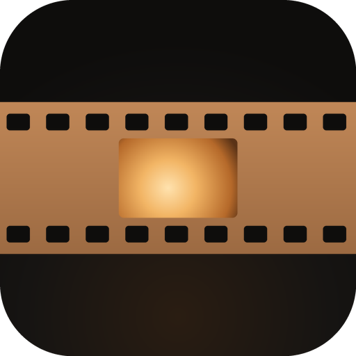
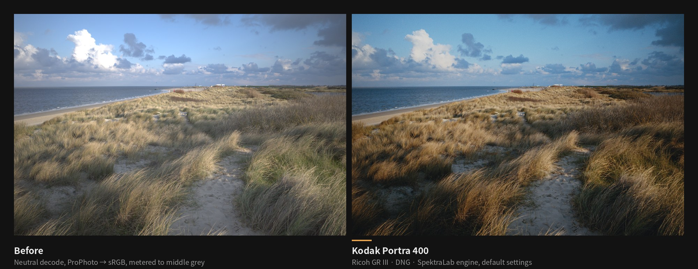
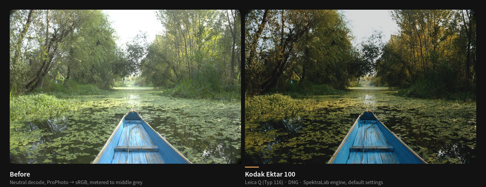
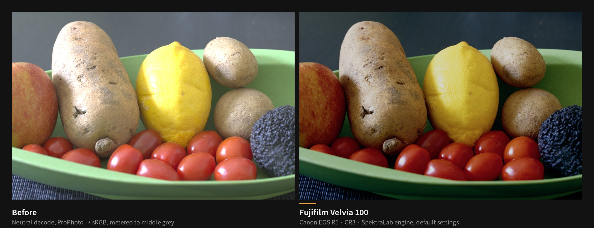
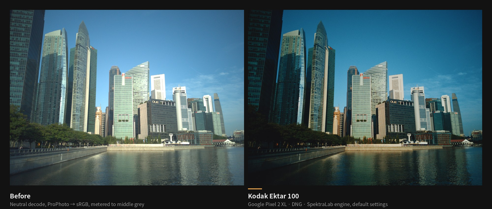
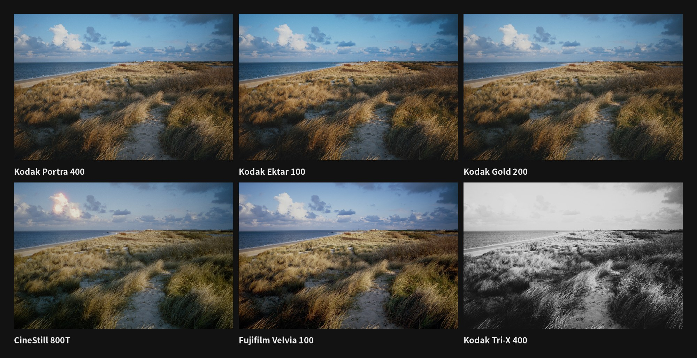
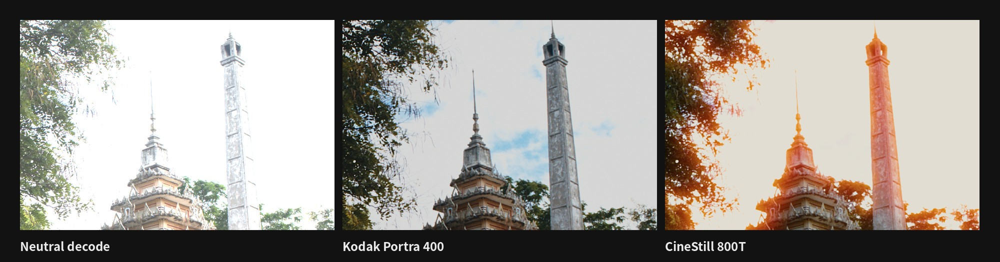

<div align="center">



# Spektralab-X

**Spectral film and print simulation: develop your photos on a phone.**

Your RAW and phone photos are "exposed" onto film from measured characteristic curves and spectral sensitivities, developed, and printed onto paper.<br>
Unofficial Android derivative of SpektraLab · tuned for Xiaomi's numbered flagships (Snapdragon / Adreno) · free and open source<br>
Film modeling powered by [spektrafilm](https://github.com/andreavolpato/spektrafilm)<br>
**Free, no ads, no in-app purchases; online only to check for updates, and your photos never leave the phone.**

[简体中文](README.md) | English

[](https://github.com/Dear-Ded/Spektralab-X/releases)
[](https://github.com/Dear-Ded/Spektralab-X/actions/workflows/android.yml)
[](LICENSE)
[](https://github.com/Dear-Ded/Spektralab-X/commits/main)


[](#download-and-verify)

[](https://github.com/Dear-Ded/Spektralab-X/releases)
[](https://github.com/Dear-Ded/Spektralab-X/releases)
[](https://github.com/Dear-Ded/Spektralab-X)
[](https://hits.sh/github.com/Dear-Ded/Spektralab-X/)

[Note](#a-note-from-the-developer) · [Download](#download-and-verify) · [Samples](#samples) · [Desktop differences](#differences-from-desktop) · [Features](#features) · [FAQ](#faq) · [Roadmap](docs/ROADMAP.md) · [Changelog](CHANGELOG.md) · [Docs](docs/README.md)

</div>

> [!IMPORTANT]
> **Under rapid development (alpha).** Updates land almost daily, and more features are on the way: a redesigned editor, more borders, on-device tuning and more; see the [roadmap](docs/ROADMAP.md). **Star** the repository, or use **Watch → Custom → Releases** to hear about new versions.
>
> Built by one independent developer working with AI assistants (Claude, GPT, Grok and DeepSeek).

> [!WARNING]
> **Not yet fully tested on real phones.** An early build was tried once on one phone; every release since has only been built by CI and tested on a cloud machine. Expect crashes, wrong colours or slow renders, and please [report them](#reporting-problems) with the in-app diagnostics.

> [!NOTE]
> **This is not an official SpektraLab build.** Spektralab-X is an independently developed Android derivative. It is not affiliated with, approved by or endorsed by the authors or owners of SpektraLab. SpektraLab™ and its icon are trademarks of their owner (registration pending). For the desktop app, use the [upstream repository](https://github.com/JamesQiu2005/SpektraLab).

<p align="center"></p>

> What makes film fascinating was never only the colour or the image quality. It is the act of shooting: the uncertainty when you press the shutter, the anticipation while the roll is developed, the regret of a missed frame, and the surprise when the prints come back.
>
> We hope Spektralab-X brings you back to the process of taking pictures, and makes you fall in love again with every press of the shutter.

## A note from the developer

Spektralab-X stands on the shoulders of giants: it is built on JamesQiu2005's [SpektraLab](https://github.com/JamesQiu2005/SpektraLab) and Andrea Volpato's [spektrafilm](https://github.com/andreavolpato/spektrafilm). Without those projects and the years of research behind them, it would not exist.

I'm not a professional programmer, just a photographer who loves film and wanted to bring the feel of the darkroom to a phone. Everything here, from the first idea through development and endless tuning, was done step by step with the help of AI assistants, and every cost along the way, from tokens to cloud servers, comes out of my own pocket. It has no commercial purpose and will always be free.

That also means it is far from perfect. There will be bugs, it may not run smoothly on your phone, and the colours won't suit everyone's taste. If you find a problem or have a good idea, please open an [issue](https://github.com/Dear-Ded/Spektralab-X/issues) or a pull request. I read every one.

If it helps you develop a photo you love, a star is the best encouragement you could give.

## What it is

Spektralab-X is an Android derivative of [SpektraLab](https://github.com/JamesQiu2005/SpektraLab) (JamesQiu2005/SpektraLab) and [spektrafilm](https://github.com/andreavolpato/spektrafilm).

[SpektraLab](https://github.com/JamesQiu2005/SpektraLab) is a macOS film simulator built on the [spektrafilm](https://github.com/andreavolpato/spektrafilm) engine. It is not a filter: it simulates the whole chain spectrally (scene light → camera and film → negative development → enlarger and paper → paper development → scan) from measured characteristic curves and spectral sensitivities.

This repository builds SpektraLab's C++ engine for Android with the NDK, runs it on its own Vulkan compute backend, and adds a Jetpack Compose editor. The look comes entirely from upstream; this project handles Android integration, mobile-GPU fixes and the UI.

- **A physical model, not a LUT.** Grain, halation and paper glare are computed from the physical parameters of each film and paper.
- **The full chain on the phone.** Vulkan compute shaders run on the Adreno GPU, with submissions split and memory capped per device.
- **Online only for updates.** The only network traffic is checking this repository's GitHub Releases and downloading a new APK; no analytics, no ads, and photos never leave the phone. Exported photos carry no location unless you turn that on in Settings.

## Samples

Every image below was rendered by the same engine this app ships, at default settings, with no retouching. They date from 0.1.18 and print colour negatives on Kodak Portra Endura; the app now defaults to Kodak Supra Endura, as the desktop app does, so results look slightly different. The samples will be re-rendered for the next release. Left: the neutral decode (RAW as linear ProPhoto, converted to sRGB, metered to middle grey). Right: the film print.

<table>
<tr><td></td></tr>
<tr><td align="center"><sub>Leica Q (Typ 116) · Kodak Ektar 100: back-lit leaves roll into the shoulder, greens warm up, the boat's blue holds</sub></td></tr>
<tr><td></td></tr>
<tr><td align="center"><sub>Canon EOS R5 · Fujifilm Velvia 100: slide-film contrast and saturation without clipping the tomatoes or the lemon</sub></td></tr>
<tr><td></td></tr>
<tr><td align="center"><sub>Google Pixel 2 XL · Kodak Ektar 100: phone DNGs go through the same spectral chain</sub></td></tr>
</table>

**One frame, six stocks** (Ricoh GR III):

<p align="center"></p>

**Halation is simulated, not painted.** CineStill 800T has no anti-halation layer, so bright light reflects off the back of the base and re-exposes the emulsion from behind: red halos around the sky. Portra 400, with its backing, shows none:

<p align="center"></p>

<sub>Sample RAWs from [raw.pixls.us](https://raw.pixls.us/), released under CC0. Tooling and parameters: [`docs/SAMPLES.md`](docs/SAMPLES.md).</sub>

## Differences from desktop

**Bottom line: you will not see a colour difference.** The Android colour path was compared pixel by pixel with upstream's Linux host (`spektralab-host`) on 43 cases: RAW exports differ by a mean ΔE00 of 0.000 (max ≤ 0.015), phone JPEG / P3 by a mean of ≤ 0.016. The eye starts to notice at about ΔE00 1, two orders of magnitude more. These numbers come from a software GPU (lavapipe) on a cloud machine; **they have not been fully verified on an Adreno phone yet**, and the macOS app has not been compared directly.

| Area | macOS / Windows desktop | Android (Spektralab-X) | Why |
|---|---|---|---|
| RAW decoding | macOS uses Apple's `CIRAWFilter`; Windows / Linux use LibRaw | LibRaw 0.22.2, the same function as Windows / Linux; no lens correction | Apple's camera matrices, demosaicing and highlight handling are its own, so the same RAW reaches the engine differently on macOS. Upstream's Windows / Linux builds differ the same way. **Not measured** (no Mac) |
| GPU and precision | Metal / desktop Vulkan, fp32 | Vulkan 1.0 on Adreno, fp32, the same code as Windows / Linux | If fma is inexact the engine falls back to Dekker split products, which affects only the halation blur and the rotate/resample shaders. The cloud machine's lavapipe has inexact fma itself, so every parity number already took that path; Adreno is reported to take it too (inferred), **still to be checked on a phone** |
| Resolution limits | Bounded by the computer's GPU memory (inferred) | Xiaomi 12–14 (Adreno 730 / 740 / 750) have a 128 MiB single buffer, about 8 MP, so the working size tops out at 3072; Adreno 650 has 512 MiB, about 33 MP; 42 MP overall ceiling. Preview is 1024 while dragging, 3400 on release | One image plane must fit in one GPU buffer or it cannot render, so large photos are scaled down first. For the full source resolution, "Extreme render" in the Save menu renders in the background at the original size (stepping down if memory runs out) |
| Screen colour | macOS converts through ColorSync with the display profile | A wide-gamut window on P3 screens; matrix and clip into Display P3 or sRGB | The same display path as upstream's `render_view`. HyperOS "Vivid" mode oversaturates (inferred); switch to "Original colour" to judge colour. This affects the screen only, not exported files |
| Phone JPEGs | Printed as encoded | Printed as encoded; highlight recovery and the Ultra HDR gain map are optional and off by default | A phone JPEG already carries the camera's tone curve, so printing it stacks two curves. Upstream does the same by design; shoot RAW for accurate colour |
| Not ported yet | All present (masks, tone masks and enlarger controls are off by default on macOS) | Missing: masks, tone masks, enlarger controls; DI / Cineon export and print LUTs (`.cube`); half-frame pairs; lens correction; scene-latitude fit and neutral picker; export soft proof; PNG, 8-bit TIFF and P3 / ProPhoto TIFF (TIFF is 16-bit sRGB only) | The most-used parts came first; the rest is scheduled in the [roadmap](docs/ROADMAP.md). In return, Android adds vibrance, 8-band HSL, fade, one-tap styles, borders, the Ultra HDR gain map and a background processing queue |

Full numbers, the cause of each difference and what is still unverified: [docs/PLATFORMS.md](docs/PLATFORMS.md) (Chinese). Method: [docs/PARITY.md](docs/PARITY.md).

## Features

**Input**
- Camera RAW through LibRaw 0.22.2: DNG, CR3, NEF, ARW, RAF, RW2, ORF and more; DNGs interpolate between the dual-illuminant matrices at the shot's white balance; Xiaomi and Pixel DNGs get their built-in GainMap lens-shading correction
- Phone photos: JPEG, HEIC/HEIF, PNG, WebP. Display P3 photos go to the engine as P3; the Ultra HDR gain map and highlight recovery can be turned on in Settings (off by default, as on the desktop)
- Open from the gallery or a file manager, or straight from another app with Share / Open with; the file picker opens in the folder you last picked from
- Film and paper for new photos: remember the last used pair (default) or always use a fixed one

**Printing**
- Colour negative, slide, black-and-white and motion-picture films with matching papers; slides are scanned directly, without paper
- Film strip: a live thumbnail of the current photo on every stock, tap to switch
- One-tap styles: 87 styles in eight groups (lab, negative, slide, cinema, black-and-white, photographers, cameras, phones), each setting film, paper, print, effects and adjustments together and naming what inspired it ([docs/STYLES.md](docs/STYLES.md)); tap the applied style again for a 0–100% strength slider
- Style import: `.spklook`, `.cube`, HaldCLUT images, Lightroom presets (`.xmp` / `.dng`), spektrafilm presets and film data (`.json`) and Fuji recipes (`.txt`), previewed with a strength slider before keeping, with a list of anything that could not be converted; the current style can be shared as a `.spklook`
- Exposure compensation, auto exposure, film format (sets the physical scale of grain and halation), print exposure, yellow / magenta filtration
- Grain, halation and paper glare, each with its own switch and strength; plus grain size, layered grain, emulsion scatter, colour separation (DIR couplers) and scan sharpening (amount, radius)
- RAW white balance: temperature / tint applied at decode, with upstream's desktop algorithm
- Post-print adjustments (Adjust tab): white balance, exposure, contrast, highlights, shadows, black/white point, saturation, eight HSL bands, four colour wheels, fade, vignette and RGB / red / green / blue curves, previewed live while dragging
- Palette: a tone × colour pad with an overall strength slider (after the iPhone's Photographic Styles); double-tap returns to the style's own point

**Framing and borders**
- Rotate, flip, centred crop (original, 3:2, 4:3, 1:1, 16:9, 65:24 and more)
- Film edges: 135, half frame, XPan, 645, 6×6, 6×7, 6×9 and more, with edge print and sprocket holes; plus paper borders such as Polaroid, Instax Mini, a parameter strip and gallery white
- Sprocket strips only: on any film, drawn outside the photo with no crop and no change to the print; position, base colour, hole shape, edge text and frame numbers are adjustable
- Brand-logo captions: the camera or phone brand is detected from EXIF (or picked by hand, or replaced by your own text), five caption layouts with logos, optional film-maker logo; 33 brands, sources in [docs/LOGOS.md](docs/LOGOS.md)
- Film-edge details: gate shape, carrier, the real stock name, frame number, and a re-roll button
- Date back: the EXIF capture time imprinted in LCD, dot-matrix or data type, Japanese or US order, any corner, in the frame or on the rebate, with size, brightness and insets adjustable and optional shooting data

**Viewing and export**
- A fast preview while dragging, the sharp render on release; new edits cancel stale renders
- Hold to compare with the original, tap the photo to hide the interface, histogram with clipping, full-screen 1:1 grain view
- Sliders show their value while dragging; double-tap to reset, tap beside the thumb to nudge one step, move your finger off the track for a slow, fine drag
- Undo / redo up to 50 steps; presets save film, paper and effect combinations
- Light table: import a whole roll, pinch the grid, filter, drag-select; a loupe where swipe up picks, swipe down rejects, plus star ratings; a film-thumbnail view; copy one frame's edit, paste it by group onto the rest, export in a batch
- If the system kills the app, reopening it brings back the same photo with the whole edit
- Extreme render: a JPEG at the photo's original resolution (quality 98) in the background, stepping down a size if memory runs short
- Background export queue: exports render on their own thread so editing is not blocked, jobs resume after the process is killed, progress notifications support Live Update
- Safe saving: the gallery entry stays hidden until the file is written and checked, so no half-written photos; an all-black, all-white or single-colour frame is refused and retried once a size down; a lost GPU is replaced and the job retried
- Wide-gamut preview on P3 screens; export JPEG (Display P3 or sRGB, with camera, lens, exposure and time EXIF; location only if you turn it on in Settings) or 16-bit TIFF (lossless Deflate)

> [!NOTE]
> The app's interface is Simplified Chinese only for now.

## Devices

Tuned for **Xiaomi 10 – 18**. Every one of these generations uses a Snapdragon flagship chip with an Adreno GPU, which is what this project adapts the driver handling for.

| Phone | Chip | GPU | Status |
|---|---|---|---|
| Xiaomi 10 series | Snapdragon 865 | Adreno 650 | Untested |
| Xiaomi 11 series | Snapdragon 888 | Adreno 660 | Untested |
| Xiaomi 12 / 12S series | Snapdragon 8 Gen 1 / 8+ Gen 1 | Adreno 730 | Untested |
| Xiaomi 13 series | Snapdragon 8 Gen 2 | Adreno 740 | Untested |
| Xiaomi 14 series | Snapdragon 8 Gen 3 | Adreno 750 | Untested |
| Xiaomi 15 series | Snapdragon 8 Elite | Adreno 830 | Untested |
| Xiaomi 17 series | Snapdragon 8 Elite Gen 5 | Adreno 840 | Untested |
| Xiaomi 18 series | Snapdragon 8 Elite Gen 6 | Adreno | Untested |

There is no Xiaomi 16. Memory, recommended working sizes and known risks per generation are in [docs/DEVICES.md](docs/DEVICES.md) (Chinese). Other arm64 phones on Android 10+ with Vulkan should run it but are not a target.

## Download and verify

<p>
<a href="https://github.com/Dear-Ded/Spektralab-X/releases"></a>
<a href="https://github.com/ImranR98/Obtainium"></a>
</p>

> [!CAUTION]
> **Official builds are published only on this repository's [GitHub Releases](https://github.com/Dear-Ded/Spektralab-X/releases), and they are free forever.** If you paid for "Spektralab-X" in an app store, a file-sharing site or a second-hand marketplace, it is not an official build: ask for a refund and check the signature as shown below.

1. Open [Releases](https://github.com/Dear-Ded/Spektralab-X/releases) and download `Spektralab-X-<version>-arm64-v8a.apk` from the latest `v…-alpha` release.
2. Install it on the phone. Xiaomi / HyperOS asks you to allow unknown sources under "Security" the first time.
3. Later versions install over earlier ones; your presets are kept.

### In-app updates

From 0.1.19 the app can check for and install new versions itself:

- **When it goes online:** at launch, at most once every 6 hours, it fetches this repository's GitHub Releases list. When a new version is out, it downloads the APK and `SHA256SUMS` when you tap Download and install, or automatically on unmetered Wi-Fi. Nothing is sent beyond the request itself; no analytics.
- **Never interrupts an edit:** with a photo open, an automatic check shows no dialog, only "New version · View" in the ⋯ menu; you are told when the editor is empty or when you open it yourself.
- **Switches:** Settings has Check for updates automatically (on by default), Download new versions on Wi-Fi (on by default) and Check now; the ⋯ menu has Check for updates.
- **Safety:** the APK's SHA-256 must match the release's `SHA256SUMS` and its signing certificate must match the installed app, and Android checks the signature again. The first self-update shows Android's install confirmation (and asks you to allow installing unknown apps); later ones can be silent on Android 12 and up.
- **Permissions:** `INTERNET`, `ACCESS_NETWORK_STATE`, `REQUEST_INSTALL_PACKAGES`, `UPDATE_PACKAGES_WITHOUT_USER_ACTION`.
- **Builds you compile yourself** are signed differently, so the updater refuses them and points you to the Releases page.

**Automatic updates with Obtainium:** add `https://github.com/Dear-Ded/Spektralab-X` and enable **Include prereleases** (every release is a pre-release for now, so nothing shows up without it).

**Feel free to share it:** pass the downloaded APK on to communities, groups and forums. No permission needed; just include this repository's address. See [Reposting and derivative works](#reposting-and-derivative-works).

### Verify the APK

Every official release is signed with the same key. Signing certificate SHA-256 (also in [`scripts/signing-cert.sha256`](scripts/signing-cert.sha256)):

```
CD:C5:E3:D0:AC:6F:C9:0B:53:E8:8C:57:E0:40:93:36:72:5A:E3:C2:6F:D1:9D:1A:7E:58:51:70:94:5F:6D:E3
```

Each release carries `SHA256SUMS` and a GitHub Actions build-provenance attestation, which proves the APK was built from this repository's public source:

```bash
sha256sum -c SHA256SUMS
gh attestation verify Spektralab-X-<version>-arm64-v8a.apk -R Dear-Ded/Spektralab-X
```

On the phone, [AppVerifier](https://github.com/soupslurpr/AppVerifier) checks the certificate; on a computer, use `apksigner verify --print-certs`. Step by step: [docs/VERIFY.md](docs/VERIFY.md).

## Tips

- **Working size** (in Settings) sets the processing and export resolution. On first launch it is picked from the GPU (up to 4096 px; 3072 on Xiaomi 12–14), and it is also capped by free memory, the GPU's single-buffer limit and a 42 MP ceiling.
- Phone photos are auto-exposed with the "balanced" meter, like RAW and like the desktop app. They were already graded by the camera, so for the most film-like result shoot RAW in the Xiaomi camera's Pro mode.
- Ultra HDR and Xiaomi "Super HDR" photos open from their base image by default; with "highlight recovery for phone photos" on in Settings, Ultra HDR photos use the gain map.

## FAQ

<details>
<summary><b>How is this different from a film filter or a LUT?</b></summary>

A filter or LUT maps one colour to another. This engine simulates how the emulsion responds to each wavelength, the dye densities after development, and the print made through an enlarger onto paper. Exposure, the colour of the light and the film format all change the result naturally, and grain and halation change with them.
</details>

<details>
<summary><b>Does it cost anything? Where do I get it?</b></summary>

The official build is free forever and published only on this repository's [GitHub Releases](https://github.com/Dear-Ded/Spektralab-X/releases). Anything you paid for elsewhere is not an official build; check the signing certificate as described in [Verify the APK](#verify-the-apk).
</details>

<details>
<summary><b>Why only Xiaomi's numbered phones? Will it run on mine?</b></summary>

Vulkan drivers differ a lot between phone GPUs: the same compute work can render, corrupt the image or reset the GPU depending on the driver. Xiaomi 10–18 are all Snapdragon with Adreno, so the driver issues are concentrated and can be handled together. Other arm64 phones on Android 10+ with Vulkan will probably run it, just without specific tuning. Reports are welcome.
</details>

<details>
<summary><b>Do the colours match SpektraLab on macOS?</b></summary>

On a cloud machine, yes. The engine prints in ProPhoto and the screen and export use upstream's own conversion code; compared pixel by pixel with upstream's Linux host in 43 cases, RAW exports differ by a mean ΔE00 of 0.000 (max 0.015). Phone JPEGs still differ by 0.20–0.36; the cause is known and being fixed. Method and numbers: [docs/PARITY.md](docs/PARITY.md). On-device comparisons are still to come. If colours differ from the desktop app, report it here, not upstream.
</details>

<details>
<summary><b>Does it need the internet? Are my photos uploaded?</b></summary>

Your photos are never uploaded: everything is computed on the phone, and no data is collected. The app goes online for one thing only, checking for and downloading updates; see [In-app updates](#in-app-updates). Exported JPEGs keep the camera, lens and exposure details; GPS location is left out unless you turn on "Keep location in exports" in Settings.
</details>

<details>
<summary><b>Why is export slow, and why does the phone get warm?</b></summary>

The full spectral chain is a lot of computation; a full-size export can take tens of seconds on older phones. Long exports make the phone throttle, most visibly on the Xiaomi 11 (Snapdragon 888). Lower the working size in Settings, or export at the 3400 px sharing size.
</details>

<details>
<summary><b>Will there be versions for other platforms?</b></summary>

It is planned. Once the Xiaomi-tuned version is stable enough for daily use, separate projects will start for a general Android version, Windows and iOS. These are plans without dates; see the [roadmap](#roadmap) below.
</details>

<details>
<summary><b>Can I repost it, modify it or build on it?</b></summary>

Yes. Publish your full source under GPL-3.0, credit this project, the upstream projects and yourself as the derivative developer, and give your version its own name and icon. Details: [Reposting and derivative works](#reposting-and-derivative-works).
</details>

## Roadmap

Work proceeds by milestone; the full list, acceptance criteria and research notes are in [docs/ROADMAP.md](docs/ROADMAP.md) (Chinese).

- **Near term (0.1.x-alpha):** fixes from on-device feedback, colour fidelity and the style system, a redesigned UI, export stability, deeper Xiaomi integration (Super Island, background keep-alive, Xiaomi DNG).
- **First stable release:** remote processing, sending photos to your own computer or server for post-processing and back to the phone (draft spec: [docs/REMOTE.md](docs/REMOTE.md)).
- **Later plans:** once the Xiaomi-tuned version is stable for daily use, separate projects for a **general Android version**, **Windows** and **iOS**. These are plans, not promises with dates.

## Star history

<a href="https://star-history.com/#Dear-Ded/Spektralab-X&Date">
<picture>
  <source media="(prefers-color-scheme: dark)" srcset="https://api.star-history.com/svg?repos=dear-ded%2FSpektralab-X&type=Date&theme=dark">
  
</picture>
</a>

<sub>Download counts come from GitHub Releases and include every pre-release APK. The visit counter and the star chart are third-party services, [hits.sh](https://hits.sh/) and [star-history.com](https://star-history.com/). On GitHub the images load through GitHub's image proxy; when this page is viewed on another site or mirror, those services receive your IP address.</sub>

## Reporting problems

1. Open **Settings → Copy diagnostics** in the app. It holds the version, device, SoC, memory, GPU probe, current parameters and the last 40 events; no file names or locations.
2. Paste it into a [bug report](https://github.com/Dear-Ded/Spektralab-X/issues/new/choose). Chinese or English are both fine.

Usage questions go to [Discussions](https://github.com/Dear-Ded/Spektralab-X/discussions). Report security issues privately as described in [SECURITY.md](SECURITY.md).

## Contributing

On-device reports are the most valuable contribution right now, even if all you can say is "it opens and exports". Code, docs and sample images are welcome too; see [CONTRIBUTING.md](CONTRIBUTING.md).

### How it works

```
Compose UI (Kotlin)
   │  JSON parameters, a dedicated engine thread
   ▼
JNI bridge            app/src/main/cpp/spektralab_jni.cpp
   │  spk_engine.h (upstream's C API)
   ▼
SpektraLab engine (C++20) ── Vulkan compute shaders (SPIR-V) ── Adreno GPU
LibRaw 0.22.2 (RAW decoding)
```

- Upstream sources are fetched at a pinned commit by [`scripts/fetch-upstream.sh`](scripts/fetch-upstream.sh); this repository holds only the Android code.
- Every change to the upstream engine lives in [`patches/`](patches/), applied in order before the build, and is described in [docs/PATCHES.md](docs/PATCHES.md).
- Module layout, threading, render tiers and the memory budget are in [docs/ARCHITECTURE.md](docs/ARCHITECTURE.md) (Chinese).

### Building

JDK 17, Android SDK 35, NDK 27.2, CMake 3.22 and `glslangValidator` (`glslang-tools` on Ubuntu):

```bash
bash scripts/fetch-upstream.sh upstream
bash scripts/stage-assets.sh upstream
SPK_UPSTREAM=$PWD/upstream ./gradlew :app:assembleRelease
```

Without `SPK_KEYSTORE` the build is debug-signed and will not install over an official release. The full pipeline is in [`.github/workflows/android.yml`](.github/workflows/android.yml).

The version lives in [`VERSION`](VERSION) as `major.minor.patch-alpha`; until the app is ready for daily use, each release bumps only the patch number. Changes are listed in [CHANGELOG.md](CHANGELOG.md).

## Reposting and derivative works

> **Please share it.** You are welcome to pass the downloaded APK on to any community, group chat or forum. No permission is needed; just include this repository's address: https://github.com/Dear-Ded/Spektralab-X
>
> For the unmodified official APK, the address is all you need: the complete source of every release can be obtained from this repository (tag `v<version>`; the upstream engine is fetched at a pinned commit by [`scripts/fetch-upstream.sh`](scripts/fetch-upstream.sh)), which also meets GPL-3.0 section 6(d)'s requirement to say where the source can be found. The points below apply only to modified versions and derivative projects.

**Reposts, modified versions and derivative projects are welcome.** This project is released under GPL-3.0: you may use, study, modify and redistribute it, including for a fee. Those are rights GPL grants, and this project does not restrict them. We only ask for the following; the first three are GPL-3.0's own requirements or additional terms permitted by its section 7, and the full terms are in [NOTICE](NOTICE):

1. **Keep the attribution** (GPL-3.0 section 7(b)): in the About screen and the documentation of a derivative version, keep the original project name "Spektralab-X", this repository's address `https://github.com/Dear-Ded/Spektralab-X` and the credit "Spektralab-X contributors", and credit the upstream [SpektraLab](https://github.com/JamesQiu2005/SpektraLab) and [spektrafilm](https://github.com/andreavolpato/spektrafilm).
2. **Use your own name and icon** (sections 7(c) and 7(e)): this project grants no trademark rights to the name "Spektralab-X" or its icon. A modified version you publish should have its own name, icon and package name, say "modified from Spektralab-X", and not present itself as the official build.
3. **Provide the source** (GPL-3.0 sections 4–6): whoever distributes an APK must also provide the complete corresponding source, keep the licence and the attributions, and release their changes under GPL-3.0.
4. **Film data:** the film and paper profiles are CC BY-SA 4.0; redistributing them requires crediting spektrafilm (Andrea Volpato) and sharing under the same licence.

When reposting in an article or video, a line such as "Source: Spektralab-X (github.com/Dear-Ded/Spektralab-X)" is enough; a derivative project should also carry your own credit as its developer.

## License and credits

The code in this repository is released under [GPL-3.0](LICENSE), like upstream, with the additional terms in [NOTICE](NOTICE). The APK also contains the following third-party content; the licence texts ship in the app under `assets/engine/licenses/`:

| Content | Source | Licence |
|---|---|---|
| Rendering engine and shaders | [JamesQiu2005/SpektraLab](https://github.com/JamesQiu2005/SpektraLab), based on [andreavolpato/spektrafilm](https://github.com/andreavolpato/spektrafilm) | GPL-3.0 |
| Film and paper profiles | Andrea Volpato, spektrafilm | CC BY-SA 4.0 |
| Black-and-white film and paper profiles | SpektraLab product data | see `Product-profiles-NOTICE.md` |
| RAW decoding | [LibRaw](https://www.libraw.org/) 0.22.2 | LGPL-2.1 |
| Vulkan loader | [volk](https://github.com/zeux/volk) | MIT |
| Image and font utilities | [stb](https://github.com/nothings/stb) | MIT |
| README sample RAWs | [raw.pixls.us](https://raw.pixls.us/) | CC0 1.0 |
| Date-back and edge-print fonts | Liberation Sans, DejaVu Sans Mono | SIL OFL 1.1 / Bitstream Vera |

The design draws on lessons from two other Android ports: [SAINTTaiYi/SpektraLab-Android](https://github.com/SAINTTaiYi/SpektraLab-Android) and [thetechgeekko/Spektrafilm-android](https://github.com/thetechgeekko/Spektrafilm-android).

Film modeling powered by [spektrafilm](https://github.com/andreavolpato/spektrafilm).

This is an unofficial derivative, not affiliated with or endorsed by the authors and owners of SpektraLab, or by Xiaomi. SpektraLab™ and its icon are trademarks of their owner (registration pending); Xiaomi, Snapdragon and Adreno are trademarks of their owners.

<div align="center">

**Find it interesting? Give it a ⭐ Star so more people can find it.**

</div>
