<a href="https://dear-ded.github.io/Spektralab-X/">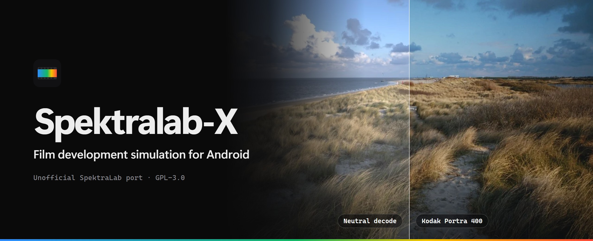</a>

<p align="center">
  <a href="https://github.com/Dear-Ded/Spektralab-X/releases"></a>
  <a href="https://github.com/Dear-Ded/Spektralab-X/releases"></a>
  <a href="https://github.com/Dear-Ded/Spektralab-X/actions/workflows/android.yml"></a>
  <a href="LICENSE"></a>
  
</p>

<p align="center">
  <a href="https://dear-ded.github.io/Spektralab-X/"><b>Website</b></a> ·
  <a href="https://github.com/Dear-Ded/Spektralab-X/releases"><b>Download APK</b></a> ·
  <a href="docs/FAQ.md">FAQ</a> ·
  <a href="CHANGELOG.md">Changelog</a> ·
  <a href="docs/README.md">Docs</a> ·
  <a href="README.md">简体中文</a>
</p>

Spektralab-X is an unofficial Android port of [SpektraLab](https://github.com/JamesQiu2005/SpektraLab). It processes RAW and phone photos in the order a darkroom does: expose the negative, develop it, print it on paper, scan the print. Films and papers use the measured characteristic curves and spectral sensitivities from [spektrafilm](https://github.com/andreavolpato/spektrafilm). Everything runs on the phone's GPU; photos are not uploaded.

The app is free, with no ads, in-app purchases or analytics. Its only network request checks this repository for new releases.

> [!NOTE]
> **This is an alpha.** On-device testing has only been done on a Xiaomi 13 Ultra; everything else comes from CI and cloud tests. Expect crashes, wrong colours or slow renders on some phones, and please [report them](#reporting-problems).

## Samples

The same RAW file: neutral decode on the left, film print on the right. Engine defaults, no retouching.

<table>
<tr>
<td width="50%">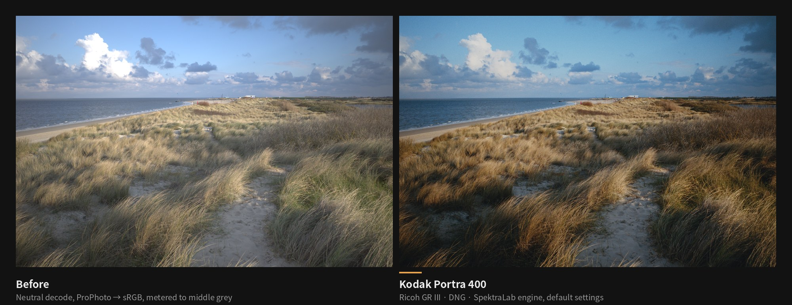<br><sub>Ricoh GR III · Kodak Portra 400</sub></td>
<td width="50%">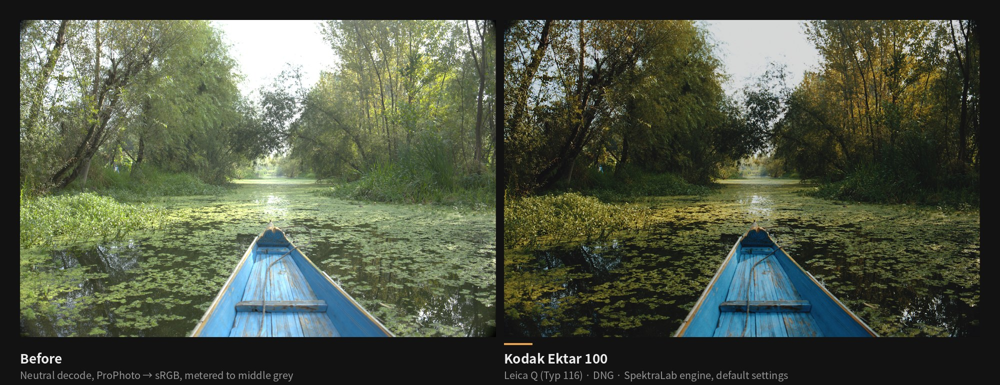<br><sub>Leica Q (Typ 116) · Kodak Ektar 100</sub></td>
</tr>
<tr>
<td>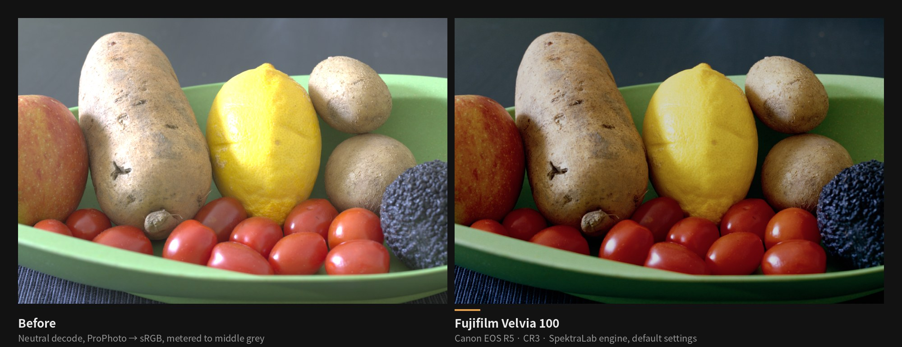<br><sub>Canon EOS R5 · Fujifilm Velvia 100</sub></td>
<td>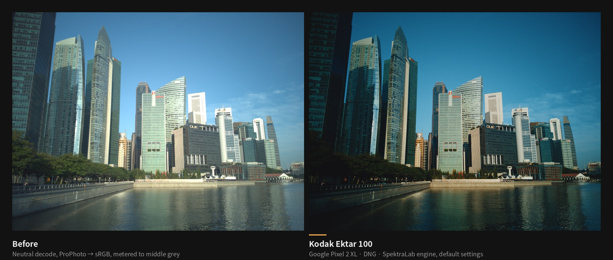<br><sub>Google Pixel 2 XL (phone DNG) · Kodak Ektar 100</sub></td>
</tr>
</table>

One RAW on six films. Besides colour, highlight compression, grain and halation change too:

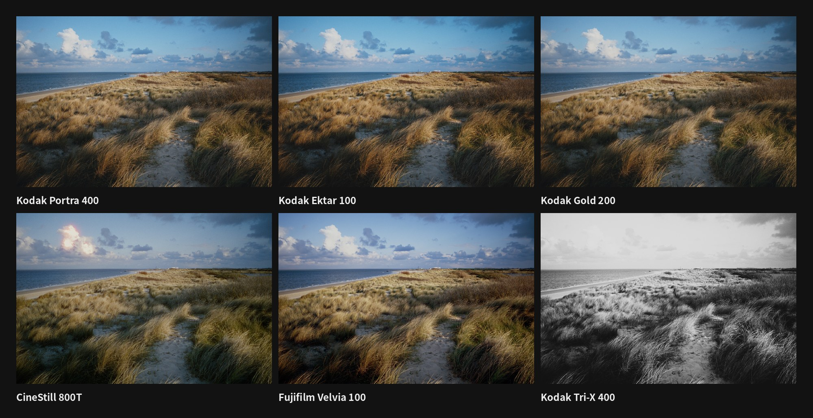

CineStill 800T has no anti-halation layer. Bright light reflects off the back of the base and exposes the emulsion a second time, so highlight edges get a red glow. Portra 400 has the layer and shows none:

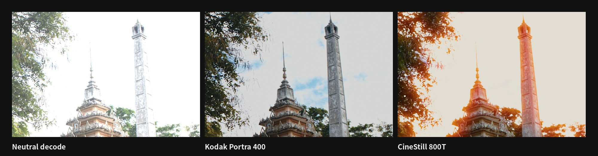

<sub>RAW files from [raw.pixls.us](https://raw.pixls.us/) (CC0), rendered with this project's engine on a cloud machine at 1600 px on the long edge. Negatives were printed on Kodak Portra Endura; the app now defaults to Kodak Supra Endura, so results differ slightly. Parameters and how to reproduce: [docs/SAMPLES.md](docs/SAMPLES.md).</sub>

## Interface

<table>
<tr>
<td width="25%" align="center">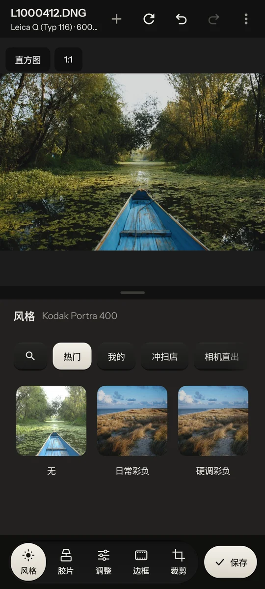<br><sub>Styles</sub></td>
<td width="25%" align="center">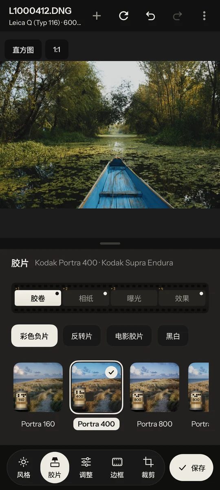<br><sub>Film</sub></td>
<td width="25%" align="center">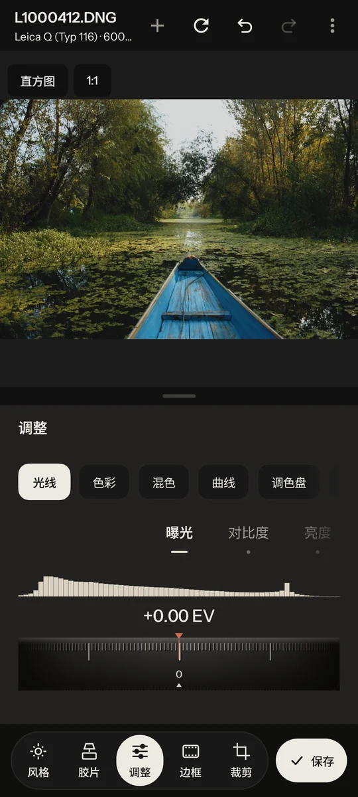<br><sub>Adjust</sub></td>
<td width="25%" align="center">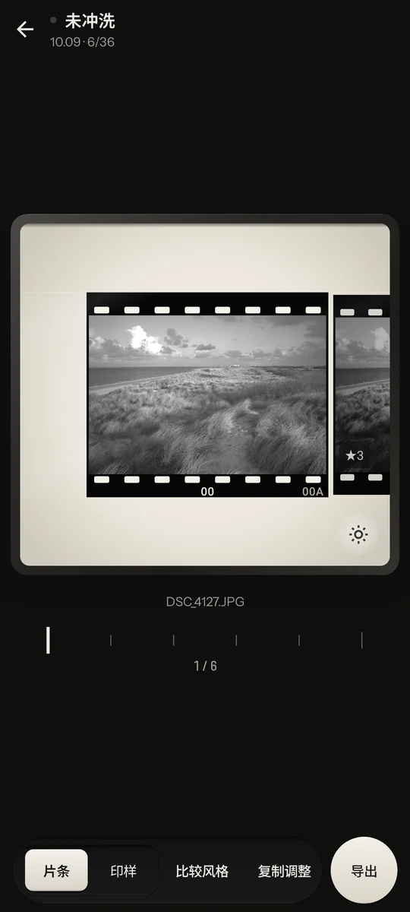<br><sub>Light table</sub></td>
</tr>
</table>

<sub>Captured by the alpha v0.3.02 [CI screenshot job](https://github.com/Dear-Ded/Spektralab-X/actions/runs/45393154860) with test data, not photographed from a phone. Method: [docs/SCREENSHOTS.md](docs/SCREENSHOTS.md).</sub>

You can pick a style, set its strength, add a border and save; or keep going with curves, colour wheels and masks. Both work on the same edit. The interface is available in Chinese and English (Settings).

The editor was redone in alpha v0.3: on the Adjust page you swipe to pick a control and fine-tune it on a large dial; the Film page goes through cassette, paper, exposure and effects in darkroom order; Save queues the job at once and the queue then shows the format, size and file size actually written. Cold start and saving have a developing animation, and the shutter, film advance and other actions use sounds recorded from real film cameras. They follow the media volume and can be turned off in Settings.

## Features

**Opening photos**
- Camera RAW: DNG, CR3, NEF, ARW (including Sony A7 V ARW 6), RAF, RW2, ORF and more, decoded by LibRaw 0.22.2. DNGs interpolate between the two illuminant matrices by the shot's white balance; Xiaomi and Pixel DNGs apply their embedded lens-shading GainMap.
- Phone photos: JPEG, HEIC/HEIF, PNG, WebP. Display P3 photos are processed as P3; Ultra HDR gain maps and highlight recovery are optional and off by default.
- Open from the gallery, a file manager, or another app's Share / Open with.

**Printing**
- Colour negative, slide, black-and-white and motion-picture films, each with matching papers. Slides are scanned directly, without paper.
- 87 styles in eight groups (lab, negative, slide, cinema, B&W, photographer, camera, phone). Each sets film, paper, enlarger and effects; strength 0–100 %; search by name or by nicknames such as "Fuji look" or "CCD". List: [docs/STYLES.md](docs/STYLES.md).
- RAW white balance applies at decode with the same algorithm as upstream desktop. Exposure compensation, film format (scales grain and halation), print exposure, yellow and magenta filtration.
- Grain, halation and paper glare can each be switched and scaled; grain size, emulsion scatter and scan sharpening sit under More parameters.

**Adjustments**
- White balance, exposure, contrast, highlights, shadows, black and white points, saturation, eight-band HSL, four colour wheels, fade, vignette, and RGB / red / green / blue curves.
- Linear, radial and brush masks, invertible.
- A two-dimensional tone × colour pad; every style has its own home point.
- Undo and redo up to 50 steps. Adjustment groups can be hidden temporarily to compare, or reset one at a time.

**Crop and borders**
- Rotate, flip, crop to ratio (3:2, 4:3, 1:1, 16:9, 65:24 and more).
- 135, half-frame, XPan, 645, 6×6, 6×7 and 6×9 film edges with sprocket holes, edge print and frame numbers; instant-film cards, mats and data bars; 50 presets in total.
- Data bars recognise 33 camera and phone brands from EXIF and can print the lens model; missing fields are left out. Logo sources: [docs/LOGOS.md](docs/LOGOS.md).
- Date imprint with LCD, dot-matrix and other faces, in any corner.

**Light table**
- Import a roll at a time; grid of 2, 3, 4 or 6 columns; long-press and drag to select; star, pick, reject.
- Rolls are grouped by film and date automatically, or loaded by hand. Copy one photo's adjustments, paste chosen groups onto others and export in batch; export a whole roll as a contact sheet.

**Export**
- JPEG (sRGB or Display P3, camera, lens and exposure EXIF kept), 16-bit TIFF (sRGB, Display P3, ProPhoto RGB, Adobe RGB (1998), ICC embedded), HEIF where the phone has an encoder.
- Exports queue on a background thread while you keep editing. Files get a placeholder in the gallery and are published only after they are written and checked; if the system kills the app, the queue resumes on next launch.
- Full-resolution render writes 4:4:4 JPEG at the original size (libjpeg-turbo, quality 98) and steps down one size if memory runs out.
- Location is not written by default; it can be turned on in Settings.

## Differences from desktop

The film engine is upstream's own code. On a cloud machine, Android output was compared pixel by pixel with upstream's Linux host (`spektralab-host`) in 43 cases:

| Input | Mean ΔE00 | Max ΔE00 |
| :--- | ---: | ---: |
| RAW, synthetic | 0.000 | ≤ 0.015 |
| Phone JPEG / P3 | ≤ 0.016 | |

The eye starts to notice differences at about ΔE00 1. These numbers were measured on a software GPU (Mesa lavapipe). They have not been verified on Adreno phones at scale, and the macOS app has not been compared directly.

Main differences:

- **RAW decoding.** The macOS app uses Apple's `CIRAWFilter`; Android uses LibRaw, as upstream does on Windows and Linux. The same RAW differs on macOS before it reaches the engine.
- **Resolution.** One image plane must fit in one GPU buffer. Xiaomi 12–14 (Adreno 730 / 740 / 750) allow 128 MiB per buffer, about 8 MP; Adreno 650 allows 512 MiB, about 33 MP; the total cap is 42 MP. Larger images are scaled down first. Use full-resolution render when you need the original size.
- **Screen colour.** P3 screens get a wide-gamut window. HyperOS's Vivid mode oversaturates; switch to Original colour to judge colour. This affects the screen only, not exported files.

Full comparison and features not yet ported: [docs/PLATFORMS.md](docs/PLATFORMS.md). Method: [docs/PARITY.md](docs/PARITY.md).

## Devices

Tuning targets the Snapdragon and Adreno drivers in Xiaomi's numbered flagships: large images are split into small batches, and the per-buffer limit is probed on first run to pick a working size.

| Model | Chip | GPU | Status |
| :--- | :--- | :--- | :--- |
| Xiaomi 10 | Snapdragon 865 | Adreno 650 | not tested |
| Xiaomi 11 | Snapdragon 888 | Adreno 660 | not tested |
| Xiaomi 12 / 12S | 8 Gen 1 / 8+ Gen 1 | Adreno 730 | not tested |
| Xiaomi 13 | 8 Gen 2 | Adreno 740 | 13 Ultra tested |
| Xiaomi 14 | 8 Gen 3 | Adreno 750 | not tested |
| Xiaomi 15 | 8 Elite | Adreno 830 | not tested |
| Xiaomi 17 | 8 Elite Gen 5 | Adreno 840 | not tested |
| Xiaomi 18 | 8 Elite Gen 6 | Adreno | not tested |

There is no Xiaomi 16. Other arm64 phones on Android 10 or later with Vulkan should run it, but are not specifically tuned. Memory, recommended working sizes and known issues per model: [docs/DEVICES.md](docs/DEVICES.md).

## Download and install

> [!CAUTION]
> Official builds are published only on this repository's [GitHub Releases](https://github.com/Dear-Ded/Spektralab-X/releases), free of charge. Copies sold in app stores, on file-sharing sites or second-hand marketplaces are not official.

1. From [Releases](https://github.com/Dear-Ded/Spektralab-X/releases), download `Spektralab-X-<version>-arm64-v8a.apk` and `SHA256SUMS` from the same release.
2. Install it on the phone. The first time, allow your browser or file manager to install apps.
3. Later versions install over the old one; edits and styles are kept.

For a first try, open an ordinary JPEG, pick a style, save at share size, wait for the queue to say it is saved, then check the gallery.

### Verifying the APK

All official builds are signed with the same key. Certificate SHA-256 (also in [`scripts/signing-cert.sha256`](scripts/signing-cert.sha256)):

```
CD:C5:E3:D0:AC:6F:C9:0B:53:E8:8C:57:E0:40:93:36:72:5A:E3:C2:6F:D1:9D:1A:7E:58:51:70:94:5F:6D:E3
```

Every release ships `SHA256SUMS` and a build provenance attestation from GitHub Actions:

```bash
sha256sum -c SHA256SUMS
gh attestation verify Spektralab-X-<version>-arm64-v8a.apk -R Dear-Ded/Spektralab-X
```

On the phone, [AppVerifier](https://github.com/soupslurpr/AppVerifier) checks the certificate; on a computer, use `apksigner verify --print-certs`. Full steps: [docs/VERIFY.md](docs/VERIFY.md).

### Updates

At most every six hours on launch, the app asks this repository's GitHub Releases for the version list. New versions can be downloaded by hand, or automatically on unmetered Wi-Fi. Before installing, the app checks `SHA256SUMS` and the signing certificate; self-built copies have a different signature and are sent to the Releases page instead. Automatic checks and Wi-Fi downloads can both be turned off in Settings.

With [Obtainium](https://github.com/ImranR98/Obtainium), add `https://github.com/Dear-Ded/Spektralab-X` and enable **Include prereleases**, since every release so far is a pre-release.

## Building from source

You need JDK 17, Android SDK 36, NDK `27.2.12479018`, CMake `3.22.1` and `glslangValidator` (`glslang-tools` on Ubuntu).

```bash
git clone https://github.com/Dear-Ded/Spektralab-X.git
cd Spektralab-X
bash scripts/fetch-upstream.sh upstream
bash scripts/stage-assets.sh upstream
export SPK_UPSTREAM="$PWD/upstream"
./gradlew :app:assembleDebug :app:testDebugUnitTest
```

[`fetch-upstream.sh`](scripts/fetch-upstream.sh) downloads upstream at a pinned commit; this repository holds only the Android code. Changes to the upstream engine live in [`patches/`](patches/) and are applied in order before the build ([docs/PATCHES.md](docs/PATCHES.md)). Without `SPK_KEYSTORE`, release builds are signed with the debug key and cannot replace an official install.

```
Compose UI (Kotlin)
   │  JSON parameters, dedicated engine thread
   ▼
JNI bridge              app/src/main/cpp/spektralab_jni.cpp
   │  spk_engine.h (upstream C API)
   ▼
SpektraLab engine (C++20) ── Vulkan compute shaders ── Adreno GPU
LibRaw 0.22.2 (RAW decoding)
```

Modules, threading and memory budgets: [docs/ARCHITECTURE.md](docs/ARCHITECTURE.md). CI: [`.github/workflows/android.yml`](.github/workflows/android.yml).

## Reporting problems

1. In the app, open **Settings → Copy diagnostics**. It contains version, model, chip, memory, GPU probe results, current parameters and the last 40 events, but no file names or location.
2. File it with the [issue templates](https://github.com/Dear-Ded/Spektralab-X/issues/new/choose). Chinese or English are both fine.

Ask usage questions in [Discussions](https://github.com/Dear-Ded/Spektralab-X/discussions); report security issues privately as described in [SECURITY.md](SECURITY.md). Code, docs and on-device test results are all welcome; see [CONTRIBUTING.md](CONTRIBUTING.md).

## Credits and license

The rendering engine and shaders come from JamesQiu2005's [SpektraLab](https://github.com/JamesQiu2005/SpektraLab); the film model comes from Andrea Volpato's [spektrafilm](https://github.com/andreavolpato/spektrafilm). This project does the Android port, phone GPU adaptation and interface. It is developed by one photography enthusiast with help from Claude, GPT, Grok and DeepSeek, at the author's own expense. Problems found by [SAINTTaiYi/SpektraLab-Android](https://github.com/SAINTTaiYi/SpektraLab-Android) and [thetechgeekko/Spektrafilm-android](https://github.com/thetechgeekko/Spektrafilm-android) informed the design.

The code is released under [GPL-3.0](LICENSE), as upstream is, with additional terms in [NOTICE](NOTICE). Third-party content in the APK, with licence texts bundled under `assets/engine/licenses/`:

| Content | Source | License |
| :--- | :--- | :--- |
| Rendering engine and shaders | [JamesQiu2005/SpektraLab](https://github.com/JamesQiu2005/SpektraLab) | GPL-3.0 |
| Film and paper data | Andrea Volpato, [spektrafilm](https://github.com/andreavolpato/spektrafilm) | CC BY-SA 4.0 |
| B&W film and paper profiles | SpektraLab product data | see `Product-profiles-NOTICE.md` |
| RAW decoding | [LibRaw](https://www.libraw.org/) 0.22.2 | LGPL-2.1 |
| JPEG encoding (full-resolution render) | [libjpeg-turbo](https://libjpeg-turbo.org/) | IJG / BSD-3-Clause |
| Vulkan loader | [volk](https://github.com/zeux/volk) | MIT |
| Image and font utilities | [stb](https://github.com/nothings/stb) | MIT |
| Date and edge-print fonts | Liberation Sans, DejaVu Sans Mono | SIL OFL 1.1 / Bitstream Vera |
| README sample RAW files | [raw.pixls.us](https://raw.pixls.us/) | CC0 1.0 |

<details>
<summary><b>Reposting and derivative works</b></summary>

You may pass on unmodified official APKs without asking; just name this repository, `https://github.com/Dear-Ded/Spektralab-X`. Complete source for every release is here (tag `v<version>`; the upstream engine is fetched at a pinned commit by [`scripts/fetch-upstream.sh`](scripts/fetch-upstream.sh)), which satisfies GPL-3.0 section 6(d) on stating where the source is.

Modified versions follow GPL-3.0: you may use, study, change and distribute them, including for a fee. Please do the following; the first three are GPL-3.0 requirements or additional terms allowed by section 7, in full in [NOTICE](NOTICE):

1. **Keep attribution** (7(b)): keep the name "Spektralab-X", this repository's address and "Spektralab-X contributors" in your About page and docs, and credit upstream [SpektraLab](https://github.com/JamesQiu2005/SpektraLab) and [spektrafilm](https://github.com/andreavolpato/spektrafilm).
2. **Rename and change the icon** (7(c), 7(e)): no trademark rights to the name or icon are granted. Public modified versions need their own name, icon and package name, marked "based on Spektralab-X".
3. **Provide source** (sections 4–6): ship the complete corresponding source with the APK, keep the licence and attribution, and release your changes under GPL-3.0.
4. **Film data**: film and paper data are CC BY-SA 4.0; credit spektrafilm (Andrea Volpato) and share alike.

For articles or videos, "Source: Spektralab-X (github.com/Dear-Ded/Spektralab-X)" is enough. Derivative projects should add their own author credit as well.

</details>

<sub>Spektralab-X is an unofficial derivative, not affiliated with or endorsed by the authors and owners of SpektraLab or by Xiaomi. SpektraLab™ and its icon are trademarks of their owner (registration pending); "Xiaomi", "Snapdragon", "Adreno" and the film names are trademarks of their respective owners. Camera, phone and film brand logos in border watermarks belong to their owners, are outside the GPL-3.0 grant, and only identify the equipment used; sources are in [docs/LOGOS.md](docs/LOGOS.md). Rights holders who object can open an issue and the logo will be removed.</sub>
