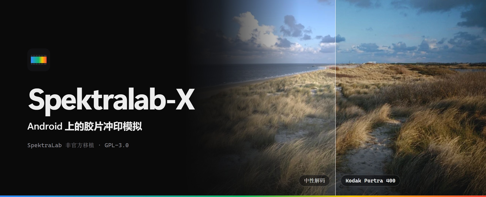
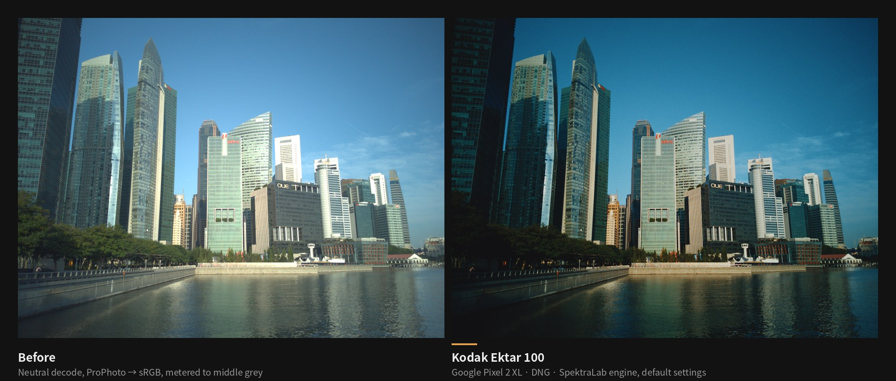
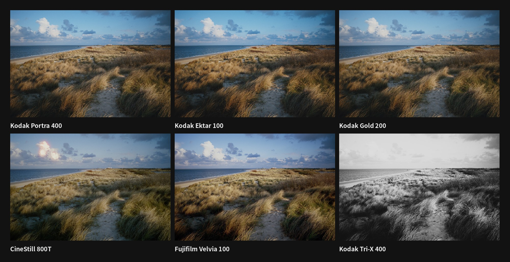
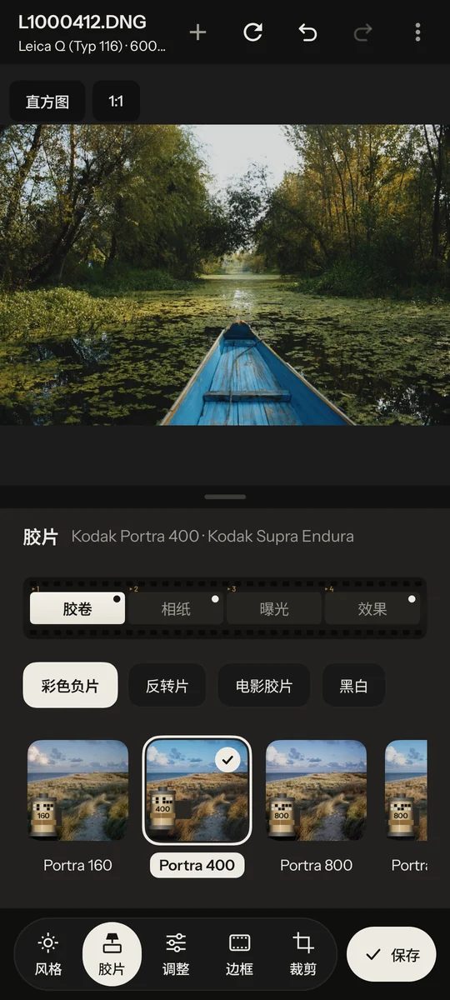
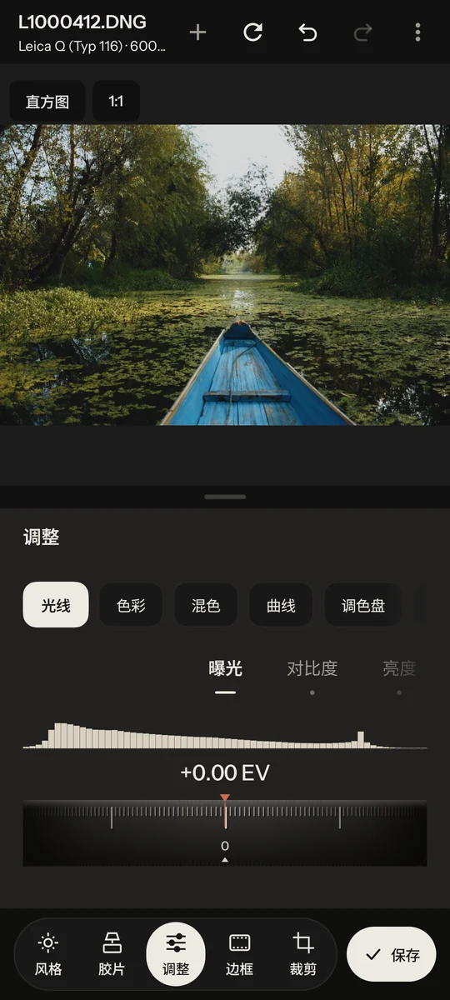
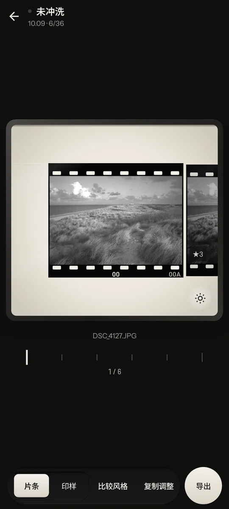

<a href="https://dear-ded.github.io/Spektralab-X/"></a>

<p align="center">
  <a href="https://github.com/Dear-Ded/Spektralab-X/releases"></a>
  <a href="https://github.com/Dear-Ded/Spektralab-X/releases"></a>
  <a href="https://github.com/Dear-Ded/Spektralab-X/actions/workflows/android.yml"></a>
  <a href="LICENSE"></a>
  
</p>

<p align="center">
  <a href="https://dear-ded.github.io/Spektralab-X/"><b>项目主页</b></a> ·
  <a href="https://github.com/Dear-Ded/Spektralab-X/releases"><b>下载 APK</b></a> ·
  <a href="docs/FAQ.md">常见问题</a> ·
  <a href="CHANGELOG.md">更新记录</a> ·
  <a href="docs/README.md">文档</a> ·
  <a href="README.en.md">English</a>
</p>

Spektralab-X 是 [SpektraLab](https://github.com/JamesQiu2005/SpektraLab) 的非官方 Android 移植。它按负片曝光、显影、放大到相纸、扫描的顺序处理 RAW 和手机照片，胶片和相纸用的是 [spektrafilm](https://github.com/andreavolpato/spektrafilm) 的实测特性曲线和光谱灵敏度。计算在手机 GPU 上进行，照片不上传。

应用免费，没有广告、内购和统计。唯一的网络请求是检查本仓库的新版本。

> [!NOTE]
> **现在是 Alpha 版。** 真机测试只在小米 13 Ultra 上做过，其余验证来自 CI 和云端测试，可能出现闪退、颜色不对或速度慢。遇到问题请[提交 issue](#反馈问题)。

## 样片

同一个 RAW 文件，左边是中性解码，右边是胶片冲印。引擎默认参数，没有后期。

<table>
<tr>
<td width="50%"><br><sub>Ricoh GR III · Kodak Portra 400</sub></td>
<td width="50%"><br><sub>Leica Q (Typ 116) · Kodak Ektar 100</sub></td>
</tr>
<tr>
<td><br><sub>Canon EOS R5 · Fujifilm Velvia 100</sub></td>
<td><br><sub>Google Pixel 2 XL（手机 DNG）· Kodak Ektar 100</sub></td>
</tr>
</table>

同一张 RAW 换六种胶片。除了色彩，高光压缩、颗粒和光晕也不一样：



CineStill 800T 没有防光晕层，强光在片基背面反射后再次曝光乳剂，亮部边缘出现红色光晕。Portra 400 有防光晕层，同一画面没有：


<sub>RAW 来自 [raw.pixls.us](https://raw.pixls.us/)（CC0），在云主机上用本项目的引擎渲染，长边 1600 px。负片样张用 Kodak Portra Endura 相纸，应用现在默认用 Kodak Supra Endura，效果会略有不同。渲染参数和复现方法见 [docs/SAMPLES.md](docs/SAMPLES.md)。</sub>

## 界面

<table>
<tr>
<td width="25%" align="center"><br><sub>风格</sub></td>
<td width="25%" align="center"><br><sub>胶片</sub></td>
<td width="25%" align="center"><br><sub>调整</sub></td>
<td width="25%" align="center"><br><sub>观片台</sub></td>
</tr>
</table>

<sub>截图由 [CI 截图任务](https://github.com/Dear-Ded/Spektralab-X/actions/runs/45614486085)生成，使用测试数据，不是手机屏摄。方法见 [docs/SCREENSHOTS.md](docs/SCREENSHOTS.md)。</sub>

可以只选风格、调强度、加边框后保存，也可以继续调曲线、色轮和蒙版。两种操作改的是同一份编辑记录。界面支持中文和英文，在设置里切换。

修图界面在 alpha v0.3 重做：调整页横滑选项目，用大刻度细调；胶片页按暗盒、相纸、曝光、效果的顺序一步步冲；点保存后任务立刻进入后台队列，完成后显示实际保存的格式、尺寸和大小。快门、过片等操作配有真实胶片相机录制的音效，跟随媒体音量。

alpha v0.3.03 起，换风格或换胶片时，新效果像在显影液里一样从旧效果中冲出来（Android 13 及以上）；冷启动和保存时，照片从彩色负片显影出来。拨盘、按键、开关、曲线、直方图和暗盒按真实相机和暗房器材的质感绘制。振动和相机声音可以在设置里分别关闭。

## 功能

**打开照片**
- 相机 RAW：DNG、CR3、NEF、ARW（含索尼 A7 V 的 ARW 6）、RAF、RW2、ORF 等，由 LibRaw 0.22.2 解码。DNG 按拍摄白平衡在双光源矩阵间插值，小米和 Pixel 的 DNG 会应用文件自带的镜头阴影校正。
- 手机照片：JPEG、HEIC/HEIF、PNG、WebP。Display P3 照片按 P3 处理；Ultra HDR 增益图和高光恢复在设置里打开，默认关闭。
- 可以从相册或文件管理器选择，也可以从其他应用“分享”或“打开方式”进来。

**冲印**
- 彩色负片、反转片、黑白负片和电影负片，配对应的相纸。反转片不经过相纸，直接扫描。
- 87 款风格，分实验室、负片、反转、电影、黑白、摄影师、相机、手机八组。每款设定胶片、相纸、放大参数和效果，强度 0–100% 可调，可以按名称或“富士味”“CCD”这类俗称搜索。列表见 [docs/STYLES.md](docs/STYLES.md)。
- RAW 白平衡在解码时生效，算法与上游桌面版相同。另有曝光补偿、画幅（影响颗粒和光晕的尺度）、放大曝光和黄、品红滤镜。
- 颗粒、光晕、相纸眩光可以分别开关和调强度；颗粒尺寸、乳剂散射、扫描锐化等参数放在“更多参数”里。

**调整**
- 白平衡、曝光、对比、高光、阴影、黑白点、饱和、八段 HSL、四个色轮、褪色、暗角，以及 RGB、红、绿、蓝曲线。
- 线性、径向和画笔蒙版，可以反选。
- 色调 × 色彩二维调色盘，每款风格有自己的默认点。
- 撤销和重做最多 50 步。调整记录可以临时隐藏某一组来比较，也可以单组重置。

**构图和边框**
- 旋转、翻转、按比例裁切（3:2、4:3、1:1、16:9、65:24 等）。
- 135、半格、XPan、645、6×6、6×7、6×9 片边，带齿孔、片基字样和帧号；另有拍立得、卡纸留白和参数条，共 50 款预设。
- 参数条按 EXIF 识别 33 个相机和手机品牌，可以印镜头型号；缺少的字段不填。logo 来源见 [docs/LOGOS.md](docs/LOGOS.md)。
- 日期后背可选 LCD、点阵等字体和位置。

**观片台**
- 一次导入一卷，网格可切 2、3、4、6 列；长按拖动多选，打星、选中、淘汰。
- 片条放在灯箱上看：光从齿孔和片边字里透出来。灯箱可以关掉，夜里看黑底。
- 按胶片和日期自动分卷，也可以手动装卷。复制一张的调整，按组粘贴给其他照片后批量导出；整卷可以导出为一张印样。

**导出**
- JPEG（sRGB 或 Display P3，保留相机、镜头和曝光 EXIF）、16-bit TIFF（sRGB、Display P3、ProPhoto RGB、Adobe RGB (1998)，嵌入 ICC）、HEIF（设备有编码器时提供）。
- 导出在后台线程排队，编辑时也可以进行。文件先在相册占位，写完并校验后才公开；进程被系统结束后，下次启动会继续。
- “极致渲染”按原始分辨率输出 4:4:4 JPEG（libjpeg-turbo，质量 98），内存不够时自动降一档。
- 拍摄位置默认不写入，设置里可以打开。

## 和桌面版的差别

胶片引擎直接使用上游代码。在云主机上，Android 的输出和上游 Linux 宿主程序（`spektralab-host`）逐像素比较了 43 组：

| 输入 | 平均 ΔE00 | 最大 ΔE00 |
| :--- | ---: | ---: |
| RAW、合成图 | 0.000 | ≤ 0.015 |
| 手机 JPEG / P3 | ≤ 0.016 | |

人眼大约在 ΔE00 1 左右才能分辨差别。这些数字是在软件 GPU（Mesa lavapipe）上测的，还没有在 Adreno 手机上大规模验证，也没有和 macOS 版直接比较。

主要差别：

- **RAW 解码。** macOS 版用 Apple 的 `CIRAWFilter`，Android 用 LibRaw，和上游 Windows、Linux 版相同。同一个 RAW 在 macOS 上进入引擎前就已经不一样。
- **分辨率。** 一个图像平面必须放进一块 GPU 缓冲。小米 12–14（Adreno 730 / 740 / 750）单块缓冲 128 MiB，约 8 MP；Adreno 650 为 512 MiB，约 33 MP；总上限 4200 万像素。超过时先缩小再处理。需要原图分辨率时用“极致渲染”。
- **屏幕色彩。** P3 屏幕上用广色域窗口显示。HyperOS 的“鲜艳”模式会让颜色更饱和，对色时请切到“原色”。这只影响屏幕，不影响导出文件。

完整对照和尚未移植的功能见 [docs/PLATFORMS.md](docs/PLATFORMS.md)，方法见 [docs/PARITY.md](docs/PARITY.md)。

## 适配机型

适配针对小米数字系列的骁龙和 Adreno 驱动：大图拆成小批提交，首次运行时探测单块缓冲上限，再决定工作尺寸。

| 机型 | 芯片 | GPU | 状态 |
| :--- | :--- | :--- | :--- |
| 小米 10 | 骁龙 865 | Adreno 650 | 未测试 |
| 小米 11 | 骁龙 888 | Adreno 660 | 未测试 |
| 小米 12 / 12S | 骁龙 8 Gen 1 / 8+ Gen 1 | Adreno 730 | 未测试 |
| 小米 13 | 骁龙 8 Gen 2 | Adreno 740 | 13 Ultra 已测试 |
| 小米 14 | 骁龙 8 Gen 3 | Adreno 750 | 未测试 |
| 小米 15 | 骁龙 8 至尊版 | Adreno 830 | 未测试 |
| 小米 17 | 骁龙 8 至尊版 Gen 5 | Adreno 840 | 未测试 |
| 小米 18 | 骁龙 8 至尊版 Gen 6 | Adreno | 未测试 |

小米没有发布 16 这一代。其他 Android 10 以上、支持 Vulkan 的 arm64 手机应该也能运行，但没有专门优化。各机型的内存、推荐工作尺寸和已知问题见 [docs/DEVICES.md](docs/DEVICES.md)。

## 下载与安装

> [!CAUTION]
> 安装包只在本仓库的 [GitHub Releases](https://github.com/Dear-Ded/Spektralab-X/releases) 发布，免费。在应用商店、网盘或二手平台收费出售的不是官方版本。

1. 在 [Releases](https://github.com/Dear-Ded/Spektralab-X/releases) 下载最新版本的 `Spektralab-X-<版本>-arm64-v8a.apk` 和同一页的 `SHA256SUMS`。
2. 在手机上安装。第一次安装需要允许浏览器或文件管理器安装应用。
3. 以后的版本可以直接覆盖安装，编辑和风格会保留。

第一次使用可以先拿一张普通 JPEG 试：选一个风格，保存“分享尺寸”，等队列显示已保存后去相册看结果。

### 校验安装包

所有官方版本用同一个密钥签名，证书 SHA-256 也记录在 [`scripts/signing-cert.sha256`](scripts/signing-cert.sha256)：

```
CD:C5:E3:D0:AC:6F:C9:0B:53:E8:8C:57:E0:40:93:36:72:5A:E3:C2:6F:D1:9D:1A:7E:58:51:70:94:5F:6D:E3
```

每个版本附带 `SHA256SUMS`，并由 GitHub Actions 生成构建溯源证明：

```bash
sha256sum -c SHA256SUMS
gh attestation verify Spektralab-X-<版本>-arm64-v8a.apk -R Dear-Ded/Spektralab-X
```

手机上可以用 [AppVerifier](https://github.com/soupslurpr/AppVerifier) 核对证书，电脑上可以用 `apksigner verify --print-certs`。完整步骤见 [docs/VERIFY.md](docs/VERIFY.md)。

### 更新

应用启动时最多每 6 小时向本仓库的 GitHub Releases 请求一次版本列表。有新版本时可以手动下载，或在不计流量的 Wi-Fi 下自动下载。安装前会核对 `SHA256SUMS` 和签名证书；自己编译的版本签名不同，会被拒绝并引导到 Releases 页面。自动检查和 Wi-Fi 自动下载都可以在设置里关闭。

用 [Obtainium](https://github.com/ImranR98/Obtainium) 订阅时，添加 `https://github.com/Dear-Ded/Spektralab-X` 并打开 **Include prereleases**，因为目前都是预发布版。

## 从源码构建

需要 JDK 17、Android SDK 36、NDK `27.2.12479018`、CMake `3.22.1` 和 `glslangValidator`（Ubuntu 上是 `glslang-tools`）。

```bash
git clone https://github.com/Dear-Ded/Spektralab-X.git
cd Spektralab-X
bash scripts/fetch-upstream.sh upstream
bash scripts/stage-assets.sh upstream
export SPK_UPSTREAM="$PWD/upstream"
./gradlew :app:assembleDebug :app:testDebugUnitTest
```

[`fetch-upstream.sh`](scripts/fetch-upstream.sh) 按固定提交下载上游源码，本仓库只放 Android 相关代码。对上游引擎的修改都在 [`patches/`](patches/)，编译前按顺序打上，说明见 [docs/PATCHES.md](docs/PATCHES.md)。没有设置 `SPK_KEYSTORE` 时 Release 构建也用调试密钥签名，不能覆盖安装官方版本。

```
Compose 界面 (Kotlin)
   │  JSON 参数，单独的引擎线程
   ▼
JNI 桥接                app/src/main/cpp/spektralab_jni.cpp
   │  spk_engine.h（上游 C 接口）
   ▼
SpektraLab 引擎 (C++20) ── Vulkan 计算着色器 ── Adreno GPU
LibRaw 0.22.2（RAW 解码）
```

模块划分、线程模型和内存预算见 [docs/ARCHITECTURE.md](docs/ARCHITECTURE.md)，CI 流程见 [`.github/workflows/android.yml`](.github/workflows/android.yml)。

## 反馈问题

1. 在应用里打开 **设置 → 复制诊断信息**。内容包括版本、机型、芯片、内存、GPU 探测结果、当前参数和最近 40 条事件，不含文件名和位置。
2. 用 [issue 模板](https://github.com/Dear-Ded/Spektralab-X/issues/new/choose)提交，贴上诊断信息。中文、英文都可以。

使用问题可以在 [Discussions](https://github.com/Dear-Ded/Spektralab-X/discussions) 提问，安全问题请按 [SECURITY.md](SECURITY.md) 私下报告。代码、文档和真机测试结果都欢迎，流程见 [CONTRIBUTING.md](CONTRIBUTING.md)。

## 致谢与许可

渲染引擎和着色器来自 JamesQiu2005 的 [SpektraLab](https://github.com/JamesQiu2005/SpektraLab)，胶片模型来自 Andrea Volpato 的 [spektrafilm](https://github.com/andreavolpato/spektrafilm)。本项目做 Android 移植、手机 GPU 适配和界面，由一位摄影爱好者在 Claude、GPT、Grok、DeepSeek 的协助下开发，费用由作者承担。开发中参考了 [SAINTTaiYi/SpektraLab-Android](https://github.com/SAINTTaiYi/SpektraLab-Android) 和 [thetechgeekko/Spektrafilm-android](https://github.com/thetechgeekko/Spektrafilm-android) 遇到的问题。

代码以 [GPL-3.0](LICENSE) 发布，与上游一致，附加条款见 [NOTICE](NOTICE)。APK 中的第三方内容如下，许可文本随应用打包在 `assets/engine/licenses/`：

| 内容 | 来源 | 许可 |
| :--- | :--- | :--- |
| 渲染引擎和着色器 | [JamesQiu2005/SpektraLab](https://github.com/JamesQiu2005/SpektraLab) | GPL-3.0 |
| 胶片和相纸数据 | Andrea Volpato，[spektrafilm](https://github.com/andreavolpato/spektrafilm) | CC BY-SA 4.0 |
| 黑白胶片、相纸配置 | SpektraLab 产品数据 | 见 `Product-profiles-NOTICE.md` |
| RAW 解码 | [LibRaw](https://www.libraw.org/) 0.22.2 | LGPL-2.1 |
| JPEG 编码（极致渲染） | [libjpeg-turbo](https://libjpeg-turbo.org/) | IJG / BSD-3-Clause |
| Vulkan 加载器 | [volk](https://github.com/zeux/volk) | MIT |
| 图像和字体工具 | [stb](https://github.com/nothings/stb) | MIT |
| 日期戳和片边字体 | Liberation Sans、DejaVu Sans Mono | SIL OFL 1.1 / Bitstream Vera |
| README 样片原图 | [raw.pixls.us](https://raw.pixls.us/) | CC0 1.0 |

<details>
<summary><b>转载与二次开发</b></summary>

转发未修改的官方安装包不需要授权，注明本仓库地址 `https://github.com/Dear-Ded/Spektralab-X` 即可。每个版本的完整源码都在本仓库（标签 `v<版本号>`，上游引擎由 [`scripts/fetch-upstream.sh`](scripts/fetch-upstream.sh) 按固定提交下载），这满足 GPL-3.0 第 6(d) 条关于注明源码获取位置的要求。

修改和二次开发按 GPL-3.0 进行，可以自由使用、研究、修改和分发，也可以收费分发。请做到以下几点，前三条是 GPL-3.0 本身的要求或第 7 条允许的附加条款，完整条款见 [NOTICE](NOTICE)：

1. **保留署名**（第 7(b) 条）：在衍生版本的“关于”页和文档里保留项目名称“Spektralab-X”、本仓库地址和“Spektralab-X 贡献者”署名，并注明上游 [SpektraLab](https://github.com/JamesQiu2005/SpektraLab) 和 [spektrafilm](https://github.com/andreavolpato/spektrafilm)。
2. **改名换图标**（第 7(c)、7(e) 条）：本项目不授予“Spektralab-X”名称和图标的商标使用权。公开发布的改版请换名字、图标和包名，注明“基于 Spektralab-X 修改”。
3. **提供源码**（第 4–6 条）：分发安装包时提供完整对应源码，保留许可证和署名，并以 GPL-3.0 发布修改。
4. **胶片数据**：胶片和相纸数据以 CC BY-SA 4.0 发布，转载需署名 spektrafilm（Andrea Volpato）并以相同许可共享。

转载文章或视频时注明“来源：Spektralab-X（github.com/Dear-Ded/Spektralab-X）”。二次开发的项目请同时写上你自己的署名。

</details>

<sub>Spektralab-X 是非官方衍生项目，与 SpektraLab 的作者和所有者、小米公司均无关联，也未获其背书。SpektraLab™ 及其图标是其所有者的商标（注册中）；“小米”“骁龙”“Adreno”和文中的胶片名称是各自所有者的商标。边框水印中的相机、手机和胶片品牌 logo 属于各自权利人，不在 GPL-3.0 授权范围内，仅用于标识拍摄器材，来源见 [docs/LOGOS.md](docs/LOGOS.md)。权利人如有异议，请提 issue，我们会移除。</sub>
