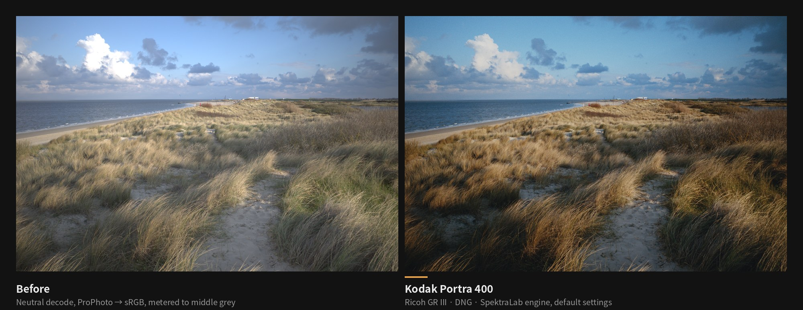
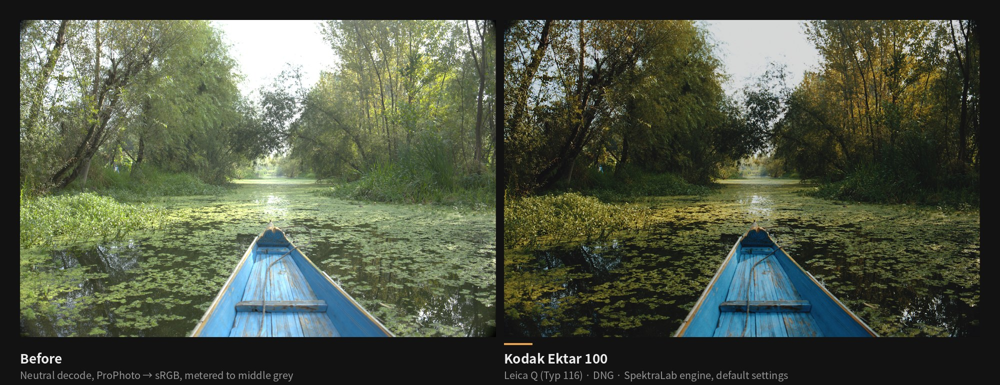
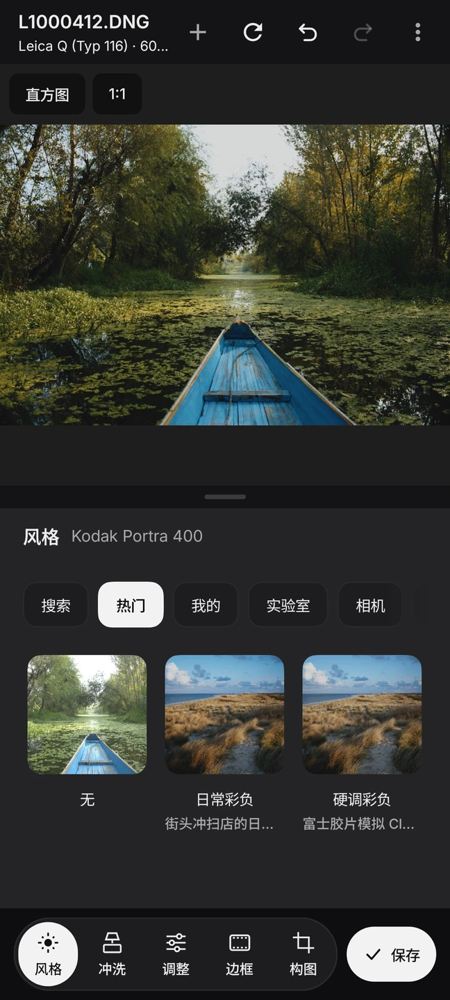
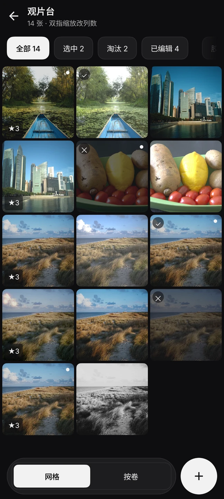
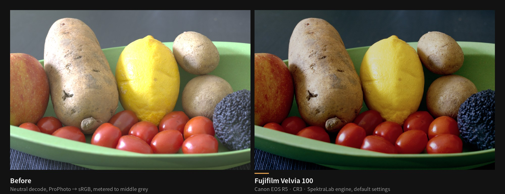
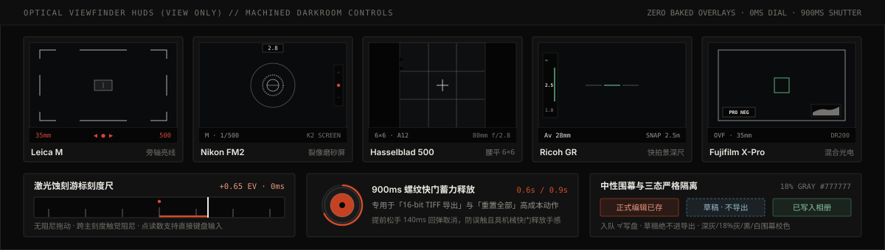

<picture>
  <source media="(prefers-color-scheme: light)" srcset="docs/assets/readme-hero-light.svg">
  <source media="(prefers-color-scheme: dark)" srcset="docs/assets/readme-hero-dark.svg">
  
</picture>

<p align="center">
  <a href="https://github.com/Dear-Ded/Spektralab-X/releases"></a>
  <a href="https://github.com/Dear-Ded/Spektralab-X/releases"></a>
  <a href="https://github.com/Dear-Ded/Spektralab-X"></a>
  <a href="https://dear-ded.github.io/Spektralab-X/"></a>
  <a href="docs/DEVICES.md"></a>
  <a href="LICENSE"></a>
</p>

<p align="center"><strong>随手选卷一键出片，也把整间零色偏光学暗房装进手机。</strong><br>
<a href="https://dear-ded.github.io/Spektralab-X/">打开在线暗房</a> · <a href="https://github.com/Dear-Ded/Spektralab-X/releases">下载 Android APK</a> · <a href="#核心功能全览">核心功能</a> · <a href="#胶卷与化学工艺目录">胶卷目录</a> · <a href="#安装与本地构建">安装与构建</a> · <a href="README.en.md">English</a></p>

## 为什么做 Spektralab-X

Spektralab-X 是 SpektraLab 的非官方 Android 移植，在手机本地模拟从底片到相纸的冲印过程。只想出一张照片，可以停在风格小样；想调整肤色、高光或局部反差，可以沿用同一份编辑记录接着做。

<table>
<thead><tr><th width="50%" align="left">给日常手机用户 · 3 步出片</th><th width="50%" align="left">给专业摄影师 · 完整光学暗房</th></tr></thead>
<tbody>
<tr><td valign="top"><b>1. 打开照片。</b> 从相册选一张手机照片，或从文件中打开相机 RAW / DNG。</td><td valign="top"><b>冲洗。</b> 独立设定 RAW 显影白平衡（K），再依次选胶卷、选相纸、调曝光、调效果。反转片直接扫描，不经相纸。</td></tr>
<tr><td valign="top"><b>2. 选胶卷，调强度。</b> 从轻、中、重开始，或用 0–100% 游标尺微调。按住画布比原图，松手看冲印效果。</td><td valign="top"><b>调色。</b> 从光线、HSL 到 L/R/G/B 曲线和阴影、中间调、高光色轮；只想改画面的一部分，可用线性、径向或画笔蒙版。</td></tr>
<tr><td valign="top"><b>3. 加片边，导出分享图。</b> 选留白、胶片片边、拍立得或真实 EXIF 数据条，再保存分享尺寸 JPEG。</td><td valign="top"><b>选片与交付。</b> 在观片台按卷浏览、多选、评级，跨张粘贴调整。将广色域 16-bit TIFF 加入导出队列；失败项目可手动重试。</td></tr>
</tbody>
</table>

## 界面与实拍展示

同一份 RAW，左边是中性解码，右边是胶片冲印。点图可看大图。

<table>
<tr>
<td width="50%" valign="top"><a href="docs/images/samples/compare_dunes.jpg"></a><br><sub><code>Ricoh GR III · Kodak Portra 400</code></sub></td>
<td width="50%" valign="top"><a href="docs/images/samples/compare_lake.jpg"></a><br><sub><code>Leica Q (Typ 116) · Kodak Ektar 100</code></sub></td>
</tr>
</table>

这组 RAW 来自 [raw.pixls.us](https://raw.pixls.us/)（CC0）。对照图由项目引擎在 Mesa lavapipe 上渲染，无后期，不是手机实测导出。`0.1.18` 时的负片样张搭配 Kodak Portra Endura 相纸，当前默认是 Kodak Supra Endura。[拍摄器材、参数与复现方法](docs/SAMPLES.md)

<table><tr>
<td width="50%" align="center" valign="top"><a href="docs/images/interface/editor.webp"></a><br><sub><code>风格编辑器 · 393 dp</code></sub></td>
<td width="50%" align="center" valign="top"><a href="docs/images/interface/light-table.webp"></a><br><sub><code>观片台 · 选中、评级与淘汰</code></sub></td>
</tr></table>

界面图取自 Alpha 8 的[公开截图运行 #93](https://github.com/Dear-Ded/Spektralab-X/actions/runs/43625578680)：真实 Compose 界面、测试数据，非手机屏摄。点图放大；另见[曲线编辑器](docs/images/interface/curves.webp)与[截图方法](docs/SCREENSHOTS.md)。

<details>
<summary>更多实拍印样：反转片静物、手机 DNG、六卷对照与光晕细节</summary>

<table>
<tr>
<td width="50%"><a href="docs/images/samples/compare_fruit.jpg"></a><br><sub><code>Canon EOS R5 · Fujifilm Velvia 100</code></sub></td>
<td width="50%"><a href="docs/images/samples/compare_skyline.jpg"></a><br><sub><code>Google Pixel 2 XL · Kodak Ektar 100</code></sub></td>
</tr><tr>
<td><a href="docs/images/samples/films_dunes.jpg"></a><br><sub><code>Ricoh GR III · 一张底片，六种胶片</code></sub></td>
<td><a href="docs/images/samples/detail_temple.jpg"></a><br><sub><code>Fujifilm X100F · Portra 400 / CineStill 800T</code></sub></td>
</tr>
</table>

</details>

## 光学取景器与精密机械操控

<picture>
  <source media="(prefers-color-scheme: dark)" srcset="docs/assets/readme-cameras-dark.svg">
  <source media="(prefers-color-scheme: light)" srcset="docs/assets/readme-cameras-light.svg">
  
</picture>

**在[在线暗房](https://dear-ded.github.io/Spektralab-X/)里试。** Leica M 用亮线和中央对焦框构图，Nikon FM2 示意裂像与磨砂屏，Hasselblad 用方形腰平画幅；Ricoh GR 展示快拍距离尺，Fujifilm X-Pro 展示混合取景读数。它们是查看叠层，不是手机相机驱动。游标上的 EV 是示例读数；快门钮按住 900 ms 才触发演示，提前松手取消。网页里的 TIFF 释放不是一次 Android 相册写入。

**在手机上判断颜色。** 照片四周可在深灰、18% 中灰（`#777777`）、纯黑与纯白间切换。查看用的参考线不印入照片；主动选择的片边、日期或数据条才进入导出。展板以“正式编辑已存 / 草稿不导出 / 已写入相册”区分三种结果，不把调试草稿说成公开 APK 的功能。

## 暗房无损处理管线

<picture>
  <source media="(prefers-color-scheme: light)" srcset="docs/assets/readme-pipeline-light.svg">
  <source media="(prefers-color-scheme: dark)" srcset="docs/assets/readme-pipeline-dark.svg">
  
</picture>

从相册或文件载入原片，先做 RAW 显影，再选胶卷与相纸，最后调色、构图并导出。按住画布对照原片；保存可复用的风格，不等于保存这张照片的局部蒙版、裁切或片边。

## 胶卷与化学工艺目录

网页胶卷架用纸盒、金属暗盒、DX 接点和片头辨认卷种，切换时有约 420 ms 的显影过渡。表中的色调与场景是选卷参考，不是固定输出；曝光、照明与相纸都会改变结果。

| 胶卷 | 实体冲洗工艺 | ISO | 片基与画面观感 | 可先试的场景 |
| :--- | :--- | ---: | :--- | :--- |
| Kodak Portra 400 | C-41 彩色负片 | 400 | 橙色掩膜，肤色和高光过渡柔和 | 窗边人像、日光街拍 |
| Kodak Ektar 100 | C-41 彩色负片 | 100 | 橙色掩膜，颗粒细，鲜明颜色容易区分 | 彩色建筑、晴天风光 |
| CineStill 800T | C-41 彩色负片，3200 K 钨光平衡 | 800 | 无传统电影卷的碳黑背层，点光源边缘易出现红橙光晕 | 夜间招牌、室内钨丝灯 |
| Fujifilm Velvia 50 | E-6 彩色反转片 | 50 | 正像透明片，饱和度和反差较高 | 山景、落日、鲜艳静物 |
| Fujifilm Provia 100F | E-6 彩色反转片 | 100 | 日光平衡正片，用较中性的色彩保留物体关系 | 自然光静物、建筑细部 |
| Kodak Tri-X 400 | 传统黑白负片 | 400 | 银影颗粒清楚，明暗分隔鲜明 | 街头纪实、侧光人像 |
| Ilford HP5 Plus | 传统黑白负片 | 400 | 中间调宽容，适合在变化光线下选片 | 阴天街景、现场纪实 |

`3200 K` 是色温，不是冲洗工艺。Velvia 50 是网页展架的型号；[Android 风格目录](docs/STYLES.md)和此处静物样片记录的是 **Velvia 100**，不能用后者证明前者已在 APK 验收。手机选“无胶卷”时可继续数字调色或使用 LUT；实验显色是风格化模拟，不是原厂直出。

## 核心功能全览

| 模块 | 在 Android 暗房里可以做什么 |
| :--- | :--- |
| 风格与配方库 | 按名称或类别搜索，从最近使用和个人组合继续；可调强度，将当前组合存为风格。导入 `.spklook`、`.cube` 或 Lightroom 预设时，可看预览和未能转换的项目。[风格库](docs/STYLES.md) |
| 四步冲洗与 RAW 显影 | 依次选胶卷、配相纸、校正曝光、设定效果。画幅会影响颗粒与光晕的尺度；反转片直接扫描。RAW 白平衡（K）在解码时生效，与冲印后的色温偏移分开。 |
| 曲线、色轮与局部蒙版 | 调整光线、八段 HSL、L/R/G/B 曲线，以及全局、阴影、中间调、高光色轮。用线性、径向或画笔蒙版限定区域，可反选覆盖范围。[看曲线界面](docs/images/interface/curves.webp) |
| 观片台与批量 | 网格可切 2、3、4 或 6 列。长按多选，按星级、选中或淘汰筛片；按卷浏览片条，选择需要的调整组粘贴给其他照片，再批量导出。 |
| 构图、片边与真实 EXIF | 旋转、翻转、裁切，再选留白、胶片片边、拍立得或数据条。设备和曝光信息来自可读 EXIF，缺失字段不编造。修改记录可临时隐藏一组以比较，也可单组重置。 |
| 广色域导出与恢复 | JPEG 可选分享或工作尺寸；16-bit TIFF 可选 sRGB、Display P3、ProPhoto RGB、Adobe RGB (1998)，HEIF 取决于设备编码能力。队列分开显示成功、取消与失败，可对失败项手动重试；清空记录不删除已保存的照片。 |
| 横竖屏与操作尺寸 | 竖屏可调底部面板高度；横向布局将画布放左侧、控件放入 360 dp 侧栏。滑杆可步进、双击复位；主要按钮以 48 dp 为触控目标。窄屏截图覆盖部分 320 dp 场景，不代表所有设备或字号已验收。 |

## 安装与本地构建

### 下载与校验

1. 打开[全部 Releases](https://github.com/Dear-Ded/Spektralab-X/releases)，在带 **Pre-release** 标识的发布中下载 `arm64-v8a.apk` 结尾的安装包和同页 `SHA256SUMS`。官方包永久免费、无广告或内购；徽章统计的是发布附件下载次数，不是独立用户数。
2. 在下载目录运行 `sha256sum -c SHA256SUMS`，再依[安装包校验指南](docs/VERIFY.md)核对[公开签名指纹](scripts/signing-cert.sha256)。在手机上允许当前下载来源安装后打开 APK；不需要长期保留未知来源安装权限。
3. 首次可用一张普通 JPEG 测试：套用胶卷、保存“分享尺寸”，等队列显示已保存，再到相册核对。之后再试 DNG、广色域 TIFF 或整卷批量导出。

### 硬件与性能

**优化对象不是兼容认证。** 本项目用 NDK 将上游 C++20 引擎移植到 Android，由 Kotlin / Jetpack Compose 经 JNI 调用 Vulkan。主要针对小米数字系列的骁龙 / Adreno 驱动；其他 Android 10 及以上、支持 Vulkan 的 arm64 设备理论上可运行，不在专门优化范围内。

| 优化对象 | 骁龙 / Adreno | 验证与限制 |
| :--- | :--- | :--- |
| 小米 10 / 11 | 865 / 650；888 / 660 | 旧驱动与 8 GB 机型余量较小，长时导出注意发热降频。 |
| 小米 12 / 12S、13、14 | 8 Gen 1 或 8+ Gen 1 / 730；8 Gen 2 / 740；8 Gen 3 / 750 | 128 MiB 单缓冲约容 8 MP，首次推荐长边 3072 px；实测记录只覆盖指定的 13 Ultra。12X 的 870 / 650 单列看待。 |
| 小米 15、17、18 | 8 至尊版 / 830；8 至尊版 Gen 5 / 840；8 至尊版 Gen 6 / Adreno | 属适配目标，没有整系列验收结论；小米数字系列没有 16 代。 |

引擎将大图计算与模糊拆成小批提交，规避驱动超时；首次运行及驱动更新后探测单缓冲读写，探测失败按保守值处理。工作尺寸同时受内存、缓冲及 4200 万像素总上限约束。Adreno 650 的参考上限为 512 MiB（约 33 MP）；加片边扩大画布时仍可能降档。交互预览分拖动 1024 px、松手 3400 px 两档。HyperOS 屏幕对色建议用“原色”；显示模式不改变导出文件。[逐机型限制与风险](docs/DEVICES.md) · [渲染与内存预算](docs/ARCHITECTURE.md) · [桌面差异](docs/PLATFORMS.md) · [对照方法](docs/PARITY.md)

### 从源码构建

准备 JDK 17、Android SDK 36、NDK `27.2.12479018`、CMake `3.22.1` 与 `glslangValidator`（Ubuntu 包 `glslang-tools`）。[Gradle 配置](app/build.gradle.kts)锁定 ABI 为 `arm64-v8a`，LibRaw 负责相机 RAW 解码。

```bash
git clone https://github.com/Dear-Ded/Spektralab-X.git
cd Spektralab-X
bash scripts/fetch-upstream.sh upstream
bash scripts/stage-assets.sh upstream
export SPK_UPSTREAM="$PWD/upstream"
./gradlew :app:assembleDebug
./gradlew :app:testDebugUnitTest
./gradlew :app:assembleRelease
```

[拉取脚本](scripts/fetch-upstream.sh)锁定上游版本并应用 [Android 补丁](patches/)；不配置 `SPK_KEYSTORE` 时，Release 构建也用调试密钥，不能覆盖官方安装包。[完整 CI](.github/workflows/android.yml) · [补丁说明](docs/PATCHES.md)

## 工程架构与诚实边界

**公开基线。** [`VERSION`](VERSION) / [`VERSION_CODE`](VERSION_CODE) 为 `0.2.00-alpha-8` / `128`。[对应预发布](https://github.com/Dear-Ded/Spektralab-X/releases/tag/v0.2.00-alpha-8)于 2026 年 11 月 15 日（北京时间）发布。该版本的生产 CI 记录为 230 项 Release、378 项 Debug 测试；这些是[历史发布验收](docs/ALPHA8_RELEASE_2026-11-15.md)，并非本次文档修改重新跑出的成绩。

**真机覆盖。** 小米 13 Ultra 候选包验证过 JPEG、TIFF、HEIF 和批量导出。最后安装的候选源码是 `c4a45e5`；随后的内存采样和队列文案由云端回归验证。[设备实测记录](docs/ALPHA8_EXPANDED_DEVICE_2026-11-14.md)不代表其他机型或所有 RAW，也不构成 Adreno 与桌面 GPU 的色彩一致性认证。

| 导出 | 文件与边界 |
| :--- | :--- |
| JPEG | 分享图长边不超过 3400 px；工作尺寸还受设置、GPU 和内存制约，不等于原始像素。高质量导出也受设备上限约束。 |
| 16-bit TIFF | 可选 sRGB、Display P3、ProPhoto RGB、Adobe RGB (1998)，并嵌入对应 ICC。默认不写 GPS 位置。 |
| HEIF | 仅在设备具备所需编码能力时提供；菜单对应工作尺寸、sRGB。 |
| 导出队列 | 入队不是已写入相册。写入、校验并发布后才算保存；失败时查看原因，再手动重试。 |

**调试与隐私。** 编辑与导出在手机上完成；公开 `main` 的[远程处理接口](docs/REMOTE.md)是禁用的规范草案。在线暗房的草稿和偏好提示是交互演示，不代表 APK 已接入远程模型、会上传照片或能自动修图。下载包的功能以该发布标签和实测记录为准。

### 核心源码索引

| 从这里看 | 对应源码 |
| :--- | :--- |
| 界面布局、围幕与滑杆 | [EditorScreen.kt](app/src/main/java/com/dearded/spektralab/EditorScreen.kt) · [Theme.kt](app/src/main/java/com/dearded/spektralab/Theme.kt) · [Sliders.kt](app/src/main/java/com/dearded/spektralab/Sliders.kt) |
| 风格、曲线与蒙版 | [Styles.kt](app/src/main/java/com/dearded/spektralab/Styles.kt) · [Curves.kt](app/src/main/java/com/dearded/spektralab/Curves.kt) · [MaskPanel.kt](app/src/main/java/com/dearded/spektralab/MaskPanel.kt) |
| 观片台、分组粘贴、片边 | [LightTableScreen.kt](app/src/main/java/com/dearded/spektralab/LightTableScreen.kt) · [LightTableBatch.kt](app/src/main/java/com/dearded/spektralab/LightTableBatch.kt) · [BorderGroups.kt](app/src/main/java/com/dearded/spektralab/BorderGroups.kt) |
| 导出与原生引擎 | [ProcessingQueue.kt](app/src/main/java/com/dearded/spektralab/ProcessingQueue.kt) · [QueueSheet.kt](app/src/main/java/com/dearded/spektralab/QueueSheet.kt) · [JNI 桥接](app/src/main/cpp/spektralab_jni.cpp) |

[架构和内存预算](docs/ARCHITECTURE.md) · [文档索引](docs/README.md) · [更新记录](CHANGELOG.md) · [反馈问题](https://github.com/Dear-Ded/Spektralab-X/issues/new/choose) · [安全反馈](SECURITY.md)

## 上游致谢与开源协议

Spektralab-X 是独立开发的非官方安卓衍生版。感谢 JamesQiu2005 的 SpektraLab 与 Andrea Volpato 的 spektrafilm：前者提供渲染引擎与着色器，后者提供光谱胶片模型。安卓项目负责手机 GPU 适配、集成和界面。项目由一位摄影爱好者与 Claude、GPT、Grok、DeepSeek 协作开发，开发费用由作者承担。

### 转载与二次开发

> **欢迎转发分享。** 欢迎把下载好的安装包转发到社区、社群、论坛等任何地方，无需事先授权，只需注明本仓库地址：https://github.com/Dear-Ded/Spektralab-X
>
> 转发的是未修改的官方安装包时，注明仓库地址就够了：每个版本的完整源码都能从这个仓库获取（标签 `v<版本号>`，上游引擎由 [`scripts/fetch-upstream.sh`](scripts/fetch-upstream.sh) 按固定提交下载），这也满足了 GPL-3.0 第 6(d) 条“注明源码获取位置”的要求。下面几条只针对修改过的版本和二次开发。

**欢迎转载、改版和二次开发。** 本项目以 GPL-3.0 发布，你可以自由使用、研究、修改和分发，也可以收费分发，这是 GPL 赋予的权利，本项目不加限制。我们只请你做到下面几件事，前三条是 GPL-3.0 本身的要求或第 7 条允许的附加条款，完整条款见 [NOTICE](NOTICE)：

1. **保留署名**（GPL-3.0 第 7(b) 条）：在衍生版本的“关于”页和文档里保留原项目名称“Spektralab-X”、本仓库地址 `https://github.com/Dear-Ded/Spektralab-X` 和“Spektralab-X 贡献者”署名，同时注明上游 [SpektraLab](https://github.com/JamesQiu2005/SpektraLab) 和 [spektrafilm](https://github.com/andreavolpato/spektrafilm)。
2. **改名换图标**（第 7(c)、7(e) 条）：本项目不授予“Spektralab-X”名称和图标的商标使用权。公开发布的改版请换一个名字、图标和包名，标明“基于 Spektralab-X 修改”，不要冒充官方版本。
3. **提供源码**（GPL-3.0 第 4–6 条）：分发安装包时，必须同时提供完整对应源码，保留许可证和署名，并以 GPL-3.0 发布你的修改。
4. **胶片数据**：胶片和相纸数据以 CC BY-SA 4.0 发布，转载需署名 spektrafilm（Andrea Volpato）并以相同许可共享。

转载文章或视频时，注明“来源：Spektralab-X（github.com/Dear-Ded/Spektralab-X）”即可；二次开发的项目请同时写上你自己作为二创开发者的署名。

### 许可与致谢

本仓库代码以 [GPL-3.0](LICENSE) 发布，与上游一致，附加条款见 [NOTICE](NOTICE)。APK 里还包含以下第三方内容，许可文本随应用打包在 `assets/engine/licenses/`：

| 内容 | 来源 | 许可 |
|---|---|---|
| 渲染引擎和着色器 | [JamesQiu2005/SpektraLab](https://github.com/JamesQiu2005/SpektraLab)，基于 [andreavolpato/spektrafilm](https://github.com/andreavolpato/spektrafilm) | GPL-3.0 |
| 胶片和相纸数据 | Andrea Volpato，spektrafilm | CC BY-SA 4.0 |
| 黑白胶片、相纸配置 | SpektraLab 产品数据 | 见 `Product-profiles-NOTICE.md` |
| RAW 解码 | [LibRaw](https://www.libraw.org/) 0.22.2 | LGPL-2.1 |
| Vulkan 加载器 | [volk](https://github.com/zeux/volk) | MIT |
| 图像和字体工具 | [stb](https://github.com/nothings/stb) | MIT |
| README 样片原图 | [raw.pixls.us](https://raw.pixls.us/) | CC0 1.0 |
| 日期戳和边缘字样字体 | Liberation Sans、DejaVu Sans Mono | SIL OFL 1.1 / Bitstream Vera |

设计上参考了另外两个安卓移植踩过的坑：[SAINTTaiYi/SpektraLab-Android](https://github.com/SAINTTaiYi/SpektraLab-Android) 和 [thetechgeekko/Spektrafilm-android](https://github.com/thetechgeekko/Spektrafilm-android)。

胶片建模基于 [spektrafilm](https://github.com/andreavolpato/spektrafilm)（film modeling powered by spektrafilm）。

本项目是非官方衍生版本，与 SpektraLab 的作者和所有者、小米公司均无关联，也未获得其背书。SpektraLab™ 及其图标是其所有者的商标（注册中）；“小米”“骁龙”“Adreno”是各自所有者的商标。

边框水印里的相机、手机和胶片品牌 logo 是各自权利人的商标，不属于本项目的 GPL-3.0 授权范围，只用于标识拍摄器材，与各品牌无隶属或背书关系。来源逐个记录在 [docs/LOGOS.md](docs/LOGOS.md)。权利人如有异议，请提 issue，我们会及时移除。
