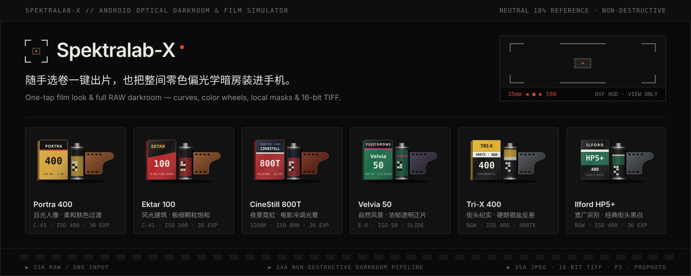
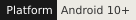
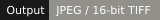
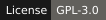
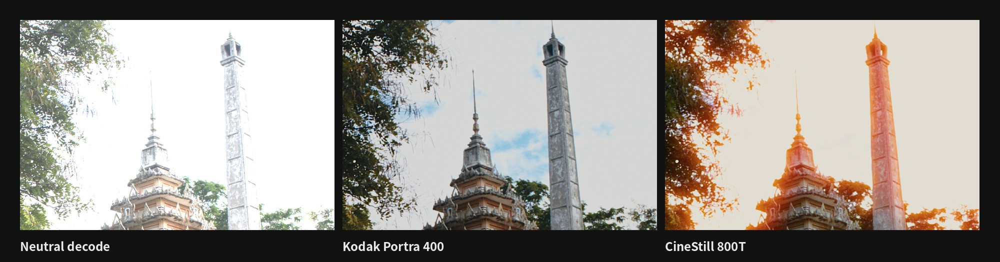
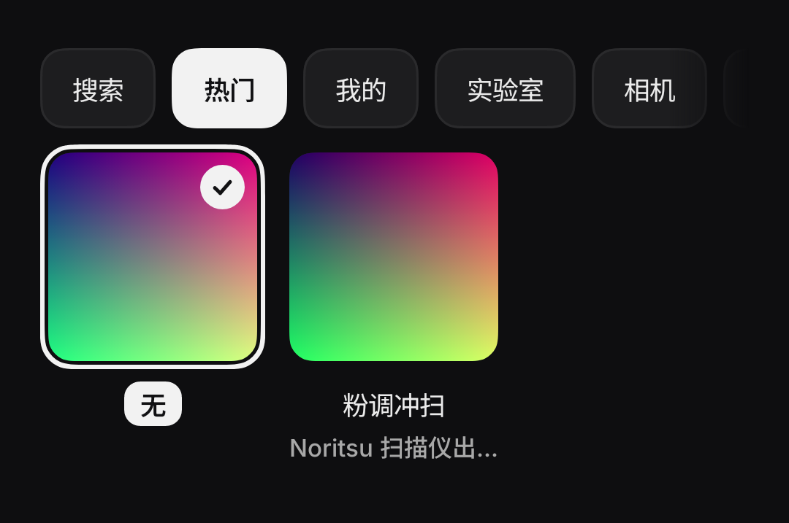
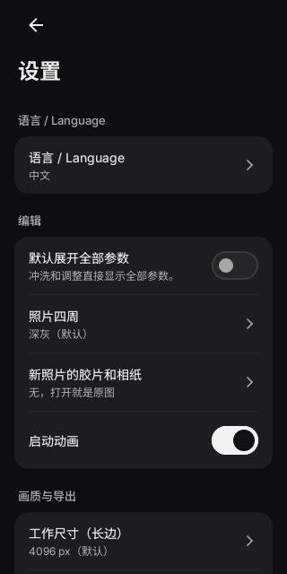
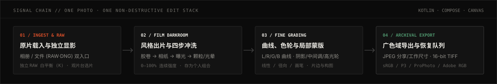

<picture>
  <source media="(prefers-color-scheme: light)" srcset="docs/assets/readme-hero-light.svg">
  <source media="(prefers-color-scheme: dark)" srcset="docs/assets/readme-hero-dark.svg">
  
</picture>

<p align="center">
  <a href="https://github.com/Dear-Ded/Spektralab-X/releases"></a>
  <a href="docs/DEVICES.md"></a>
  <a href="#暗房无损处理管线"></a>
  <a href="LICENSE"></a>
</p>

> **同一张照片，两条工作流**：给想选好胶卷一键出片的手机用户，也给会看直方图、曲线、色轮和底片参数的摄影者。

SpektraLab 的非官方 Android 移植，在手机本地冲印 RAW 与相册照片。

[English](README.en.md) · [下载 Alpha 预发布版](https://github.com/Dear-Ded/Spektralab-X/releases) · [校验安装包](docs/VERIFY.md) · [更新记录](CHANGELOG.md)

## 样片

同一份 RAW，左边是中性解码，右边是胶片冲印。点图可看大图。

<table>
<tr>
<td width="50%" valign="top"><a href="docs/images/samples/compare_dunes.jpg"></a><br><sub><code>Ricoh GR III · Kodak Portra 400</code></sub></td>
<td width="50%" valign="top"><a href="docs/images/samples/compare_lake.jpg"></a><br><sub><code>Leica Q (Typ 116) · Kodak Ektar 100</code></sub></td>
</tr>
</table>

样片用项目引擎在 Mesa lavapipe 上渲染，无后期调整，不是手机实测导出。拍摄底片的中性解码不变；这组彩色负片在 `0.1.18` 时配 Kodak Portra Endura 相纸，现在默认用 Kodak Supra Endura。原片来自 [raw.pixls.us](https://raw.pixls.us/)（CC0）。[渲染参数与复现方法](docs/SAMPLES.md)

<details>
<summary>更多印样与界面对照</summary>

<table>
<tr>
<td width="50%"><a href="docs/images/samples/compare_fruit.jpg"></a><br><sub><code>Canon EOS R5 · Fujifilm Velvia 100</code></sub></td>
<td width="50%"><a href="docs/images/samples/compare_skyline.jpg"></a><br><sub><code>Google Pixel 2 XL · Kodak Ektar 100</code></sub></td>
</tr><tr>
<td><a href="docs/images/samples/films_dunes.jpg"></a><br><sub><code>Ricoh GR III · 一张底片，六种胶片</code></sub></td>
<td><a href="docs/images/samples/detail_temple.jpg"></a><br><sub><code>Fujifilm X100F · Portra 400 / CineStill 800T</code></sub></td>
</tr>
</table>

以下是界面测试截图：左图用合成色块辨认风格选中态，右图展示窄屏设置。它们不用于评价胶片画质。[截图方法与限制](docs/SCREENSHOTS.md)

<table>
<tr>
<td width="50%" valign="top"><br><sub><code>风格选择组件 · 393 dp</code></sub></td>
<td width="50%" valign="top"><br><sub><code>中文设置页 · 320 dp</code></sub></td>
</tr>
</table>

</details>

## 同一张照片，两条工作流

<table>
<thead><tr><th width="50%" align="left">给日常手机用户 · 3 步出片</th><th width="50%" align="left">给专业摄影师 · 完整光学暗房</th></tr></thead>
<tbody>
<tr><td valign="top"><b>1. 打开照片。</b> 从相册选一张手机照片，或从文件中打开相机 RAW / DNG。</td><td valign="top"><b>冲洗。</b> 独立设定 RAW 显影白平衡（K），再依次选胶卷、选相纸、调曝光、调效果。反转片直接扫描，不经相纸。</td></tr>
<tr><td valign="top"><b>2. 选胶卷，调强度。</b> 从轻、中、重开始，或用 0–100% 游标尺微调。按住画布比原图，松手看冲印效果。</td><td valign="top"><b>调色。</b> 从光线、HSL 到 L/R/G/B 曲线和阴影、中间调、高光色轮；只想改画面的一部分，可用线性、径向或画笔蒙版。</td></tr>
<tr><td valign="top"><b>3. 加片边，导出分享图。</b> 选留白、胶片片边、拍立得或真实 EXIF 数据条，再保存分享尺寸 JPEG。</td><td valign="top"><b>选片与交付。</b> 在观片台按卷浏览、多选、评级，跨张粘贴调整。将广色域 16-bit TIFF 加入导出队列；失败项目可手动重试。</td></tr>
</tbody>
</table>

## 暗房无损处理管线

<picture>
  <source media="(prefers-color-scheme: light)" srcset="docs/assets/readme-pipeline-light.svg">
  <source media="(prefers-color-scheme: dark)" srcset="docs/assets/readme-pipeline-dark.svg">
  
</picture>

调色时，照片四周可用深灰、18% 中灰（`#777777`）、纯黑或纯白。围幕、查看态取景框与参考标不写入成片；封面的旁轴取景器是插图，不是拍摄模式。选用导出片边或数据条时才印入相应内容，缺失的 EXIF 字段留空，不编造参数。

<details>
<summary>版本边界、导出规格与调试功能说明</summary>

**下载与验证。** `main` 的[显示版本](VERSION)是 `0.2.00-alpha-8`，[内部版本码](VERSION_CODE)为 `128`。同号[官方预发布](https://github.com/Dear-Ded/Spektralab-X/releases/tag/v0.2.00-alpha-8)于 2026 年 11 月 15 日（北京时间）发布；此后工作树的改动不在该 APK 中。官方包永久免费、无广告或内购，仅从本仓库 Releases 分发。同页下载 `Spektralab-X-0.2.00-alpha-8-arm64-v8a.apk` 和 `SHA256SUMS`，按[签名与构建来源校验](docs/VERIFY.md)核实。

小米 13 Ultra 的 Alpha 8 候选包验证了 JPEG、TIFF、HEIF 和观片台批量导出。最后一次安装的候选源码是 `c4a45e5`；后续内存采样、队列文案以云端回归验证。单台设备与合成输入不代表其他相机 RAW 或整代小米机型，软件 Vulkan 数值对照也不等于 Adreno 真机一致性。[真机记录](docs/ALPHA8_EXPANDED_DEVICE_2026-11-14.md) · [发布验收](docs/ALPHA8_RELEASE_2026-11-15.md)

| 导出 | 文件与边界 |
| :--- | :--- |
| JPEG | 分享图长边不超过 3400 px；工作尺寸还受设置、GPU 和内存制约，不等于原始像素。高质量导出也受设备上限约束。 |
| 16-bit TIFF | 可选 sRGB、Display P3、ProPhoto RGB、Adobe RGB (1998)，并嵌入对应 ICC。默认不写 GPS 位置。 |
| HEIF | 仅在设备具备所需编码能力时提供；菜单对应工作尺寸、sRGB。 |
| 导出队列 | 入队不是已写入相册。写入、校验并发布后才算保存；失败时查看原因，再手动重试。 |

**实验与调试。** RAW 默认线性显影；相机内嵌曲线或标准曲线属于实验显色，是风格化模拟，不是原厂 JPEG 直出。公开版在本机处理照片；[远程调色建议](docs/REMOTE.md)仍是规范草案。公开 `main` 未提供可用的调试态修图助手：不会由它上传原图，也没有助手草稿进入导出。本地偏好提示不自动修图。

[使用问答](docs/FAQ.md) · [风格目录](docs/STYLES.md) · [路线图](docs/ROADMAP.md) · [反馈问题](https://github.com/Dear-Ded/Spektralab-X/issues/new/choose)

</details>

<details>
<summary>设备优化说明与本地构建命令</summary>

**优化对象不是兼容认证。** 本项目用 NDK 将上游 C++20 引擎移植到 Android，由 Kotlin / Jetpack Compose 经 JNI 调用 Vulkan。主要针对小米数字系列的骁龙 / Adreno 驱动；其他 Android 10 及以上、支持 Vulkan 的 arm64 设备理论上可运行，不在专门优化范围内。

| 优化对象 | 骁龙 / Adreno | 验证与限制 |
| :--- | :--- | :--- |
| 小米 10 / 11 | 865 / 650；888 / 660 | 旧驱动与 8 GB 机型余量较小，长时导出注意发热降频。 |
| 小米 12 / 12S、13、14 | 8 Gen 1 或 8+ Gen 1 / 730；8 Gen 2 / 740；8 Gen 3 / 750 | 128 MiB 单缓冲约容 8 MP，首次推荐长边 3072 px；实测记录只覆盖指定的 13 Ultra。12X 的 870 / 650 单列看待。 |
| 小米 15、17、18 | 8 至尊版 / 830；8 至尊版 Gen 5 / 840；8 至尊版 Gen 6 / Adreno | 属适配目标，没有整系列验收结论；小米数字系列没有 16 代。 |

引擎将大图计算与模糊拆成小批提交，规避驱动超时；首次运行及驱动更新后探测单缓冲读写，探测失败按保守值处理。工作尺寸同时受内存、缓冲及 4200 万像素总上限约束。Adreno 650 的参考上限为 512 MiB（约 33 MP）；加片边扩大画布时仍可能降档。交互预览分拖动 1024 px、松手 3400 px 两档。HyperOS 屏幕对色建议用“原色”；显示模式不改变导出文件。[逐机型限制与风险](docs/DEVICES.md) · [渲染与内存预算](docs/ARCHITECTURE.md) · [桌面差异](docs/PLATFORMS.md) · [对照方法](docs/PARITY.md)

**本地构建。** 按当前 [Gradle 配置](app/build.gradle.kts)准备 JDK 17、Android SDK 36、NDK `27.2.12479018`、CMake `3.22.1`，以及 `glslangValidator`（Ubuntu 包名 `glslang-tools`）。在仓库根目录执行：

```bash
bash scripts/fetch-upstream.sh upstream
bash scripts/stage-assets.sh upstream
SPK_UPSTREAM=$PWD/upstream ./gradlew :app:assembleRelease
```

上游源码由[拉取脚本](scripts/fetch-upstream.sh)锁定提交，Android 补丁见 [patches/](patches/) 和[补丁说明](docs/PATCHES.md)。未设置 `SPK_KEYSTORE` 时用调试密钥签名，不能覆盖官方安装包。完整构建与测试命令见 [Android CI](.github/workflows/android.yml)。[文档索引](docs/README.md) · [贡献指南](CONTRIBUTING.md) · [安全反馈](SECURITY.md)

</details>

<details>
<summary>上游致谢与开源协议</summary>

Spektralab-X 是独立开发的非官方安卓衍生版。感谢 JamesQiu2005 的 SpektraLab 与 Andrea Volpato 的 spektrafilm：前者提供渲染引擎与着色器，后者提供光谱胶片模型。安卓项目负责手机 GPU 适配、集成和界面。项目由一位摄影爱好者与 Claude、GPT、Grok、DeepSeek 协作开发，开发费用由作者承担。

## 转载与二次开发

> **欢迎转发分享。** 欢迎把下载好的安装包转发到社区、社群、论坛等任何地方，无需事先授权，只需注明本仓库地址：https://github.com/Dear-Ded/Spektralab-X
>
> 转发的是未修改的官方安装包时，注明仓库地址就够了：每个版本的完整源码都能从这个仓库获取（标签 `v<版本号>`，上游引擎由 [`scripts/fetch-upstream.sh`](scripts/fetch-upstream.sh) 按固定提交下载），这也满足了 GPL-3.0 第 6(d) 条“注明源码获取位置”的要求。下面几条只针对修改过的版本和二次开发。

**欢迎转载、改版和二次开发。** 本项目以 GPL-3.0 发布，你可以自由使用、研究、修改和分发，也可以收费分发，这是 GPL 赋予的权利，本项目不加限制。我们只请你做到下面几件事，前三条是 GPL-3.0 本身的要求或第 7 条允许的附加条款，完整条款见 [NOTICE](NOTICE)：

1. **保留署名**（GPL-3.0 第 7(b) 条）：在衍生版本的“关于”页和文档里保留原项目名称“Spektralab-X”、本仓库地址 `https://github.com/Dear-Ded/Spektralab-X` 和“Spektralab-X 贡献者”署名，同时注明上游 [SpektraLab](https://github.com/JamesQiu2005/SpektraLab) 和 [spektrafilm](https://github.com/andreavolpato/spektrafilm)。
2. **改名换图标**（第 7(c)、7(e) 条）：本项目不授予“Spektralab-X”名称和图标的商标使用权。公开发布的改版请换一个名字、图标和包名，标明“基于 Spektralab-X 修改”，不要冒充官方版本。
3. **提供源码**（GPL-3.0 第 4–6 条）：分发安装包时，必须同时提供完整对应源码，保留许可证和署名，并以 GPL-3.0 发布你的修改。
4. **胶片数据**：胶片和相纸数据以 CC BY-SA 4.0 发布，转载需署名 spektrafilm（Andrea Volpato）并以相同许可共享。

转载文章或视频时，注明“来源：Spektralab-X（github.com/Dear-Ded/Spektralab-X）”即可；二次开发的项目请同时写上你自己作为二创开发者的署名。

## 许可与致谢

本仓库代码以 [GPL-3.0](LICENSE) 发布，与上游一致，附加条款见 [NOTICE](NOTICE)。APK 里还包含以下第三方内容，许可文本随应用打包在 `assets/engine/licenses/`：

| 内容 | 来源 | 许可 |
|---|---|---|
| 渲染引擎和着色器 | [JamesQiu2005/SpektraLab](https://github.com/JamesQiu2005/SpektraLab)，基于 [andreavolpato/spektrafilm](https://github.com/andreavolpato/spektrafilm) | GPL-3.0 |
| 胶片和相纸数据 | Andrea Volpato，spektrafilm | CC BY-SA 4.0 |
| 黑白胶片、相纸配置 | SpektraLab 产品数据 | 见 `Product-profiles-NOTICE.md` |
| RAW 解码 | [LibRaw](https://www.libraw.org/) 0.22.2 | LGPL-2.1 |
| Vulkan 加载器 | [volk](https://github.com/zeux/volk) | MIT |
| 图像和字体工具 | [stb](https://github.com/nothings/stb) | MIT |
| README 样片原图 | [raw.pixls.us](https://raw.pixls.us/) | CC0 1.0 |
| 日期戳和边缘字样字体 | Liberation Sans、DejaVu Sans Mono | SIL OFL 1.1 / Bitstream Vera |

设计上参考了另外两个安卓移植踩过的坑：[SAINTTaiYi/SpektraLab-Android](https://github.com/SAINTTaiYi/SpektraLab-Android) 和 [thetechgeekko/Spektrafilm-android](https://github.com/thetechgeekko/Spektrafilm-android)。

胶片建模基于 [spektrafilm](https://github.com/andreavolpato/spektrafilm)（film modeling powered by spektrafilm）。

本项目是非官方衍生版本，与 SpektraLab 的作者和所有者、小米公司均无关联，也未获得其背书。SpektraLab™ 及其图标是其所有者的商标（注册中）；“小米”“骁龙”“Adreno”是各自所有者的商标。

边框水印里的相机、手机和胶片品牌 logo 是各自权利人的商标，不属于本项目的 GPL-3.0 授权范围，只用于标识拍摄器材，与各品牌无隶属或背书关系。来源逐个记录在 [docs/LOGOS.md](docs/LOGOS.md)。权利人如有异议，请提 issue，我们会及时移除。

</details>
