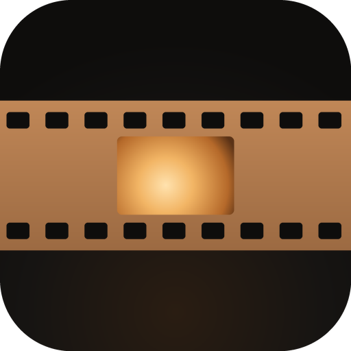
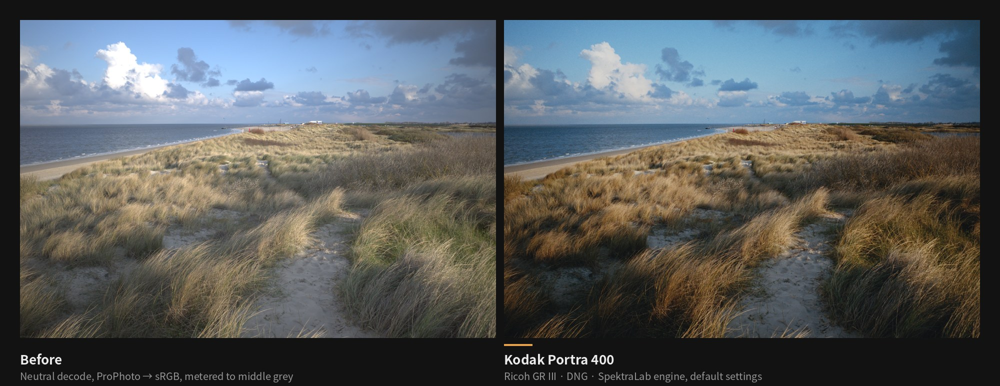
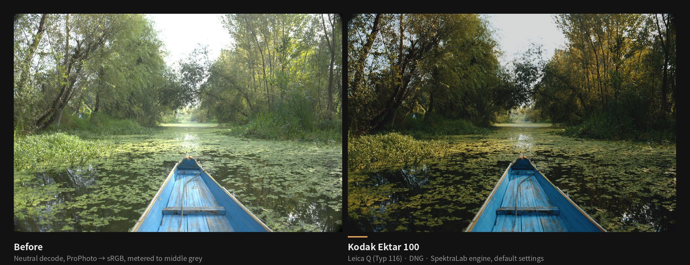
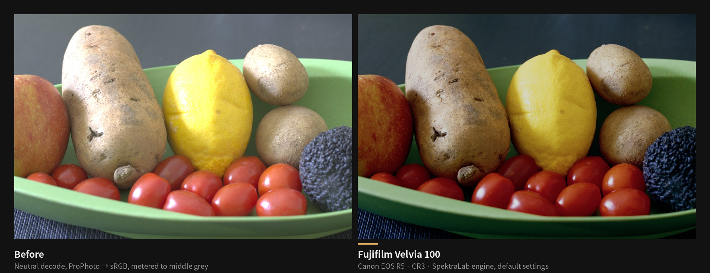
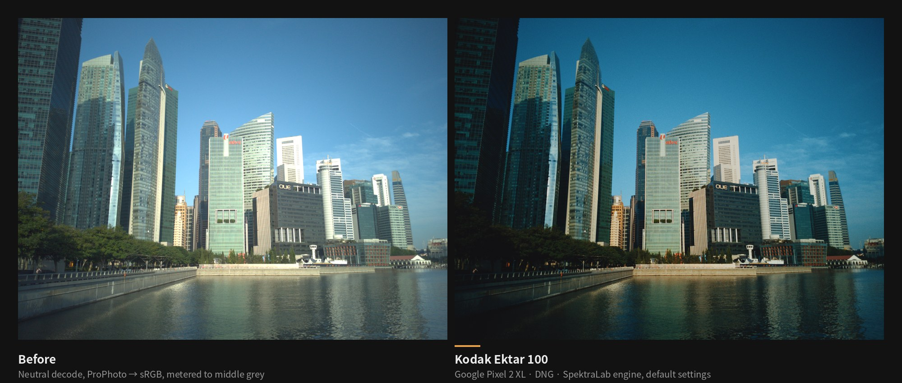
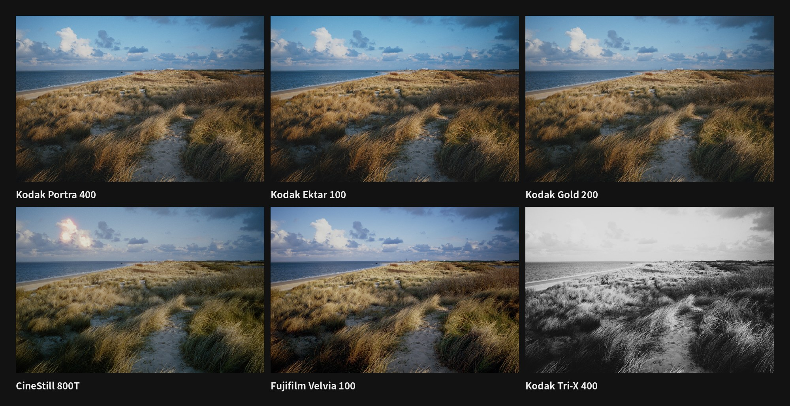
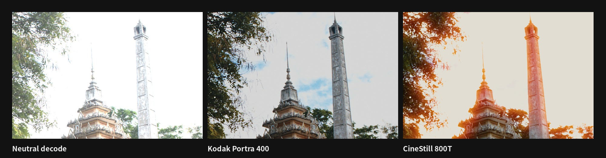

<div align="center">



# Spektralab-X

**光谱胶片与相纸模拟，在手机上冲洗你的照片。**

按真实胶片的特性曲线和光谱灵敏度，把 RAW 和手机照片“曝光”到胶片上、显影、放大到相纸。<br>
SpektraLab 的非官方安卓衍生版 · 针对小米数字系列（骁龙 / Adreno）优化 · 开源免费

简体中文 | [English](README.en.md)

[](https://github.com/Dear-Ded/Spektralab-X/releases)
[](https://github.com/Dear-Ded/Spektralab-X/actions/workflows/android.yml)
[](LICENSE)
[](https://github.com/Dear-Ded/Spektralab-X/commits/main)


[](#下载与校验)

[](https://github.com/Dear-Ded/Spektralab-X/releases)
[](https://github.com/Dear-Ded/Spektralab-X/releases)
[](https://github.com/Dear-Ded/Spektralab-X)
[](https://hits.sh/github.com/Dear-Ded/Spektralab-X/)

[写在前面](#写在前面) · [下载](#下载与校验) · [样片](#样片) · [和桌面版的差别](#和桌面版的差别) · [功能](#功能) · [常见问题](#常见问题) · [路线图](docs/ROADMAP.md) · [更新记录](CHANGELOG.md) · [文档](docs/README.md)

</div>

> [!IMPORTANT]
> **项目正在快速开发迭代中（Alpha）。** 几乎每天都有更新，后续会陆续加入更多功能：界面重构、一键风格扩充、观片台、色彩方案导入等，详见[路线图](docs/ROADMAP.md)。欢迎点 **Star** 收藏，或 **Watch → Custom → Releases** 关注新版本。
>
> 本项目由一位独立开发者在 AI 助手（Claude、GPT、Grok、DeepSeek）的协助下开发。

> [!WARNING]
> **尚未在真机上验证。** 目前所有版本都只通过了 CI 编译，可能闪退、颜色不对或速度很慢。遇到问题请按[反馈问题](#反馈问题)提交，附上应用里的诊断信息。

<p align="center"></p>

## 写在前面

Spektralab-X 站在巨人的肩膀上：它基于 JamesQiu2005 的 [SpektraLab](https://github.com/JamesQiu2005/SpektraLab) 与 Andrea Volpato 的 [spektrafilm](https://github.com/andreavolpato/spektrafilm) 开发。没有这些开源项目和背后多年的研究，就不会有它。

我不是职业程序员，只是一个热爱胶片影像、想把暗房的质感带进手机的摄影爱好者。这个项目从构思、开发到一遍遍调教，都是在 AI 助手的协助下一点点完成的；开发过程中的 token、云服务器等费用，全部由我个人承担。它没有商业目的，也永远不会收费。

正因为如此，它一定还有许多不完美：可能有 bug，可能在你的手机上不够流畅，色彩也未必合每个人的口味。如果你发现了问题，或者有好的想法，非常欢迎提交 [Issue](https://github.com/Dear-Ded/Spektralab-X/issues) 或 Pull Request，每一条反馈我都会认真看。

如果它帮你冲出了一张喜欢的照片，点一个 Star，就是对我最大的鼓励。

## 这是什么

Spektralab-X 是基于 [SpektraLab](https://github.com/JamesQiu2005/SpektraLab)（JamesQiu2005/SpektraLab）与 [spektrafilm](https://github.com/andreavolpato/spektrafilm) 的安卓衍生项目。

[SpektraLab](https://github.com/JamesQiu2005/SpektraLab) 是一个 macOS 胶片模拟软件，引擎来自 [spektrafilm](https://github.com/andreavolpato/spektrafilm)。它不套滤镜，而是按光谱模拟整条冲印链路：场景光 → 相机与胶片 → 负片显影 → 放大机与相纸 → 相纸显影 → 扫描。胶片和相纸数据来自实测的特性曲线和光谱灵敏度。

这个仓库把上游的 C++ 渲染引擎用 NDK 编译到安卓上，走它自带的 Vulkan 计算后端，再配一个 Jetpack Compose 编辑界面。胶片效果全部来自上游；本仓库负责安卓集成、手机 GPU 适配和界面。

- **物理模拟，不是 LUT。** 颗粒、光晕、相纸眩光都由胶片和相纸的物理参数算出来。
- **手机上跑完整链路。** Vulkan 计算着色器跑在 Adreno GPU 上，按机型限制分批提交、控制内存。
- **不联网。** 应用不申请网络权限，不收集任何数据，导出的照片不写入位置信息。

## 样片

下面每张图都由本仓库使用的同一个引擎渲染，默认设置，没有任何后期调整。样片渲染于 0.1.18 时期，彩色负片配 Kodak Portra Endura 相纸；应用现在默认使用 Kodak Supra Endura，与桌面版一致，所以实际效果会略有不同，样片会在下一版重新渲染。左边是中性解码（RAW 按 ProPhoto 线性光解出，转 sRGB，按中灰测光），右边是胶片冲印结果。

<table>
<tr><td></td></tr>
<tr><td align="center"><sub>Leica Q (Typ 116) · Kodak Ektar 100：逆光树叶的高光压进肩部，绿色转暖，船身的蓝保持不变</sub></td></tr>
<tr><td></td></tr>
<tr><td align="center"><sub>Canon EOS R5 · Fujifilm Velvia 100：反转片的高反差和饱和度，番茄和柠檬不溢色</sub></td></tr>
<tr><td></td></tr>
<tr><td align="center"><sub>Google Pixel 2 XL · Kodak Ektar 100：手机 DNG 同样走完整条光谱链路</sub></td></tr>
</table>

**同一张底片，六种胶片**（Ricoh GR III）：

<p align="center"></p>

**光晕是物理模拟出来的。** CineStill 800T 去掉了防光晕层，强光在片基背面反射后从背后再次曝光乳剂，于是亮天空边缘出现红色光晕；带防光晕层的 Portra 400 没有：

<p align="center"></p>

<sub>样片 RAW 来自 [raw.pixls.us](https://raw.pixls.us/)，以 CC0 发布。渲染工具和参数见 [`docs/SAMPLES.md`](docs/SAMPLES.md)。</sub>

## 和桌面版的差别

**结论：颜色看不出差别。** 安卓版的色彩链和上游 Linux 版（`spektralab-host`）逐像素对照了 43 组：RAW 导出平均 ΔE00 0.000、最大 ≤ 0.015，手机 JPEG / P3 平均 ≤ 0.016。人眼大约在 ΔE00 1 才能分辨，这些差别小两个数量级。数字来自云主机上的软件 GPU（lavapipe），**还没在 Adreno 真机上验证**，也还没和 macOS 版直接比过。

| 方面 | macOS / Windows 桌面版 | 安卓（Spektralab-X） | 原因 |
|---|---|---|---|
| RAW 解码 | macOS 用苹果的 `CIRAWFilter`；Windows / Linux 用 LibRaw | LibRaw 0.22.2，和 Windows / Linux 同一个函数；没有镜头校正 | 苹果的相机矩阵、去马赛克和高光处理都是自己的，所以同一个 RAW 在 macOS 上进入引擎前就不一样，上游 Windows / Linux 版也一样。**未实测**（没有 Mac） |
| GPU 与精度 | Metal / 桌面 Vulkan，fp32 | Vulkan 1.0，Adreno，fp32，代码与 Windows / Linux 相同 | fma 不精确时改用 Dekker 拆分乘积，只影响光晕模糊和旋转重采样两个着色器。云主机 lavapipe 的 fma 本身就不精确，所以全部对照数字走的就是这条路；Adreno 据报告同样会走这条路〔推断〕，**真机待验** |
| 分辨率上限 | 受电脑显存限制〔推断〕 | 小米 12–14（Adreno 730 / 740 / 750）单块缓冲 128 MiB，约 8 MP，工作尺寸最高 3072；Adreno 650 为 512 MiB，约 33 MP；总上限 4200 万像素。拖动时预览 1024，松手后 3400 | 一个图像平面必须放进一块 GPU 缓冲，超了就无法渲染，所以大图会先缩小再处理。全分辨率的“极致渲染模式”在计划中 |
| 屏幕色彩 | macOS 由 ColorSync 按显示器配置文件转换 | P3 屏幕上开广色域窗口，矩阵加裁切到 Display P3 或 sRGB | 和上游 `render_view` 的显示路径相同。HyperOS 的“鲜艳”模式会把颜色拉得更饱和〔推断〕，对色请切到“原色”。只影响屏幕，不影响导出文件 |
| 手机 JPEG | 照原样冲印 | 照原样冲印；高光恢复和 Ultra HDR 增益图可选，默认关闭 | 手机 JPEG 已带相机的色调曲线，再冲印等于叠两条曲线。上游也是这样设计的，需要准确颜色请拍 RAW |
| 尚未移植的功能 | 都有（蒙版、色调蒙版、放大机控制在 macOS 默认关闭） | 还没有：Layer 2 曲线；蒙版、色调蒙版、放大机控制；DI / Cineon 导出、打印 LUT（`.cube`）；半格双拼；镜头校正；场景宽容度拟合、中性点吸管；导出软打样；PNG、8 位 TIFF、P3 / ProPhoto 的 TIFF（TIFF 只有 16 位 sRGB） | 先做手机上最常用的部分，其余按[路线图](docs/ROADMAP.md)排期。反过来，安卓新增了自然饱和度、8 段 HSL、褪色、一键风格、边框、Ultra HDR 增益图和后台处理队列 |

完整的对照数据、每项差别的原因和尚未验证的清单见 [docs/PLATFORMS.md](docs/PLATFORMS.md)，对照方法见 [docs/PARITY.md](docs/PARITY.md)。

## 功能

**输入**
- 相机 RAW：DNG、CR3、NEF、ARW、RAF、RW2、ORF 等，由 LibRaw 0.22.2 解码；DNG 按拍摄白平衡在双光源矩阵之间插值
- 手机直出照片：JPEG、HEIC/HEIF、PNG、WebP。Display P3 照片按 P3 交给引擎；Ultra HDR 增益图和高光恢复可在设置里打开（默认关闭，与桌面版一致）
- 可以从相册、文件管理器选择，也可以在其他应用里“分享”或“打开方式”直接打开

**冲印**
- 彩色负片、反转片、黑白负片、电影负片，配对应的相纸；反转片直接扫描，不经过相纸
- 胶片预览条：每种胶片在当前照片上实时渲染一张小样，点一下切换
- 一键风格：实验室、负片、反转、电影、黑白、摄影师、相机、手机八组共 87 款，每款同时设定胶片、相纸、放大参数、效果和调整，并注明灵感来源（[docs/STYLES.md](docs/STYLES.md)）；再点一次可调强度（0–100%）
- 曝光补偿、自动曝光、画幅（影响颗粒和光晕的物理尺度）、放大曝光、黄 / 品红滤镜
- 颗粒、光晕（Halation）、相纸眩光，可分别开关和调强度
- RAW 白平衡：色温 / 色调在解码时生效，算法与上游桌面版一致
- 冲印后调整（“调整”页）：白平衡、曝光、对比、高光、阴影、黑白点、饱和、八色 HSL、四个色轮、褪色、暗角，拖动时实时预览

**构图与边框**
- 旋转、水平翻转、居中裁剪（原始、3:2、4:3、1:1、16:9、65:24 等）
- 胶片边框：135、半格、XPan、645、6×6、6×7、6×9 等，带片基边缘字样和片孔；另有宝丽来、拍立得、参数水印条、画廊白边等相纸边框
- 只加齿孔：任何胶片都能加，画在照片外侧，不裁剪、不改冲印参数；可选位置、片基颜色、齿孔形状、片边字和帧号
- 品牌 logo 水印：按照片 EXIF 自动识别相机或手机品牌（也可手动选、写自定义文字），五种带 logo 的参数条版式，可加胶片厂牌 logo；共 33 个品牌，来源见 [docs/LOGOS.md](docs/LOGOS.md)
- 日期戳：读取照片 EXIF 拍摄时间，按日期后背的格式压印

**查看与导出**
- 拖动滑块时先出快速预览，松手后自动渲染清晰版；新的改动会取消还没完成的旧渲染
- 长按预览看原图，轻点照片隐藏界面全屏查看，直方图带溢出提示，全屏 1:1 查看颗粒细节
- 撤销 / 重做，最多 50 步；预设保存胶片、相纸和效果组合
- 后台导出队列：导出在单独的线程里跑，不挡编辑；进程被杀后下次启动接着做，进度通知支持 Live Update
- 导出保护：先在相册里占位，写完、校验通过才公开，不会留下半张图；全黑、全白或纯色的画面拒绝保存并自动降一档重试；GPU 掉线时自动换引擎重试
- P3 屏幕上按广色域预览；导出 JPEG（Display P3 或 sRGB，保留相机、镜头、曝光、时间等 EXIF，不含 GPS）或 16 位 TIFF（Deflate 无损压缩）

> [!NOTE]
> 应用界面目前只有简体中文。

## 设备支持

主要针对**小米数字系列 10 – 18**。这几代全部使用骁龙旗舰芯片和 Adreno GPU，也就是本项目做驱动适配的对象。

| 机型 | 芯片 | GPU | 状态 |
|---|---|---|---|
| 小米 10 系列 | 骁龙 865 | Adreno 650 | 未测试 |
| 小米 11 系列 | 骁龙 888 | Adreno 660 | 未测试 |
| 小米 12 / 12S 系列 | 骁龙 8 Gen 1 / 8+ Gen 1 | Adreno 730 | 未测试 |
| 小米 13 系列 | 骁龙 8 Gen 2 | Adreno 740 | 未测试 |
| 小米 14 系列 | 骁龙 8 Gen 3 | Adreno 750 | 未测试 |
| 小米 15 系列 | 骁龙 8 至尊版 | Adreno 830 | 未测试 |
| 小米 17 系列 | 骁龙 8 至尊版 Gen 5 | Adreno 840 | 未测试 |
| 小米 18 系列 | 骁龙 8 至尊版 Gen 6 | Adreno | 未测试 |

小米没有发布“16”这一代。各机型的内存、推荐工作尺寸和已知风险见 [docs/DEVICES.md](docs/DEVICES.md)。其他 arm64、安卓 10 以上、支持 Vulkan 的手机理论上也能运行，但不在优化范围内。

## 下载与校验

<p>
<a href="https://github.com/Dear-Ded/Spektralab-X/releases"></a>
<a href="https://github.com/ImranR98/Obtainium"></a>
</p>

> [!CAUTION]
> **官方安装包只在本仓库的 [GitHub Releases](https://github.com/Dear-Ded/Spektralab-X/releases) 发布，永久免费。** 如果你在应用商店、网盘或二手平台付费买到“Spektralab-X”，那不是官方版本，请申请退款，并按下面的方法核对签名。

1. 打开 [Releases](https://github.com/Dear-Ded/Spektralab-X/releases)，下载最新 `v…-alpha` 版本里的 `Spektralab-X-<版本>-arm64-v8a.apk`。
2. 在手机上安装。小米 / HyperOS 第一次安装未知来源应用时，会要求在“安全”里允许。
3. 以后的版本可以直接覆盖安装，编辑预设会保留。

**用 Obtainium 自动更新：** 添加仓库地址 `https://github.com/Dear-Ded/Spektralab-X`，并打开 **Include prereleases**（目前所有版本都是预发布，不打开就找不到）。

**欢迎转发分享：** 下载好的安装包可以直接转发到社区、社群、论坛，无需授权，注明本仓库地址即可，见[转载与二次开发](#转载与二次开发)。

### 校验安装包

所有官方版本都用同一个密钥签名。签名证书 SHA-256（也记录在 [`scripts/signing-cert.sha256`](scripts/signing-cert.sha256)）：

```
CD:C5:E3:D0:AC:6F:C9:0B:53:E8:8C:57:E0:40:93:36:72:5A:E3:C2:6F:D1:9D:1A:7E:58:51:70:94:5F:6D:E3
```

每个版本附带 `SHA256SUMS`，并由 GitHub Actions 生成构建溯源证明（build provenance），可以证明安装包就是由本仓库的公开代码编译出来的：

```bash
sha256sum -c SHA256SUMS
gh attestation verify Spektralab-X-<版本>-arm64-v8a.apk -R Dear-Ded/Spektralab-X
```

在手机上可以用 [AppVerifier](https://github.com/soupslurpr/AppVerifier) 核对证书，在电脑上可以用 `apksigner verify --print-certs`。完整步骤见 [docs/VERIFY.md](docs/VERIFY.md)。

## 使用提示

- **工作尺寸**（设置里调整）决定处理和导出的分辨率。首次启动时按 GPU 自动选择（最高 4096 px；小米 12–14 为 3072），同时受手机可用内存、GPU 单缓冲上限和 4200 万像素的总上限约束。
- 手机直出照片和 RAW 一样按“均衡”方式自动测光，与桌面版一致。手机照片已经由相机调过色，想要最接近真实胶片的效果，请在小米相机专业模式里打开 RAW 拍摄。
- Ultra HDR 和小米“超级 HDR”照片默认只读取普通的那一层画面；在设置里打开“手机照片高光恢复”后，Ultra HDR 照片会用增益图恢复高光。

## 常见问题

<details>
<summary><b>和普通的胶片滤镜、LUT 有什么区别？</b></summary>

滤镜和 LUT 是把一种颜色映射成另一种颜色。这里的引擎模拟的是胶片乳剂对不同波长光的感光、显影后的染料密度、再经放大机印到相纸上的过程，所以曝光高低、光源色温、画幅大小都会让结果自然变化，颗粒和光晕也随之改变。
</details>

<details>
<summary><b>收费吗？哪里能下载？</b></summary>

官方版永久免费，只在本仓库的 [GitHub Releases](https://github.com/Dear-Ded/Spektralab-X/releases) 发布。在其他地方付费买到的都不是官方版本，请按[校验安装包](#校验安装包)核对签名证书。
</details>

<details>
<summary><b>为什么只针对小米数字系列？我的手机能用吗？</b></summary>

手机 GPU 的 Vulkan 驱动差异很大，同一段计算在不同驱动上可能出图、花屏或直接让 GPU 重置。小米 10–18 全是骁龙 + Adreno，驱动问题集中，可以统一处理。其他 arm64、安卓 10 以上、支持 Vulkan 的手机大概率能运行，只是没有专门调过，欢迎反馈结果。
</details>

<details>
<summary><b>颜色和 macOS 版 SpektraLab 一致吗？</b></summary>

在云主机上已经一致。引擎在 ProPhoto 里冲印，屏幕和导出用上游自己的转换代码；与上游 Linux 版逐像素对照 43 组，RAW 输入导出平均色差 ΔE00 0.000、最大 0.015。手机 JPEG 还差 0.20–0.36，原因已查明、正在修。方法和全部数字见 [docs/PARITY.md](docs/PARITY.md)，真机对照还没做。颜色与桌面版不一致时，请在本仓库报告，不要去上游。
</details>

<details>
<summary><b>需要联网吗？会上传我的照片吗？</b></summary>

不需要。应用不申请网络权限，所有计算都在手机上完成，不收集任何数据。导出的 JPEG 会保留相机、镜头、曝光等拍摄信息，但不写入 GPS 位置。
</details>

<details>
<summary><b>为什么导出很慢、手机发烫？</b></summary>

完整的光谱链路计算量很大，全尺寸导出在旧机型上可能要几十秒。长时间导出时手机会降频，小米 11（骁龙 888）最明显。可以在设置里调小工作尺寸，或者用 3400 px 分享尺寸导出。
</details>

<details>
<summary><b>以后会有其他平台的版本吗？</b></summary>

有计划。小米优化版稳定到可以日常使用之后，会另开项目做通用安卓版、Windows 版和 iOS 版。这些是计划，还没有时间表，见下方[路线图](#路线图)。
</details>

<details>
<summary><b>可以转载、改版或者拿去二次开发吗？</b></summary>

欢迎。请按 GPL-3.0 公开完整源码，并注明本项目、上游项目和二创开发者，改版请换一个名字和图标。详见[转载与二次开发](#转载与二次开发)。
</details>

## 路线图

按里程碑推进，完整清单、验收标准和调研结论见 [docs/ROADMAP.md](docs/ROADMAP.md)。

- **近期（0.1.x-alpha）：** 真机反馈修复、色彩还原与风格体系、界面与交互重构、导出稳定性、小米深度适配（超级岛、后台保活、小米 DNG）。
- **正式版：** 远程处理，把照片交给自己的电脑或服务器做后处理再传回手机（规范草案见 [docs/REMOTE.md](docs/REMOTE.md)）。
- **之后的计划：** 小米优化版稳定到可以日常使用后，另开项目做**通用安卓版**、**Windows 版**和 **iOS 版**。这些是计划，没有承诺时间。

## Star 趋势

<a href="https://star-history.com/#Dear-Ded/Spektralab-X&Date">
<picture>
  <source media="(prefers-color-scheme: dark)" srcset="https://api.star-history.com/svg?repos=dear-ded%2FSpektralab-X&type=Date&theme=dark">
  
</picture>
</a>

<sub>下载数来自 GitHub Releases，包含所有预发布版本的安装包。访问计数和 Star 趋势图由第三方服务 [hits.sh](https://hits.sh/) 和 [star-history.com](https://star-history.com/) 提供；在 GitHub 上浏览时图片经 GitHub 的图片代理加载，在其他网站或镜像里浏览时这些服务会收到你的 IP 地址。</sub>

## 反馈问题

1. 打开应用的 **设置 → 复制诊断信息**。里面有版本、机型、芯片、内存、GPU 探测结果、当前参数和最近 40 条事件，不含文件名和位置。
2. 用 [问题反馈模板](https://github.com/Dear-Ded/Spektralab-X/issues/new/choose) 提交，把诊断信息贴进去。中文、英文都可以。

使用上的问题请到 [Discussions](https://github.com/Dear-Ded/Spektralab-X/discussions)。安全问题请按 [SECURITY.md](SECURITY.md) 私下报告。

## 参与贡献

真机反馈是目前最有价值的贡献，哪怕只是“能打开、能导出”。代码、文档和样片同样欢迎，流程见 [CONTRIBUTING.md](CONTRIBUTING.md)。

### 工作方式

```
Compose 界面 (Kotlin)
   │  JSON 参数，单独的引擎线程
   ▼
JNI 桥接层            app/src/main/cpp/spektralab_jni.cpp
   │  spk_engine.h（上游的 C 接口）
   ▼
SpektraLab 引擎 (C++20) ── Vulkan 计算着色器（SPIR-V）── Adreno GPU
LibRaw 0.22.2（RAW 解码）
```

- 上游源码在 CI 里按固定提交下载，见 [`scripts/fetch-upstream.sh`](scripts/fetch-upstream.sh)；本仓库只放安卓相关代码。
- 对上游引擎的修改全部放在 [`patches/`](patches/)，编译前按顺序打上，说明见 [docs/PATCHES.md](docs/PATCHES.md)。
- 应用层的模块划分、线程模型、渲染档位和内存预算见 [docs/ARCHITECTURE.md](docs/ARCHITECTURE.md)。

### 自己编译

需要 JDK 17、Android SDK 35、NDK 27.2、CMake 3.22 和 `glslangValidator`（Ubuntu 上是 `glslang-tools`）：

```bash
bash scripts/fetch-upstream.sh upstream
bash scripts/stage-assets.sh upstream
SPK_UPSTREAM=$PWD/upstream ./gradlew :app:assembleRelease
```

没有设置 `SPK_KEYSTORE` 时用调试密钥签名，装不上正式版的位置。完整流程见 [`.github/workflows/android.yml`](.github/workflows/android.yml)。

版本号写在 [`VERSION`](VERSION)，格式为 `主版本.次版本.修订号-alpha`，能日常使用之前每次发布只加修订号。更新内容见 [CHANGELOG.md](CHANGELOG.md)。

## 转载与二次开发

> **欢迎转发分享。** 欢迎把下载好的安装包转发到社区、社群、论坛等任何地方，无需事先授权，只需注明本仓库地址：https://github.com/Dear-Ded/Spektralab-X
>
> 转发的是未修改的官方安装包时，注明仓库地址就够了：每个版本的完整源码都能从这个仓库获取（标签 `v<版本号>`，上游引擎由 [`scripts/fetch-upstream.sh`](scripts/fetch-upstream.sh) 按固定提交下载），这也满足了 GPL-3.0 第 6(d) 条“注明源码获取位置”的要求。下面几条只针对修改过的版本和二次开发。

**欢迎转载、改版和二次开发。** 本项目以 GPL-3.0 发布，你可以自由使用、研究、修改和分发，也可以收费分发，这是 GPL 赋予的权利，本项目不加限制。我们只请你做到下面几件事，前三条是 GPL-3.0 本身的要求或第 7 条允许的附加条款，完整条款见 [NOTICE](NOTICE)：

1. **保留署名**（GPL-3.0 第 7(b) 条）：在衍生版本的“关于”页和文档里保留原项目名称“Spektralab-X”、本仓库地址 `https://github.com/Dear-Ded/Spektralab-X` 和“Spektralab-X 贡献者”署名，同时注明上游 [SpektraLab](https://github.com/JamesQiu2005/SpektraLab) 和 [spektrafilm](https://github.com/andreavolpato/spektrafilm)。
2. **改名换图标**（第 7(c)、7(e) 条）：本项目不授予“Spektralab-X”名称和图标的商标使用权。公开发布的改版请换一个名字、图标和包名，标明“基于 Spektralab-X 修改”，不要冒充官方版本。
3. **提供源码**（GPL-3.0 第 4–6 条）：分发安装包时，必须同时提供完整对应源码，保留许可证和署名，并以 GPL-3.0 发布你的修改。
4. **胶片数据**：胶片和相纸数据以 CC BY-SA 4.0 发布，转载需署名 spektrafilm（Andrea Volpato）并以相同许可共享。

转载文章或视频时，注明“来源：Spektralab-X（github.com/Dear-Ded/Spektralab-X）”即可；二次开发的项目请同时写上你自己作为二创开发者的署名。

## 许可与致谢

本仓库代码以 [GPL-3.0](LICENSE) 发布，与上游一致，附加条款见 [NOTICE](NOTICE)。APK 里还包含以下第三方内容，许可文本随应用打包在 `assets/engine/licenses/`：

| 内容 | 来源 | 许可 |
|---|---|---|
| 渲染引擎和着色器 | [JamesQiu2005/SpektraLab](https://github.com/JamesQiu2005/SpektraLab)，基于 [andreavolpato/spektrafilm](https://github.com/andreavolpato/spektrafilm) | GPL-3.0 |
| 胶片和相纸数据 | Andrea Volpato，spektrafilm | CC BY-SA 4.0 |
| 黑白胶片、相纸配置 | SpektraLab 产品数据 | 见 `Product-profiles-NOTICE.md` |
| RAW 解码 | [LibRaw](https://www.libraw.org/) 0.22.2 | LGPL-2.1 |
| Vulkan 加载器 | [volk](https://github.com/zeux/volk) | MIT |
| 图像和字体工具 | [stb](https://github.com/nothings/stb) | MIT |
| README 样片原图 | [raw.pixls.us](https://raw.pixls.us/) | CC0 1.0 |
| 日期戳和边缘字样字体 | Liberation Sans、DejaVu Sans Mono | SIL OFL 1.1 / Bitstream Vera |

设计上参考了另外两个安卓移植踩过的坑：[SAINTTaiYi/SpektraLab-Android](https://github.com/SAINTTaiYi/SpektraLab-Android) 和 [thetechgeekko/Spektrafilm-android](https://github.com/thetechgeekko/Spektrafilm-android)。

本项目与 SpektraLab 上游、小米公司均无关联。“SpektraLab”名称由上游项目管理；“小米”“骁龙”“Adreno”是各自所有者的商标。

边框水印里的相机、手机和胶片品牌 logo 是各自权利人的商标，不属于本项目的 GPL-3.0 授权范围，只用于标识拍摄器材，与各品牌无隶属或背书关系。来源逐个记录在 [docs/LOGOS.md](docs/LOGOS.md)。权利人如有异议，请提 issue，我们会及时移除。

<div align="center">

**觉得有意思？点个 ⭐ Star，让更多人看到。**

</div>
