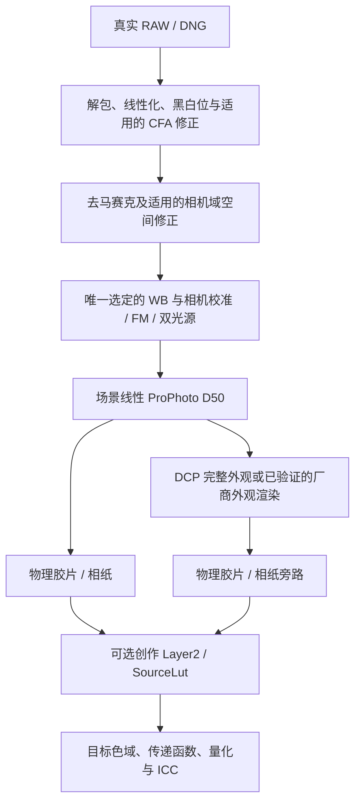

# 厂商色彩接入准备：原生引擎、Android 接口与流水线

2026-11-15，GPT（OpenAI）共创。本文只设计适配边界和后续工作，不实现运行时代码，不评审当前 UI。核查基线为仓库提交 `7163fadeb9e610042305631abe94894083aa5fcb`，以及下列实际 Kotlin/C++ 源码和构建补丁。本文是本 agent 唯一写入文件；验收标准、样本收集与标定数据由另一位 agent 独立负责。

已检查从 `D:/` 到本工作树的各级 `AGENTS.md`，并检索工作树内含隐藏目录的 `AGENTS.md`，未发现适用文件。未读取凭据、私人交接或私人影像；未联网、上传资料、执行构建或测试，也未提交、推送或发布。

## 1. 接入结论与证据边界

1. **DCP 分为相机输入校准和完整 profile 外观两个职责。** 矩阵和白平衡必须在 RAW 解码的相机域确定；HueSat、曝光、Look、Tone 必须按已明确的 profile 渲染合同执行。完整相机外观使用真实 RAW 和物理胶片/相纸旁路，不能放进冲印后的 CUBE 槽位。
2. **NP3 是依赖 Nikon 基础处理的配方。** 当前只证明 `0310` 参数和曲线解码；缺基础 Picture Control 与滑杆函数时，只能读入研究描述，不能声称得到 Nikon RGB。锐化、清晰度和中范围锐化还需要空间算子。
3. **Canon PF2 目前是结构证据，PF3 尚无完整已验证合同。** 名称、基础风格 ID、TLV 位置和哈希不能当作已解码 RGB 表。运行时渲染准入保持关闭，不能借未知 LUT 或相近基础风格静默代替。
4. **Lensfun 属于镜头空间修正。** 暗角、TCA、畸变需保留各自坐标阶段和匹配条件，不进入全局颜色 LUT，也不提供镜头透射光谱或“品牌镜头色”。现有 DNG 修正必须纳入去重。
5. **参数解码准确不等于厂商 RGB 输出复刻。** DCP 全数值对照、HSV 插值小误差、NP3 逐字段一致和 PF2 记录完整性，分别只证明对应组件。忠实执行某个 DCP 也不自动等于相机直出、Adobe、NX Studio 或 DPP 的完整输出。

研究输入为 [厂商色彩研究](VENDOR_COLOR_RESEARCH_2026-11-15.md)、[研究工具合同](../tools/vendor_color/README.md)、[风格引擎还原说明](STYLE_ENGINE_FIDELITY_2026-11-15.md)。本文沿用其中固定语料与许可记录，不重新声称完成厂商输出标定。特别是研究阶段未取得的 DNG 新版本特性、PF3 编码和专有渲染数学，仍是待补证项。

## 2. 已核查的运行时能力

正文裸路径相对仓库根目录，Markdown 链接相对本文位置；链接落到本仓库确实存在的文件。上游 `engine/src/io/*` 不在此工作树展开，相关能力根据本仓库实际补丁、包含它们的生产调用和构建配置交叉核查，未声称检查了本机生成后的上游源码或二进制。

| 现有入口/符号 | 核查到的行为 | 接入含义 |
|---|---|---|
| [NativeEngine.kt](../app/src/main/java/com/dearded/spektralab/NativeEngine.kt)：`openRaw`、`openRawCancellableV1`、`openBitmap`、`openBitmapF16V1`、`openBitmapHdr` | RAW 与已渲染 Bitmap 分开打开；SDR F16 只接有限 `[0,1]` 编码 sRGB/P3；会话按所属线程使用，错误为线程本地状态 | 新格式须有独立、有版本的输入合同，不能只给 `setLut` 加扩展名 |
| [spektralab_jni.cpp:669](../app/src/main/cpp/spektralab_jni.cpp#L669)：`open_raw()` | 探测元数据和精度，选择 WB，调用 `decode_raw_precision()`，准备 RAW 显影和统计，再缩放并 `open_pixels()`；记录 make/model、WB、精度信息 | `decoded.rgb` 已是工作空间图像，不是可再次套相机矩阵的传感器 RGB |
| [raw_precision_input.hpp:23](../app/src/main/cpp/raw_precision_input.hpp#L23)：`RawPrecisionPlan`、`inspect_raw_precision()`、`decode_raw_precision()` | 分派 `integer_compatible16`、`float_linear_v1`、`float_legacy_quantized`；兼容分支调用 `io::decode_raw_compatible()`；取消不冒充不支持后重试 | 保留精度分级与取消语义，不把 float 容器误称为全链无量化 |
| [float_dng_linear.hpp:361](../app/src/main/cpp/float_dng_linear.hpp#L361)：`decode_float_linear_dng()` | 原始逐平面黑白位归一化、WB、`interpolate_dng_matrix()`、`apply_dng_forward_matrix()`，输出有符号/可大于白点的场景线性 ProPhoto D50 | 可复用其归一化和矩阵衔接；不是通用 DNG/profile 导入器 |
| [raw_white_balance.hpp:13](../app/src/main/cpp/raw_white_balance.hpp#L13)：`raw_multipliers_for()` | 用明确温度选择校准，再求 WB 乘数；解码必须携带相同温度 | 新 profile 不能基于旧矩阵先算 WB，再基于新矩阵重复反推另一光源 |
| [0021 补丁:103](../patches/0021-dng-forward-matrix.patch#L103)、[0032 补丁:55](../patches/0032-dng-as-shot-white-xy.patch#L55)、[0043 补丁:20](../patches/0043-dng-asn-calibration-signature.patch#L20) | 引入 `dng_forward::Profile/Prepared/prepare/first_weight/post_wb_to_prophoto`、`dng_white_xy::prepare()`，并在 `CameraLibRaw` 中处理 FM、双光源和签名选择的 CameraCalibration | 复用现有矩阵数学和校准门控；补充外部 profile 数据来源与状态传递 |
| [raw_development.hpp:17](../app/src/main/cpp/raw_development.hpp#L17)、[raw_development.cpp:125](../app/src/main/cpp/raw_development.cpp#L125) | `RawDevelopmentMetadata`、`RawDevelopment::build()` 消费基线曝光、偏移、有限点数曲线等；标准显影拒绝混合 profile 来源/额外 profile/HDR；黑位 Auto 未实现会报状态 | 已有“部分显示显影”，不是完整 DCP；它和新 profile 的曝光/曲线不能叠加执行 |
| [passthrough.hpp:38](../app/src/main/cpp/passthrough.hpp#L38)：`ViewFlags`、`take_app_keys()`、`render_view_float()`、`render_view_float_rows()` | `x_no_film` 和 RAW 显影应用键由 JNI 截获；无胶片路径用上游 view 输出编码 ProPhoto float，并单独带几何；DI 是另一路 | 完整相机 profile 复用无胶片路径；仅“无相纸”或 DI 不能替代完整物理胶片旁路 |
| [Model.kt:72](../app/src/main/java/com/dearded/spektralab/Model.kt#L72)、[Model.kt:620](../app/src/main/java/com/dearded/spektralab/Model.kt#L620) | `RawDevelopmentMode` 只有 `NEUTRAL/STANDARD_V1`；`Edit.openingParams()` 设置输入空间/CCTF 与编码 ProPhoto 输出 | 当前没有 camera-profile 渲染模式；`linear=true` 只表示传递函数，不能证明图像仍是场景光度 |
| [SourceLoader.kt:124](../app/src/main/java/com/dearded/spektralab/SourceLoader.kt#L124)、[input_transform.cpp:21](../app/src/main/cpp/input_transform.cpp#L21) | `decodePhoto()` 由 ImageDecoder 转到 sRGB/P3 并应用方向；`InputTransform::decode/to_prophoto` 去编码并转线性 ProPhoto | JPEG 去编码不撤销机内 Tone、Look、局部处理、WB 和剪切 |
| [StyleImport.kt:69](../app/src/main/java/com/dearded/spektralab/StyleImport.kt#L69)、[source_lut.hpp:14](../app/src/main/cpp/source_lut.hpp#L14)、[layer2.cpp:200](../app/src/main/cpp/layer2.cpp#L200) | `StyleImports.read/applyLut` 现有 CUBE/SPKLOOK 等流程；`SourceLut` 实现 1D/域/3D，3D 红轴最快、四面体插值；`Layer2::apply()` 先 LUT 后调整 | 不含通用外部 DCP/NP3/PF2/PF3 渲染；不能复用 SourceLut 的表布局、插值和剪切执行 DCP HSV 表 |
| [output_transform.cpp:170](../app/src/main/cpp/output_transform.cpp#L170)、[output_transform.hpp:87](../app/src/main/cpp/output_transform.hpp#L87) | float 打包依次为 `RawDevelopment`、Layer2、`finish_float()`、目标空间；`Rgba8Rows/Rgba16Rows` 共享这些职责；`finish_float()` 存在 UNORM16 裁切/量化边界 | 完整 profile 必须在最终打包边界之前完成；不能等量化后补相机校准 |
| [spektralab_jni.cpp:83](../app/src/main/cpp/spektralab_jni.cpp#L83)、[Model.kt:642](../app/src/main/java/com/dearded/spektralab/Model.kt#L642) | `Session` 和 `sourceInfo()` 记录来源、WB、精度、RAW 显影状态；Kotlin `SourceInfo` 只是其中子集，无逐阶段 provenance/profile/lens 合同 | 需增加明确的已应用步骤和机器可读状态，不能凭 `kind=raw` 推断尚未校准 |

### 2.1 ForwardMatrix/双光源的精确复用范围

`0021` 中 `dng_forward::prepare()` 具有两个校准槽、逆色温权重、端点钳制、白点求解、FM 归一化、AnalogBalance/CameraCalibration 组合及缺失 FM 回退；`post_wb_to_prophoto()` 检查实际 WB 比例，避免在已 WB 的像素上多乘一次。`0032` 增加 AsShotWhiteXY 路径与无 FM 时的相关变换；`0043` 扩展显式 AsShotNeutral + 有效 FM 的非单位 CameraCalibration 签名门控。不能依据早期 `0004` 补丁中“FM 未使用”的旧注释否定后续能力。

签名门控有明确语义：有效签名相等（包括两者都空的默认情形）时才使用相应非单位 CameraCalibration；在上述已覆盖分支中，有效签名不等会选单位 CameraCalibration，并非自动判定整个 DNG 或 profile 文件损坏。新外部 DCP 应记录“CC 未采用及原因”，复用已验证规则；非法签名、相机型号不匹配和缺少所要求的完整校准证据另行处理，不能混成同一种匹配结果。

这不代表当前浮点读取器接受双光源 DNG：[float_dng_linear.hpp:176](../app/src/main/cpp/float_dng_linear.hpp#L176) 的严格 allowlist 与 [同文件:289](../app/src/main/cpp/float_dng_linear.hpp#L289) 的单 CM/FM 要求，只接受 `ColorMatrix1/ForwardMatrix1/CalibrationIlluminant1` 等有限字段，拒绝第二光源、复杂校准、Opcode 和 profile。新增外部 DCP 必须把两个校准槽接到可复用数学层；扩展浮点 DNG 输入支持应另列显式版本，不能删除 allowlist 后宣布全支持。当前不支持的浮点源可能走有说明的 `float_legacy_quantized`，严格 profile 路径不得静默采用它。

### 2.2 已有 DNG 镜头修正也必须记账

[0006 补丁:68](../patches/0006-dng-opcode-gain-map.patch#L68) 的 `apply_dng_gain_maps()` 在兼容 RAW 解码中对 CFA 应用部分 OpcodeList2 GainMap；[0009 补丁:186](../patches/0009-dng-opcode-list-3.patch#L186) 的 `apply_dng_opcode_list3()` 与 `CameraLibRaw::opcode_list3` 在颜色转换前处理部分 WarpRectilinear/FixVignetteRadial；[0050 补丁](../patches/0050-opcode-list3-cancellation.patch) 增加此路径的取消传播。`dng_opcode_list3_applied` 只说明应用数量，不能证明所有畸变/TCA/暗角均已处理；原实现还存在跳过其他 Opcode 的兼容行为。GainMap 返回 0 也不能区分“无记录”和“损坏未应用”。Lensfun 接入前必须增加逐算子结果，保留兼容策略的事实，严格路径不得把跳过的必需步骤记为完成。

## 3. 流水线与数值合同

### 3.1 真实 RAW 的两条输出路线

下图是职责图，镜头算子的先后仍须由其坐标合同确定，不是把所有算法强制串到同一阶段。

**胶片路线**只能消费经匹配的输入校准结果。若以后支持 DCP 的“仅校准”用途，明确只执行矩阵/合格的输入校正，记录未执行的外观阶段；不能把完整 DCP Tone/Look 处理后的图像重新称为中性场景输入。是否包含输入 HueSat 必须由所选 profile 子集明确约定并记账，不能凭字段名称自行划分。

**完整相机外观路线**在解码时选定 profile 校准，再执行该 profile 所需的 HueSat、曝光/黑位显示处理、Look、Tone 等阶段。初版计划在原生输入准备阶段完成 profile，早于 `raw_working_converter()` 的提前缩小、`resize_area_rgb()`、`make_before()` 和 `open_pixels()`，保证非线性颜色转换不随工作尺寸改变处理顺序。输出为 profile 渲染后的线性 ProPhoto D50，由无胶片 view 仅承担几何与 ProPhoto 编码。这里的线性是传递函数线性，光度语义已是渲染后图像，必须单独记录，不能再进入物理曝光/乳剂模型。

完整模式必须强制满足 `x_no_film=true`、`x_raw_development="neutral"`；`STANDARD_V1`、完整 profile 与物理胶片并存时返回模式冲突，不能只关颗粒或改成 DI。厂商输出对照时 Layer2、SourceLut 和创作性高光恢复也应为中性；后续主动加效果属于另一个创作结果。现有标准显影的 AE、`BaselineExposure/Offset`、PCHIP/默认 log-logistic 曲线不在 profile 后再次执行。新完整模式自己持有显示曲线与曝光职责，保留现有标准显影作为独立旧路线。

**必须在解码前选校准。** 当前 `decode_raw_precision()` 输出已经过 WB/相机转换；只在它返回后乘外部 DCP 矩阵会重复校准。后续应给原生解码增加显式 profile 输入，使选中的校准和 WB 进入同一 `CameraLibRaw`/矩阵准备过程；需要表前相机域数据时，增加有版本的相机 RGB 中间结果。禁止逆算已裁切/量化的 ProPhoto 来伪造传感器 RGB。保留 `integer_compatible16` 的实际量化限制；中间缓冲变成 Float 不会恢复丢失信息。新的高精度路线只在已支持源布局上开放，不替换全体默认解码策略。

### 3.2 JPEG/HEIC 与 HDR 入口

`SourceLoader.decodePhoto()` 与 `InputTransform` 得到的是“显示 RGB 去编码后转工作空间”，不恢复拍摄现场的线性响应。JPEG 已包含机内或软件的校准、色彩选择、曲线、锐化、降噪和可能的镜头修正；EXIF 中有机型也不能证明这些步骤可逆。完整 DCP、NP3 基础相机渲染与 PF2/PF3 RAW 校准均拒绝这类输入，避免重复 WB、相机矩阵和 Tone。

可另行定义有参考条件的“已渲染图像相对外观转换”：明确输入/输出色域、编码、基准外观及适用范围，仅在已有 LUT/创作路线执行，不声称恢复 RAW 或相机直出。未知既有外观标为 `rendered_look.present=true`、`status=unknown`，不能当作尚未应用。`openBitmapHdr()` 的 gain map 恢复和 `openBitmap()` 的 headroom 处理也须单独标记；SDR profile 不得默套在 HDR 恢复图像上。NP3 当前证据限定 SDR，PQ/HLG/Log 不能因同为三通道浮点数而放行。

### 3.3 四类资料的接入层、输入/输出与匹配

| 资料 | 应落层与输入 | 输出合同 | 匹配字段与当前缺口 |
|---|---|---|---|
| DCP 输入校准 | 原生 RAW 输入层；未二次 WB/矩阵转换的归一化相机 RGB，与 RAW 的 AB/CC、黑白位和选定白点组合 | 场景线性 ProPhoto D50 Float；矩阵阶段保留有限负值与超白值；裁切只在明确的后续阶段发生 | `UniqueCameraModel`，原始及规范化 make/model，三通道/源布局，profile 名称/内容哈希，CameraCalibrationSignature 与 ProfileCalibrationSignature，光源槽、ASN/WhiteXY/自定义 WB 来源；这些字段目前未完整传到 `SourceInfo` |
| DCP 完整外观 | 原生 profile 渲染层；同一个已选校准结果，转换到该 profile 规定的工作 RGB/HSV 合同再处理，不能默认等于现有编码 ProPhoto | 显示渲染后的线性 ProPhoto D50 Float，再由旁路编码一次；附外观、曝光、曲线及裁切状态；最终输出空间另选 | 同上，并绑定 HueSat 两套表/编码、Look 表/编码、Tone、曝光偏移、黑位策略、支持版本和 renderer 版本；不允许跨 IFD 混合字段 |
| Nikon NP3 | 独立配方描述层；只有明确的 Nikon 基础渲染合同可用后，才接其后/其中的颜色与空间控制阶段；现在只允许研究描述 | 当前输出解码参数、控制点、257 点大端 UInt16 原始曲线（已观察范围 0..32767）及未知字节信息；这个存储尺度不是已知 RGB TRC。未来 RGB 基色域/编码/动态范围须由基础渲染实证确定，不能写成已知 sRGB | `NCP`/`0310`、原文件哈希、曲线模式、基础 Picture Control、机型/固件/NX Studio 版本、WB/曝光、SDR 条件；NP3 没有提供足够已验证的相机绑定，缺项由外部权利清晰的描述补齐，禁止按品牌猜 |
| Canon PF2/PF3 | 隔离研究导入/容器描述层；仅在完整算法及许可闭环后再增加独立原生外观 renderer；不调用 SourceLut 执行未知块 | PF2 当前为头部、TLV 标识/边界、少量控制字段与哈希；PF3 仅候选结构，RGB 输入域、轴序、编码与输出均未确立 | 版本/长度/可选校验和状态、原件哈希、基础风格整数 ID、机型/固件/DPP 版本、WB/曝光；名字和 ID 不能映射成已有胶片；PF3 未验证须拒绝渲染 |
| Lensfun | 原生镜头空间修正层；暗角在已明确黑位/曝光单位的线性相机域，TCA 在明确通道布局，畸变在明确重采样坐标域；不在输出编码 RGB 上盲套 | 修正后图像仍保持所处色彩域；另输出像素映射、有效区域、裁切/缩放、每项模型与应用状态，非颜色风格表 | body make/model、lens maker/model/稳定 ID及别名、卡口与转接、传感器裁切系数、实际焦距、光圈、对焦距离、校准覆盖范围、数据库版本；部分当前 EXIF 可读，但不够完整 |

[ExifCopy.kt:46](../app/src/main/java/com/dearded/spektralab/ExifCopy.kt#L46) 已有 `actualFocal()`、`lensModel`、`fNumber()`；应复用其真实焦距语义，不能拿 `focal35()` 的等效焦距代替。镜头稳定 ID、卡口、距离和修正 provenance 需新增来源合同。现有 `ExifCopy.filledFrom()` 可从其他照片补展示字段，但补入的字段必须保留来源，不能直接当作同一曝光或校准匹配已确认的证据。

匹配结果至少区分 `exact`、`ambiguous`、`incompatible`、`missing_evidence`。规范化别名不覆盖原始字段；profile 文件名和品牌名只供展示，不作为校准绑定。相机域不匹配不提供“仍然完整应用”的强制选项；人为替换应进入另行标识的实验/创作路线。

### 3.4 DCP HSV 表不能借用 CUBE 数值合同

[inspect_profiles.py:161](../tools/vendor_color/inspect_profiles.py#L161) 的 `sample_hsv_table()` 只返回 `(色相偏移度数, 饱和度比例, 亮度比例)`。其索引为 `((v * H + h) * S + s) * 3`，S 最快，H 环形，V 为单层时退化；使用双线性/三线性权重。编码 1 影响多 V 层的查找坐标，完整 RGB 应用还需处理编码亮度尺度的逆变换。不能直接把三参数当成输出 RGB，不能使用红轴最快的四面体插值，也不能沿用 `SourceLut` 的默认 `[0,1]` 剪切。

后续独立实现需要明确：工作 RGB 及白点、RGB/HSV 变换、负值/超白值策略、双光源 HueSat 融合权重、HueSat/Look 的编码默认值与支持范围、完整曝光/黑位/Tone 顺序、缺失可选字段的规则。这里复用矩阵的选定光源与状态，不把“两套 HSV 表简单相乘”当融合。现有研究工具不承担上述完整数学，现有 `RawDevelopment` 的曲线插值也不能未经对照就宣称等于完整 DCP Tone 实现。

## 4. Android/原生接口适配草案（拟议）

本节所有新类型、方法名和状态字符串均为**拟议新增合同**，当前源码中不存在；现有符号只在明确给出源码引用时视为已实现。不扩充现有 `Look.values()` 的定长数组来暗带相机信息，也不把大浮点表塞入参数 JSON。

### 4.1 三类持久对象与一个执行结果

| 拟新增对象 | 必需内容 | 生命周期/所有者 |
|---|---|---|
| `CameraProfileDescriptorV1` | 格式/变体/解析器版本、原文件大小/内容哈希、本地原件引用、相机适用条件、签名、光源槽与编码、版权/嵌入字段、来源与资产准入记录、已支持/未知字段清单 | Android 导入与本地资产库；保留原字节，不通过重新序列化丢弃未知区段 |
| `LensCorrectionDescriptorV1` | 数据库提交/条目 ID、模型与参数、单位、校准范围、别名与卡口、来源/许可标识 | 与 camera profile 分开存放；可被 RAW 或经确认的已渲染路线引用 |
| `ColorRenderRequestV1` | 模式 `film/calibration_only/camera_profile/rendered_relative`、校准与外观 profile 引用、lens 各算子选择、WB/曝光意图、严格/兼容策略、支持版本、原始来源身份 | 每张照片的 Edit/历史及每个导出作业的不可变快照；引用本地不可变资产，禁止 ID 指向的内容被原地改写 |
| `AppliedInputStateV1` | 输入/输出域、实际使用的 profile/renderer/矩阵/WB/光源权重、精度与几何、各处理阶段结果、已知既有外观/修正及警告 | 原生解析/解码/渲染计划产生，随实际像素缓冲和会话携带；Android 读取摘要，不反向伪造“已应用” |

`CameraProfileDescriptorV1` 的能力状态至少区分 `metadata_only`、`component_verified`、`profile_renderer_verified`、`vendor_rgb_verified`。前两者不允许完整外观渲染；最后一项必须绑定具体机型/固件/官方处理版本及参考条件，不能从某一个 profile 推广到整个品牌。内容哈希用于绑定同一原件和缓存，不证明正确性或素材许可。

### 4.2 有版本的 JNI 入口

**拟议 API（未实现）**：`inspectColorProfileV1(profileBytes: ByteArray): String?` 返回有界元数据/能力报告；**拟议 API（未实现）**：`openRawWithProfileV1(...)` 在现有 `openRawCancellableV1` 的 RAW 路径、尺寸限额、完整参数、温度/tint 和取消令牌之外，增加 `profileBytes: ByteArray?` 与 `profilePlanJson: String`。后者只含模式、来源绑定、profile 哈希、镜头参数、支持版本和执行意图，不含表载荷或任意可执行脚本。两个拟议入口均由 native 校验真实字节、尺寸、计数、编码、模型和计划，不能信任 Kotlin 的摘要即可跳过 native 验证。

Android 先用有界读取获得文件；首版可沿用研究的 16 MiB 文件上限作为明确约束，但需另计原件副本、已解码数组、表、像素和临时空间的峰值，文件上限不是内存预算。JNI 只复制已验证范围，checked size 计算先于分配；JSON 只回传摘要。后续若采用 fd/流式接口，另定长度、可重复读取与所有权，不能依赖 URI 显示名当作本地路径。

拟新增 C++ `PreparedCameraProfileV1` 持有不可变表和矩阵，`PreparedLensCorrectionV1` 持有不可变空间计划；相机域像素处理在 native 内进行，不把整张 RAW 传回 Kotlin。外部 DCP 校准的准备须接入 WB 求解之前，并与 `CameraLibRaw::interpolate_dng_matrix()` 使用同一份选定矩阵来源。旧入口仍使用旧默认策略，不能让安装了 profile 就改变全体旧照片。

`NativeEngine.capabilities()` 现为引擎能力透传，新 Android profile 适配器能力应另加有版本查询或明确命名的 adapter 子块；逐项报告格式、变体、编码、镜头模型、精度路线和渲染等级。格式能被读出不代表能在当前来源/模式渲染。

### 4.3 已应用标记的最小合同

每项至少有 `status`、`owner`、`source_ref`、`implementation_version`、`domain_before/domain_after`。`status` 分为 `absent`、`applied_here`、`already_applied`、`skipped_by_policy`、`unsupported`、`invalid`、`unknown`；来源标签“存在”另存 `present`，不得直接转为已应用。需要记账的阶段如下。

| 阶段/拟新增标记 | 防重与来源要求 |
|---|---|
| `linearization`、`sensor_black_white`、`demosaic` | RAW 线性化、传感器黑位和显示黑位分开；注明 CFA/已去马赛克与原始平面单位 |
| `dng_gain_map`、`lens_vignetting` | 记录实际应用的 GainMap 及范围；若已有源内 shading，不再盲加 Lensfun 暗角；需要不同物理量叠加时必须有可核对的组合合同 |
| `lens_tca`、`lens_distortion`、`geometry` | 分开记录通道映射和坐标系；DNG Warp 的某些平面已处理不等于所有模型完成；保留 ActiveArea、方向、有效区域与裁切映射 |
| `white_balance`、`camera_calibration`、`camera_to_working` | 同一输入只选一份实际 WB 与校准；记 CM/FM 分支、签名选择、光源槽/权重和 WB 来源，不能叠加内嵌与外部矩阵 |
| `huesat`、`baseline_exposure`、`profile_exposure_offset` | 表和技术曝光分别记账；用户 RAW 曝光另记 `user_raw_exposure`，避免 `RawDevelopment` 重做；完整模式 AE 必须固定为该 renderer 的意图或显式关闭 |
| `display_black_render`、`look_table`、`tone_curve` | 原生 profile 唯一负责；显示黑位 Auto 缺少可实现语义时为 unsupported，不混用传感器黑位或任意 lift |
| `rendered_look`、`hdr_gain_map`、`creative_headroom` | 对 JPEG/HEIC 记已渲染/未知外观；Ultra HDR 恢复与模拟 headroom 分开，不能据“转成线性”清除既有外观 |
| `physical_film_paper`、`creative_layer2`、`source_lut`、`output_transform` | 完整相机模式物理阶段为显式旁路；创作操作与厂商外观区分；目标空间/ICC/编码/量化仅在对应输出执行一次 |

标记绑定的是**某份像素及其生成计划**，不是整个会话“此算子永远只调用一次”的布尔开关。重算新缓冲仍需执行相同算子；预览/导出不得因为全局 `applied=true` 漏做，也不得对已生成的 profile 图像再执行。旧存档缺少状态按 unknown 处理，不推定为未应用。重新打开原始 RAW 时从解码事实重建状态；保存的报告用于核对，不作为跳过源内步骤的授权。

### 4.4 状态传播、缓存与输出

当前 [EditorViewModel.kt:282](../app/src/main/java/com/dearded/spektralab/EditorViewModel.kt#L282) 的 WB 修改通过重开源文件生效，profile、基础模式、校准、镜头方案或源域变化也应走候选会话重开；不得只修改 `setLook/setLut`。先准备并验证新计划、解码、建会话，再原子替换；失败或取消保留旧会话与旧 Edit。复用现有取消令牌、会话线程规则和资源所有权。

`setParams()` 现有事务与 `render_revision` 在 [spektralab_jni.cpp:1258](../app/src/main/cpp/spektralab_jni.cpp#L1258)，`repack()` 检查缓存版本；新请求须计入 revision 与缓存身份。最小键含源身份、profile 内容/renderer 版本、校准与 WB、镜头模型/参数/方向/有效区、模式、曝光/AE 策略和精度路线。输出空间仍归输出转换缓存所有，不能和相机校准混成一份 RGB 表。

当前 [openPreviewV1:1145](../app/src/main/cpp/spektralab_jni.cpp#L1145) 从 `small_rgb` 新建隔离会话并复制 RAW metadata/stats。若该缩略源已生成完整 profile 外观，预览应继承相同 AppliedInputState 并只几何/编码；切换到另一 profile 则需从对应输入重新生成，不能在现有 small_rgb 上连续套外观。`beforeBitmap()` 也需明确它表示校准前/后哪一种源，不能借旧缩略图冒充新计划。

[ProcessingQueue.kt:801](../app/src/main/java/com/dearded/spektralab/ProcessingQueue.kt#L801) 会在 ExportThread 独立重开 RAW；作业必须持有同一 ColorRenderRequest 与可用的原件引用，恢复作业/历史时也要校验 hash 和版本。`Edit` 序列化、`FrameStore`/`FrameEditAutosave` 和队列快照必须同步携带该引用；不能仅在编辑器临时 Session 保存它。缺失资产或未知新模式应返回结构化错误，不能静默回到相近色彩。旧存档缺省继续走现有路线。

当前 [exportJpeg444:1397](../app/src/main/cpp/spektralab_jni.cpp#L1397) 有 no-film 分条读取，[export_tiff:1517](../app/src/main/cpp/spektralab_jni.cpp#L1517) 使用 `Rgba16Rows`；与 Bitmap、proof、reuse/repack 路线必须共享同一 profile 结果和状态。空间修正应在条带输出前完成，或提供严格的邻域/全图坐标访问，不能在输出 pack 时按 tile 独立猜坐标。AE/统计从同一完整来源取得；现有未准备完整统计的会话不能用局部预览统计替代。

完整模式先生成既定线性 ProPhoto 外观结果，再使用既有 ProPhoto 编码和 `OutputTransform` 目标转换。屏幕显示与文件导出本来有不同目标意图；厂商 RGB 对照需锁定目标色域、CCTF、裁切/压缩及量化边界，不能把两个不同输出空间的码值直接比较。`SourceInfo`/原生 `sourceInfo()` 增加 profile、匹配、阶段摘要和降级原因；它是诊断合同，不要求本轮新增任何 UI。

## 5. 错误、拒绝与降级策略

下列机器状态是拟新增 detail code，不是已分配的 `E-xxxx`。现有 [ErrorCodes.kt](../app/src/main/java/com/dearded/spektralab/ErrorCodes.kt) 的来源/解码/资源大类可保留，新 code 由 profile 结果携带；使用 `lastError()` 时仍在失败调用的同一线程读取。取消、显存故障、格式不支持和参考不足应彼此区分。

| 条件 | 计划结果 | 可接受的降级 |
|---|---|---|
| 越界、循环 IFD、重复关键标签、计数溢出、NaN/Inf、矩阵/表尺寸非法、曲线横坐标非法 | `PROFILE_CORRUPT`；不发布新资产/会话 | 无像素降级；保留旧状态和错误位置，不能丢掉坏字段继续称完整 |
| DCP 渲染相关未知标签/版本、未支持编码/多 profile 来源/必需黑位数学 | `PROFILE_FEATURE_UNSUPPORTED`，列具体字段和阶段 | 可保留 metadata-only 描述；若另选受支持的 calibration-only 子集，输出须明确缺失哪些外观，不能把它记作完整模式成功 |
| 明确缺省的可选 DCP 字段 | 按已审定版本合同记录 `absent` 和实际默认行为 | 缺失可选 FM 可走既有合格 CM 分支并报告；损坏的显式 FM/校准不按“缺失”处理，严格外部 profile 模式直接拒绝 |
| 型号/通道或所要求的校准绑定不兼容，或只有品牌/模糊文件名 | `CAMERA_PROFILE_MISMATCH` / `MATCH_EVIDENCE_MISSING` | 不强制把 profile 套到错误相机域；有效 CC 签名不等按第 2.1 节已验证规则选择单位 CC 并记录，不等同坏文件；未经验证的创作实验须独立命名 |
| 已渲染 JPEG/HEIC、已 WB 相机布局或源域未知请求完整 RAW profile | `SOURCE_DOMAIN_INCOMPATIBLE` / `ALREADY_APPLIED_CONFLICT` | JPEG 只可走明确定义的相对外观；已 WB RAW 布局须先有被支持的解码合同，不能假定乘倒数即恢复 |
| 完整外观同时请求物理胶片、`STANDARD_V1` 或不兼容的 HDR | `RENDER_MODE_CONFLICT` | 不隐式拼接两条 Tone/外观路线；由调用方提交一致的完整请求 |
| 浮点 DNG 超出严格 v1 的布局/标签，或要求的精度不可用 | `PRECISION_UNSUPPORTED` | 现有旧入口可保留有说明的 `float_legacy_quantized`；新严格 profile 请求失败，不把兼容量化作为高精度成功 |
| NP3 非 `0310`、曲线/注释扩展损坏，或缺基础 renderer | `PROFILE_VARIANT_UNSUPPORTED` / `PROFILE_CORRUPT` / `BASE_RENDERER_UNAVAILABLE` | 合法文件可仅保留参数；保留未知字节，不按我们 HSL/清晰度滑杆代填，不将解码曲线直接当已知 RGB 曲线 |
| PF2 坏 TLV/长度/存在但错误的 checksum；PF3 未验证 | `PROFILE_CORRUPT` / `PROFILE_RENDERER_UNAVAILABLE` | PF2 无 checksum 记 `absent`，不记通过；完整 PF2/任何未证实 PF3 只保留结构报告，无未知色表求值 |
| Lensfun 无唯一匹配、缺必要焦距/光圈/距离、处在校准范围外 | `LENS_MATCH_AMBIGUOUS` / `LENS_METADATA_MISSING` / `LENS_RANGE_UNSUPPORTED` | 只在依赖字段齐备且范围内插值；不猜镜头/距离、不静默外推。可关闭相应空间算子并报告；若请求要求完整校正则失败 |
| 源内镜头修正状态 unknown，或 DNG 与 Lensfun 同项冲突 | `LENS_APPLIED_STATE_UNKNOWN` / `ALREADY_APPLIED_CONFLICT` | 按算子保守不叠加；不能一个总开关跳过所有镜头修正，也不能以“DNG”后缀认定全部已做 |
| 缺少 profile 原件/renderer 版本，或资产未准入 | `PROFILE_ASSET_MISSING` / `RENDERER_VERSION_UNSUPPORTED` / `ASSET_NOT_ADMITTED` | 已存编辑/作业失败并保留引用；不换同名表、不静默关闭外观；格式可解析不意味着资产可进入运行时 |
| 分配预算不足、取消、GPU device lost | 复用资源/取消/设备故障机制，并携带所处阶段 | 不把内存失败改成另一 profile、不因取消走 legacy 重试；候选失败不替换旧图，不发布未完成导出 |

对兼容路线已有的“保留有用图像、跳过部分不支持项”行为，先记录真实状态，不在本准备文档中扩大为完整支持承诺。严格完整模式只允许全部必需阶段都有可解释结果。信息级缺项、近似输出、渲染失败应使用不同状态，不能只在日志中警告而让导出报告仍显示完整还原。

## 6. 分阶段可执行工作项

以下是后续实现任务，不是本轮已完成的功能。每项列出可落实的修改位置、交付和完成门槛；所有编译、可执行校验及性能测量都在云端。验收/样本 agent 决定样本、对照条件和阈值；本设计只给它们提供算法阶段、可观察状态与一致的调用边界，不重复编写采集计划。

| 阶段 | 实现工作与真实落点 | 交付/完成门槛 |
|---|---|---|
| P0：锁定合同和来源 | 在 `Model.kt` 的 Edit/SourceInfo 合同旁定义请求与来源；在 `spektralab_jni.cpp` 的 Session/`sourceInfo()` 增加阶段摘要；通过 RAW 解码元数据扩展保留签名、选定矩阵、镜头事实及 Opcode 分项结果 | 请求/schema/default/migration 说明、各阶段 owner 表、精度与模式能力矩阵；旧保存缺省可明确解析；将必要观测字段交给验收 agent |
| P1：独立 DCP 描述与准备 | 新增专用 profile 导入/存储和 native 有界解析模块，独立于 `StyleImports`/`LutStore`；读原件、两校准槽、表/编码、曝光/曲线、版权/嵌入字段，未知渲染项列明；借鉴现有 `LookState` 的候选构建后提交方式 | metadata-only 导入可保存/恢复原字节和能力摘要；格式有效与可渲染分开；native 二次验证、预算和失败不改旧状态在云端验证 |
| P2：DCP 校准接入 RAW | 在 `open_raw()` 选择 WB 和 `decode_raw_precision()` 之前准备 profile；扩展上游 RAW 解码接口以接收外部校准计划，复用 `dng_forward`/WhiteXY/签名门控；按需要新增有版本的相机 RGB 中间入口 | 一个校准来源贯穿 WB、去马赛克相关系数及最终 FM/CM；矩阵/曝光不重做；明确每条源精度路线的范围。对已有 float v1 的扩展单独列版本，不以放宽 allowlist 代实现 |
| P3：完整 DCP 渲染与物理旁路 | 独立实现 HSV/编码尺度/双光源融合、曝光/黑位/Look/Tone；在原生输入准备阶段执行，再接 `render_view_float`；与 `RawDevelopment::build()` 保持互斥；对新模式关闭提前 RGB16 缩小/半尺寸路径，直到顺序与坐标一致有证据后再优化 | 同一来源的 profile 处理早于缩放，所有必需特性有结果；不经过胶片/相纸/DI；能输出 profile-only 各阶段边界值与最终目标编码；只达到该 DCP 的执行一致性，不冒称原厂直出 |
| P4：Android/JNI 全路径接线 | 实现有版本 inspect/open 入口、候选事务、重开、sourceInfo；接 `EditorViewModel`、`openPreviewV1/filmPreview`、`Edit`/历史/`FrameStore`/`FrameEditAutosave`、`ProcessingQueue` 作业快照；输出共用 `Rgba8Rows/Rgba16Rows` | 编辑/预览/批处理/导出/重启恢复使用同一不可变请求；profile 更换能失效旧缓存；缺文件、取消和设备恢复不串图；JNI 声明/导出 ABI 与 NDK 链接仅云端检查，无 APK 发布 |
| P5：Lensfun 空间模块 | 完成每算子已应用状态后，新增镜头匹配与有界数据库适配；先覆盖研究实际模型 `distortion:ptlens/poly3/poly5`、`tca:poly3/linear`、`vignetting:pa` 中已实现并验证的子集，其余明确拒绝；复用既有 DNG 几何和取消事实 | 每种模型的坐标/单位/方向/裁切/插值范围有版本合同；相机域处理早于颜色混合、几何映射早于最终裁切/缩放；同项修正不叠加，预览/导出采用一致全图坐标；数据库准入单独完成 |
| P6：NP3 分离配方与基础 renderer | 完成 `0310` 控制/原始 257 点曲线及未知字节描述；曲线模式与五个被抑制 tone 滑杆互斥；在匹配的 SDR 基础 renderer 可用后逐项实现颜色权重、分级、Tone 和空间尺度控制 | 解码报告可先交付；基础处理/滑杆数学缺口未闭合前不进入完整模式。近似配方另标等级与版本，不能用解码逐字段一致替代 RGB 结果 |
| P7：Canon 独立证据门 | 继续以容器/TLV 标识为研究输出；分别解决 PF2 块语义/顺序/基础外观和 PF3 官方样本/轴序/候选 12-bit 编码/数值合同，再独立实现且审查来源 | 缺口清单及明确 unsupported 状态就是当前交付；没有算法/许可证据时不新增 Canon runtime renderer。结构 checksum 与完整 RGB 证明分开，禁止移植无许可 codec |

依赖关系为 P0 → P1 → P2 → P3/P4；P4 可提前完成类型和持久化骨架，完整渲染仍以 P3 的能力状态为门。P5 依赖 P0 的镜头分项 provenance，不依赖厂商品牌外观标定。P6/P7 可独立研究，但不能靠完成元数据解析绕过基础 renderer 与许可缺口。

云端交接提供的最小产物是：实现版本/源文件身份、请求摘要、输入/输出数值域、选定 profile/匹配结果、阶段状态及可选中间数值、完整图像输出的目标空间/编码与降级原因。原始样本及官方目标结果仍由验收/样本 agent 管理。现有 `tools/native/dng_forward_matrix.cpp`、`dng_asn_calibration_gate.cpp`、`dng_whitexy.cpp`、`raw_color_audit.cpp` 和研究工具仅作为后续云端可复用入口，本轮只是阅读，没有运行它们。

## 7. 来源与运行时资产边界

[tools/vendor_color/THIRD_PARTY_NOTICES.md](../tools/vendor_color/THIRD_PARTY_NOTICES.md) 和厂商研究报告已分别记录代码与资产来源。本设计不把外部 GPL 参考实现、无许可证厂商解析器、官方样本配置/图片/LUT/固件加入运行时、APK 资源或运行时依赖，也不把外部研究工具当成 Android 插件执行。相机 profile 的格式支持、组件数值正确和资产准入是三项独立条件。

| 来源 | 本计划的使用边界 |
|---|---|
| RawTherapee/dcamprof GPL 参考 | 隔离云端作独立研究/对照；不得复制其执行实现、代码片段或内嵌表进入本次拟接入的运行时。新数学按清楚的数据合同独立实现，记录推导与参照 |
| NP3 外部 MIT 解析项目 | 许可告知继续保留；控制字段事实可作研究依据，但不自动授予 Nikon 基础外观或官方素材分发权；本轮无运行时移植 |
| Canon 无明确许可证 codec 与官方 PF2/PF3 | codec 的字节变换常量/实现不复制；官方文件仅隔离研究参照，不提交原件、不打包运行时；公开可下载不构成再分发许可 |
| DCP 文件/官方参考成片 | 逐文件保留 Copyright/EmbedPolicy/来源；元数据一句 public domain、EmbedPolicy 数值或所在仓库根许可证都不自动代表所有权利。研究语料不转为预装相机外观库 |
| Lensfun 实现与数据库 | 代码 LGPL 与数据库 CC BY-SA 3.0 按研究记录分开审查；本轮不链接代码、不打包 XML。后续拟采用的数据/实现须单独确定来源、告知和交付边界，不能把数据许可当代码许可 |

运行时原型先用自行编制的合成 profile/表/空间模型验证接口；研究 corpus 留在隔离研究目录，不进入构建资源搜索路径。资料获取或云端验证只用公开、合成或已明确授权且非私人素材，不读取本机凭据/私人交接，不上传私人照片、手机数据或其他私人资料。本文没有执行任何网络操作。

## 8. 本轮静态核查记录

已读指定三份文档及研究工具许可说明；逐段核查本文引用的 Kotlin/C++、研究 Python 和构建补丁。`scripts/fetch-upstream.sh` 固定上游提交并按名字应用 `patches/*.patch`；`app/src/main/cpp/CMakeLists.txt` 从 `SPK_UPSTREAM/engine` 编译并加入 JNI 适配器，所以本文用存在的补丁文件引用上游新增符号，未伪造工作树内不存在的 `engine/src/io` 路径。

本轮只进行源文件阅读、符号/路径检索、文档编辑和 Git 静态检查；无 app 构建、单测、原生程序执行、云端作业或手机测量。已有研究报告中的历史测试结果不是本轮运行结果。未修改 `tools/lut_experiment/__pycache__/`、`tools/native/feedback_pipeline.cpp` 或其他代码；未写入另一位验收/样本 agent 的文件。
