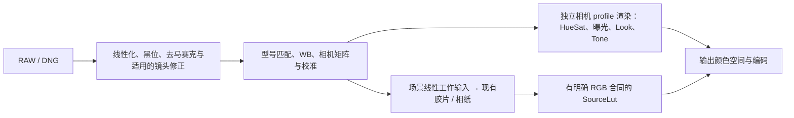

# 厂商色彩：字节证据与应用还原路径

2026-11-15，GPT（OpenAI）共创。目标是把相机输入校准、厂商外观、用户配方和镜头空间修正拆开，依据真实文件和独立实现判断 Spektralab-X 能还原什么。本轮交付研究工具、可复现证据与引擎接入设计；没有新增应用入口、APK、品牌风格卡片或厂商复刻承诺。

## 1. 已完成的拆解

| 资料 | 实际覆盖 | 证明的内容 | 尚未证明的内容 |
|---|---|---|---|
| DCP 相机配置 | 161 份，13 个文件名品牌族群，82,706,944 字节 | TIFF/DCP 标签、矩阵、光源、完整浮点表、曲线、版权与嵌入策略的读取；与 ExifTool 对照 | 相机原厂直出、所有 DNG 新版本特性、完整 profile RGB 渲染 |
| Nikon Flexible Color NP3 | 13 个公开文件、96 个参考生成组合 | 控制字段、8 色混合器、3 路分级、注释与 257 点曲线的逐字段一致性 | Nikon 基础 Picture Control、具体滑杆数学、降噪／锐化和相机 JPEG |
| Canon 官方 PF2 | 8 个，10,245 字节，109 条 TLV 记录 | 外层长度、去混淆后的记录边界、名称、基础风格 ID、曲线／颜色数据块位置和哈希；3 个存在的校验和有效 | 基础颜色块的实际渲染数学、曲线作用顺序、PF3 LUT 轴序／编码及完整直出 |
| Lensfun 镜头资料 | 56 个 XML，1,059 个机身条目，1,580 个镜头条目 | 畸变、TCA、暗角校准数据的盘点和跨云机字节一致性 | 镀膜透射光谱、镜头色偏、耀光、散景和厂商审美外观 |

这些数字是本轮固定提交语料的条目数，不是全球厂商、型号或镜头的完整覆盖。RawTherapee 中的 DCP 是公开配置语料，**不能因为文件名含 Canon／Nikon 就把它称为该厂商官方相机色彩**。

DCP 按文件名首词统一大小写后的分布：Canon 40、Fujifilm 23、Nikon 35、Sony 21、Olympus 10、Panasonic 18、Pentax 6、Ricoh 3、Minolta 1、Leaf 1、LG 1、YI 1、Samsung 1。Hasselblad HNCS、Leica Looks、Sigma 相机模式等没有在这 161 份文件中得到相应的原厂外观实现；上一轮的公开视觉意图研究仍见 `COLOR_STYLE_RESEARCH_2026-11-15.md`，不可冒充本轮字节解析结果。

## 2. 相机文件中究竟有什么

### DCP：相机输入与外观有多个阶段

`inspect_profiles.py` 能处理经典 TIFF 的大小端和 DCP `0x4352` 标记，记录每个标签的类型、数量、IFD／数据字节偏移、原始数据 SHA-256 和解析值。检查目录循环、重复标签、越界、异常计数、非有限数值、零分母、三通道矩阵形状、曲线横坐标顺序及色表形状。对未解释的字节区段保留范围和哈希；默认 JSON 的大数组只预览前 18 个值，实际对照使用全部值。

语料中观察到：126 份 Hue/Sat 维度为 90×30×1、34 份为 6×6×3、1 份为 90×25×1；72 份还含 90×30×30 Look Table。另有 66 份包含 Profile Calibration Signature。相机校准签名、相机型号与颜色矩阵适用性都应进入匹配判断，而不能只看用户选中的品牌名。

最容易误用的地方是：DCP 的色表以 **S 轴最快、随后 H、随后 V** 存储；H 跨 360° 循环；参数使用双线性／三线性插值。现有 RGB CUBE 的红轴顺序与四面体插值不是这个合同。部分表的 V 查找坐标采用 sRGB 转移函数。读取完表后，还要分别处理色相偏移、饱和度比例、亮度比例，以及编码亮度尺度的逆变换。

固定 dcamprof DNG 参考代码的完整处理说明为：矩阵到工作 RGB → Hue/Sat Map → 曝光／基线曝光偏移／黑位相关步骤 → Look Table → Tone Curve。本轮 `sample_hsv_table` **只返回插值后的三个参数**，不承担整条 RGB 转换、双光源融合、尺度应用或剪切。参考 C 试验也只暴露这三个参数，不能据其小误差宣称整张照片与 Adobe 或相机相同。

现有 `float_dng_linear.hpp` 已有 DNG Forward Matrix／双光源相关路径，`raw_development.cpp` 也已有部分 RAW 显影设置。后续接入必须复用这些事实并跟踪已应用步骤，避免白平衡、矩阵、曝光或 Tone Curve 执行两次。当前没有通用外部 DCP 导入与完整 HueSat／LookTable 执行链。

### Nikon NP3：配方参数读准了，基础成像仍要另找参照

实测 `0310` 变体基础区 392 字节，包含固定偏移控制值。可选曲线扩展为 586 字节，含控制点与 257 个大端 16-bit 值，观察到的曲线范围为 0..32767。注释长度和后继块标识会移动曲线起点，不能固定从同一绝对偏移读曲线。生成组合覆盖非零八色调整、三路分级、正负滑杆、UTF-8 注释及曲线互斥行为。

工具和外部 MIT 解析器在 109 个文件／生成组合上逐字段一致。部分高位和其余固定区的意义仍未解释，保留原字节而不重新序列化。锐度、清晰度和中范围锐化属于不同空间尺度，单个 RGB LUT 无法表达。

Nikon 官方 NX Studio 说明要求 Flexible Color 作用于 SDR，并与支持最新 Picture Control 的相机／处理版本相匹配。这说明 NP3 是依附特定基础处理的自定义控制文件。把相同数值填入我们的 HSL、亮暗滑杆，不能证明 Nikon 的函数形状、颜色选择权重和基础相机响应已复现。

### Canon PF2/PF3：已展开记录，未声称还原专有数学

8 个文件来自 Canon 官方 Picture Style 下载 URL。结构检查识别 `PSP\0`、大端版本和长度。外部固定哈希研究解析器提供字节变换，本项目另写有边界检查的 TLV 遍历，验证每条记录长度、结束标记、主体全覆盖及可选校验和。结果为 109 条记录；较早 5 个文件没有该校验和记录，较新 3 个存在且有效，不能把缺席记为“校验通过”。

观察到名称、`Canon INC.` 版权文字、基础风格整数 ID，以及 0x1018／0x1019 的 300 字节曲线块和 0x1021／0x1029 的 240 字节颜色块。8 个文件基础 ID 分别为 132、129、129、129、129、130、130、132。部分较新文件还有锐度／对比度／饱和度／色调记录。这里只记录定位、标识、少量控制值和块哈希，**没有导出曲线／色表内容或把这些块当成已知 RGB LUT**。

外部项目还描述 PF3 的候选 33³ 12-bit 色表记录；本轮分析过一个二手 PF3 头部，但没有完成官方 PF3 样本、轴序、编码、算法和许可的闭环，PF3 不计入已验证解码覆盖。该研究解析器没有明确许可证，所以仅作为云端外部分析工具，未复制其字节变换常量／实现进入本仓库，也不是 Android 依赖。官方文件可下载与能再分发是两个不同问题。

## 3. 镜头色彩与镜头修正的界限

镜头 XML 来自固定 Lensfun 提交。数据库包含 Canon、Nikon、Sony、Fujifilm、Leica、Sigma、Carl Zeiss／Zeiss、Tamron、Tokina、Samyang、Voigtländer、Schneider、Hasselblad 等制作者条目；厂商名称有别名，条目数没有强行合并为独立物理型号数。

| 校准元素／模型 | 记录数 |
|---|---:|
| distortion:ptlens | 5,606 |
| distortion:poly3 | 889 |
| distortion:poly5 | 5 |
| tca:poly3 | 3,811 |
| tca:linear | 5 |
| vignetting:pa | 29,817 |

这些模型能支持几何与径向亮度校正，但不提供“蔡司蓝”“徕卡色”的光谱证明。若要复现镜头色彩，需要测量透射随波长变化、径向通道差异、杂散光和角度响应，并把照明光谱与传感器光谱敏感度一起纳入。仅一个 3×3 矩阵或全局偏色不能普遍表达这些依赖。

未来镜头模块应按真实算法所需坐标在 RAW／显影／几何阶段接入：从 EXIF 型号、卡口、裁切系数、焦距、光圈、对焦距离匹配；区分已做过机内修正的 JPEG／DNG；暗角与 TCA、畸变的坐标和插值由所选实现定义，再验证裁切、缩放、预览／导出一致性。当前数据库盘点没有实现 Android 镜头校正，也未把空间修正塞入全局色表。

## 4. 在应用中怎样实现忠实还原

当前 `StyleImport.kt` 支持已约定输入空间的 CUBE／SPKLOOK 等，`InputTransform` 的 JPEG 输入是 sRGB／Display P3 转场景线性 ProPhoto，不能把相机输入配置直接当作另一张后处理表。上轮 SourceLut 已解决原始 CUBE 的 1D／定义域／3D 链路保留，但它不会自动补齐厂商相机校准。

应建立两个明确的渲染分支，而非让厂家外观在完整胶片／相纸处理后再执行一次：

图示是接入边界，不是通用于所有算法的执行次序规范。HueSat 等 DCP 步骤必须使用其规定工作空间；镜头模型的坐标阶段也必须单独定义。相机外观模式要有真正中性的胶片旁路，否则得到的是相机外观与胶片模拟的叠加。已有 JPEG 含先前相机／软件外观，通用 DCP 不是它的逆变换；这类输入只能在有明确参考的相对外观转换或创作模式使用。

实施优先顺序：

1. **完整 DCP profile 渲染。** 保留原文件、版本、相机绑定、校准签名、光源、编码和版权字段；支持的子集必须明确，对未支持的字段不能静默忽略。先以独立完整 RAW 参考实现验证矩阵／WB／双光源／HueSat／曝光／Look／Tone 全链，之后才接入 native／JNI；这能忠实执行该 DCP，不自动等同原厂相机。
2. **Nikon／Canon 专有外观标定。** 利用同一 RAW 和用户有权使用的官方 NX Studio／DPP／相机输出获取目标，锁定机型、固件、软件版本、WB、基础模式与曝光。将可解码配方与基础外观分离，再确定需要 RGB 表、曝光相关曲线、颜色选择权重还是空间算子。
3. **镜头修正。** 单独接入校准数据库／实现及匹配逻辑，按焦距／光圈／距离插值；用网格、均匀场和真实照片检查残差及重复修正。光谱“镜头色”另建测量数据，不借用几何数据库的覆盖率。

标定集应包含中性灰、色卡、肤色、植被、蓝天、饱和织物、LED／混合光、反光与剪切边缘，分离训练和保留场景；至少覆盖不同光源和曝光档。先对齐几何、黑位、曝光与 WB，再分别统计线性／编码通道误差、灰阶单调性、饱和边界、色相连续与规范色域中的色差。色表组件误差、照片色差、审美评价和手机性能是不同验收项。官方参考不足的模式只能标为近似，不能用风格名称替代证据。

## 5. 云端验证与可复现交付

全部可执行验证在现有 AOIDC 和 IBX 完成。本机只做源码／文档编辑、Git、哈希和证据归档；没有使用私人照片或上传手机数据。

- AOIDC，Python 3.10、ExifTool 12.40：固定 Git blob 校验 248 个源码／数据文件，另记录 8 个 Canon 官方文件的 SHA-256；最终抓取清单 256 项、0 缺失。12 项结构测试通过。
- DCP 全语料：161 份，2,411 个已知标签、20,662,584 个数值与 ExifTool 对照，最大打印数值差 `5.115907697472721e-13`。显式请求大型浮点数组，避免 ExifTool 默认占位摘要。此误差仅比较文件解码数值。
- NP3：13 个公开样本＋96 个生成组合，共 109 个逐字段一致；原 MIT 项目自带 28 个解析／序列化测试通过。官方 SHA-256 校验的 Node 26.13.1 在云端执行 TypeScript，无 npm 依赖或 agent 注册。
- AOIDC／IBX：各自 12 项结构测试和独立 8,192 点解析函数检查通过；解析插值最大绝对分量差 `1.7763568394002505e-14`。
- C 参考：两机分别编译固定 dcamprof DNG 插值块，在三种合成表及四个实际 DCP 中七张表上，各 40,960 个样本，涵盖 2D／3D、单 H 格、周期 H 和两种 V 编码；两机最大绝对分量差均 `1.3500311979441904e-13`。双光源融合、RGB 应用／剪切及完整厂商照片不在此试验内。
- Lensfun：两机的 56 个 XML 逐文件哈希归并摘要相同：`505e733d8eff9d1e0e0b2b93767213cc02b977948c6ea0c518a6801e509cf2d9`。
- Canon：IBX 对 8 个官方 PF2 的 109 条记录做独立 TLV 边界遍历，3 个出现的校验和有效。只证明记录结构与观察字段；不计为完整渲染成功。

最终证据在 `validation/vendor-color-2026-11-15/`。`aoidc/final/` 为最后结果，`ibx/` 为独立云机结果。此前下载超时／连接重置，使用固定提交归档填充后重新逐文件校验；首次 ExifTool 遗漏大数组、首次 Lensfun 拒绝其实际外部 DTD 声明，以及 IBX 命令长度截断均已修正后重跑。邻近可表示色相测试还发现负次正规数取模会舍入为 360°、造成索引越界，已在缩放后的循环坐标再次归一化，加入八种 H 维度的边界回归。早期失败不计成功，抓取失败与最终零缺失保存在 `acquisition-errors-resolved.json`。外部 DTD 只允许该已知声明，不加载外部资源。

REA（Reverse Engineer Anything）已核对原项目 README 和 npm 元数据 6.9.0：它主要编排原生二进制／应用分析，依赖 Ghidra／Hopper／IDA 等能力。当前资料为可直接验证的结构化 profile，独立解析器与编译参考已能回答本轮问题，因此未安装 REA 或更改 agent 配置。若后续需要分析有权使用的官方二进制实现，可在隔离云环境按具体缺口采用它；当前没有完成厂商二进制逆向的声明。

## 6. 来源、版本与许可

| 原始来源 | 本轮定位与使用 |
|---|---|
| [Nikon 官方 Flexible Color 手册](https://nikonimglib.com/nxstdo/onlinehelp/en/the_picture_controls_flexible_color_23.html) | 输入条件与控制分组；文件哈希见来源清单 |
| [NP3 原项目固定提交](https://github.com/ssssota/nikon-flexible-color-picture-control/tree/ed0397fbf1e4d4f2bc11ab3070522c613667d359) | MIT，独立 TypeScript 参考与 13 个样本；保留许可告知 |
| [Canon 官方风格下载页](https://global.canon/en/imaging/picturestyle/file/download.html) | 8 个 PF2，逐 URL／哈希记录，不再分发原件 |
| [Canon 研究解析项目](https://github.com/Icodextrin/pf2_decomp/tree/40dc9150af04650ed2088a4485946ee1b4391acc) | 无明确许可证；外部 `pfstyle.py` SHA-256 `4005569993a94853e77ea61df0d6f7d9b9fe396687d3711c6d36531bb35db75e`，仅云端读入分析 |
| [RawTherapee 固定提交](https://github.com/RawTherapee/RawTherapee/tree/64c2d90a3248c7ad41842d9162368858b61aac6a) | GPL-3.0 实现参考；DCP 文件另保留 Copyright／Embed Policy |
| [dcamprof DNG 参考](https://github.com/Beep6581/dcamprof/blob/bffb659d6a0af82f7b6b2e6d0006d1824ac4d398/src/dngref.c) | GPL-3.0，Anders Torger；只编译固定插值块作独立参考 |
| [Lensfun 固定提交](https://github.com/lensfun/lensfun/tree/52cf1a7b0e82e07e0ecaa3391ee5106a6dd1ee54) | 代码 LGPL 与数据库 CC BY-SA 3.0 分开；本轮只盘点外部数据库 |
| [REA 原项目](https://github.com/bryankwandou/rea) | README／npm 能力核对；未安装或运行其分析工具 |

DCP 元数据中 46 份标为 `public domain`、9 份标为 `RawTherapee CC0`，其余有不同作者版权文字或缺失；嵌入策略 126 份为 3、35 份为 0。这些字段与根许可证共同保留以备后续资产审核，不将元数据一句声明自动视为全部权利证明。没有把任何外部 profile 原文件、商业 LUT、厂商固件或未许可的解析器实现打包进本仓库／APK。

Adobe 官方 DNG 1.7.1 PDF 和 Sony 支持页本轮 HTTP 获取返回 403，不将其计为已读格式证据；对应缺失与其他来源指纹在清单中明示。上述还原设计来自实际代码、已取得原始资料和组件试验，仍须同场景官方成片完成视觉标定。
